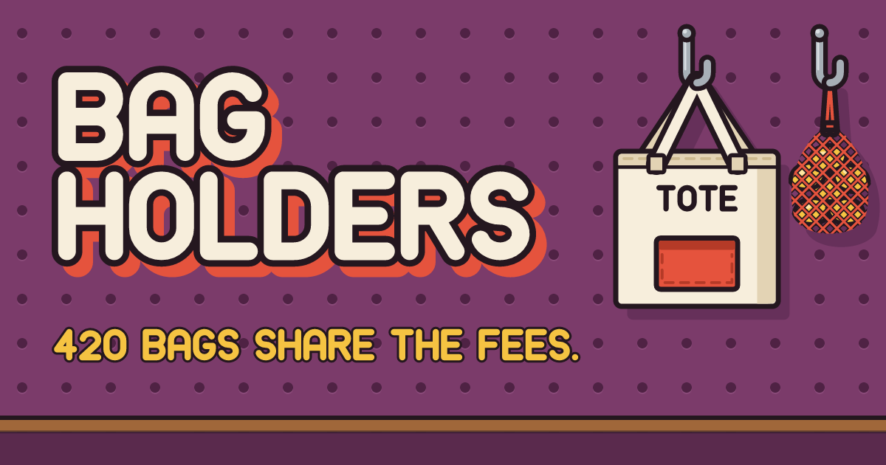

# Bag Holders

Build it with `node scripts/kits/bundle.mjs bag-holders`.
Bag Holders uses 3D: every bag has a picture and a model. In Create, Load settings takes its settings file, then the
numbered pictures, models (`1.glb` …) and `traits.csv` from the bundle's `items/` folder.
Resolve its [public bindings](../../../scripts/kits/README.md); the inventory lists what still waits.

Nobody wants to be left holding the bag, so in this box the bags get the fees.

This is the brand kit for the Bag Holders example box on Square Hole. The token is TOTE. The box is priced in a
community coin, LINK in the example registry, and holds a new collection of 420 bags. Every buy and every sale pays a
small fee in the price coin. On both sides, the box's share of that fee is split equally across all 420 bags. A bag
outside the box keeps its share for its owner to claim. A bag still inside the box keeps its share in the bag, for
whoever takes it out.



The kit is ready for review. Nothing in it is deployed or posted, and the founder checks it before any use.

## Files

| File | What it is |
| --- | --- |
| [README.md](README.md) | This page |
| [brand-book.md](brand-book.md) | Name, joke, voice, palette, fonts, logo rules, do and don't, accessibility, homage rules |
| [storybook.md](storybook.md) | The story in seven pictures, showing what the fees do |
| [details.md](details.md) | The box settings in plain words, what owners get, the risks, what still waits |
| [art-notes.md](art-notes.md) | How the art is built, so a creator can extend it |
| [assign.mjs](assign.mjs) | Builds and verifies all 420 unique bags through the shared producer interface |
| [assign.test.mjs](assign.test.mjs) | Checks all traits, picture and model hashes, family helpers and exact assignment regeneration |
| [assignment.json](assignment.json) | Each ID's five traits, picture and model file names, SHA-256 hashes and byte lengths; model policy `3d` |
| [build-art.mjs](build-art.mjs) | Builds every SVG in `art/` from `src/` and renders each PNG |
| [check.mjs](check.mjs) | Checks every file, pixel size, the assignment, the storybook, the registry settings, the avatar corner and the wording |
| [src/](src/) | The art source: palette, sticker alphabet, pen, pegboard and hooks, bags, props, items, scenes, brand pieces |
| [art/](art/) | Brand pictures, twelve base families in `items/`, generic fee scenes in `scenes/`, and word-free `reference/` pictures |
| [unique/](unique/) | Active edition source, fixed seed, reviewed manifest, `lib/`, labelled sheets and approved `samples/`; see its [README](unique/README.md) |
| `art/logo.svg`, `art/logo.png` | The mark, 1024 x 1024 |
| `art/logo-48.png` | The same mark at 48 x 48, to show it still reads |
| `art/x-avatar.svg`, `art/x-avatar.png` | X profile picture, 400 x 400 |
| `art/x-banner.svg`, `art/x-banner.png` | X header, 1500 x 500, with a bare corner for the avatar |
| `art/cover.svg`, `art/cover.png` | Link card, 1200 x 630 |
| `art/box-banner.svg`, `art/box-banner.png` | Box page banner, 2400 x 600, with all twelve kinds of bag |
| `art/items/variant-01` to `variant-12`, `.svg` and `.png` | The 12 base family pictures used as generator inputs, 1024 x 1024 each |
| `art/scenes/scene-01` to `scene-07`, `.svg` and `.png` | The storybook pictures, 1200 x 1200 each |
| `art/reference/cover.png`, `box-banner.png`, `scenes/scene-01.png` to `scene-07.png` | The cover, the box banner and the scenes with no lettering, as reference pictures of the kit's world. PNG only |
| [SH-KIT-BAG-HOLDERS.md](SH-KIT-BAG-HOLDERS.md) | Historical work record for the original twelve-picture kit |
| `.gitattributes` | Keeps the art bytes exact, so the freshness check holds on every checkout |

The main `art/` pictures have SVGs beside their PNGs; word-free references and review sheets are PNG only.
The SVGs hold only shapes. They load no fonts, images or scripts.

## The 420 bags

Each bag id from 1 to 420 has its own picture and 3D model, with all five traits: `kind`, `trim`, `repair`,
`tag` and `stitch`. The fixed seed and reviewed bytes live in `unique/`; the [trait table](unique/README.md#traits-and-counts)
lists every value and its exact count. Every kind has all 35 trim/repair pairs. All 420 pictures are distinct.
Traits and pictures change nothing about fees or claims.

The original family rule stays fixed:

```
kind = ((id - 1) mod 12) + 1, written with two digits
```

Bag 1 and bag 13 are both totes with different traits and pictures. Bag 12 and bag 420 are different bags of
lemons. Each of the twelve base families has 35 bags. The library below describes kinds, not repeated NFT pictures.

| Kind | Bag | Kind | Bag | Kind | Bag |
| --- | --- | --- | --- | --- | --- |
| 01 | Tote | 05 | Bean bag | 09 | Duffel bag |
| 02 | Paper bag | 06 | Punching bag | 10 | Backpack |
| 03 | Tea bag | 07 | Sleeping bag | 11 | Bag of chips |
| 04 | Sandbag | 08 | Gift bag | 12 | Bag of lemons |

Square Hole collections start at id 1. Check that the deployed collection uses ids 1 to 420 before the
assignment becomes metadata. The cover, banners, storybook and word-free references show generic bags and fee
mechanics. They depict no numbered NFT. The unique contact and model sheets label real sample IDs and traits.

## Rebuild and check

From the repository root, with Node 24.22.1 and the workspace installed:

```sh
node examples/boxes/bag-holders/build-art.mjs
node examples/boxes/bag-holders/assign.mjs > examples/boxes/bag-holders/assignment.json
node examples/boxes/bag-holders/check.mjs
node --test examples/boxes/bag-holders/assign.test.mjs
node --test examples/boxes/bag-holders/unique/unique.test.mjs
```

`assign.mjs` and the parent check consume `scripts/kits/unique.mjs`'s `buildUniqueSet('bag-holders')` result.
It builds the full edition in a fresh ignored `.cache/tmp/kits-unique-bag-holders-*` directory and checks
every file against `unique/manifest.json`. The assignment keeps the shared traits, hashes, byte lengths and
model policy unchanged; its `picture.path` and `model.path` are relative to that generated directory.
To keep a full build at a chosen fresh scratch destination:

```sh
node examples/boxes/bag-holders/unique/build.mjs --out .cache/tmp/bag-holders-full
```

That output contains `picture-1.svg` through `picture-420.svg`, the matching PNGs, `model-1.glb` through
`model-420.glb`, and `manifest.json`. Full output stays uncommitted. Only the reviewed manifest and selected
samples are tracked. Do not regenerate those samples or change the seed during adoption.

`build-art.mjs` rebuilds the base library and generic illustrations with the pinned `@resvg/resvg-js` 2.6.2.
Nothing is downloaded. The parent check retains file, dimensions, SVG/PNG freshness, palette, wording, links,
registry, storybook and avatar checks, alongside the complete unique edition and assignment comparisons.

`node examples/boxes/bag-holders/build-art.mjs --no-words` builds only `art/reference/`, the same pictures with no
lettering ([art-notes.md](art-notes.md#word-free-references)). `check.mjs` does not read that folder, so rebuild it
after any change to the cover, the box banner or a scene.

## Using the kit

- Show live text next to the pictures. The brand book has the lines, and the storybook has the captions.
- The pictures never name the price coin. The coins are plain gold discs, so the art also fits a copy of this box
  priced in another community coin. Name the coin in live text.
- Every live TOTE page shows the chain and the full contract address. Other tokens may use TOTE too.
  Until a contract exists, the line reads "Contract: not deployed".
- When Square Hole launches this box as one of its own, its address also goes on the list of Square Hole's
  own boxes, as decided in F133.
- The registry recipe is the create page's Collection template as it stands: a new collection, both fee sides
  To items, and Keep for the bags in the box. F89 asks for Bag Holders as a ready-made template, so this kit can
  be that template's example look. See [details.md](details.md).
- The example registry still points at local test pictures. Wiring this art into a launch is a separate step,
  listed in [details.md](details.md). Create's model reader keeps every model; T05 publishes the final list after Create.
- The kit grants no license yet. The open-source license for its code, text and art is still to be chosen.
