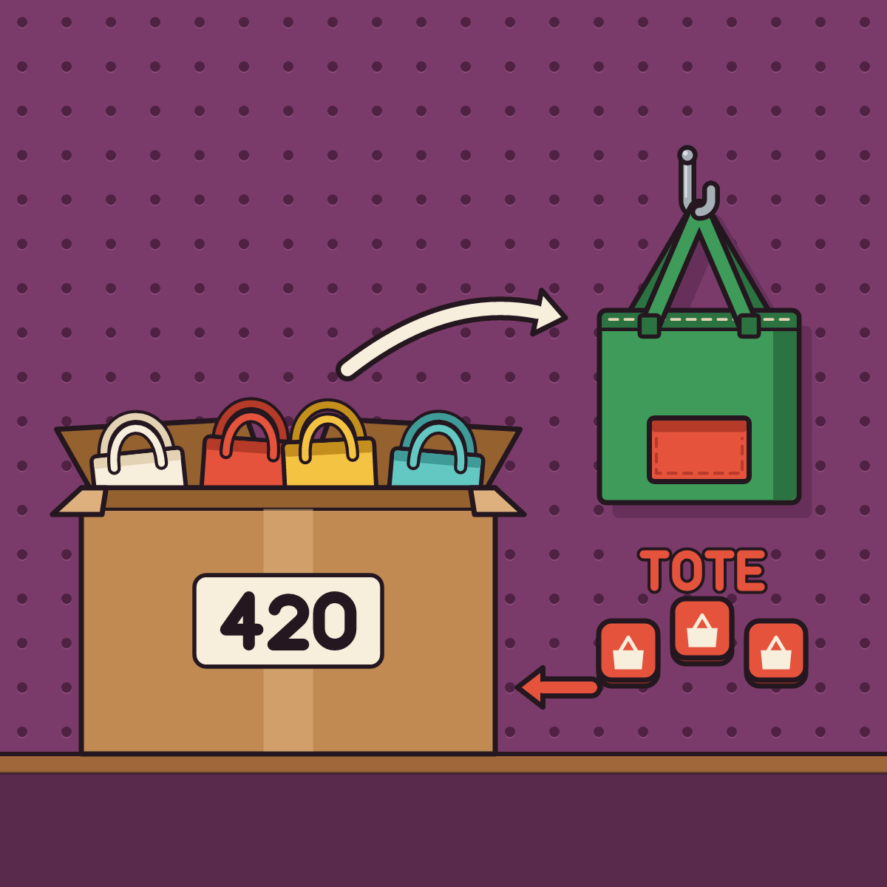
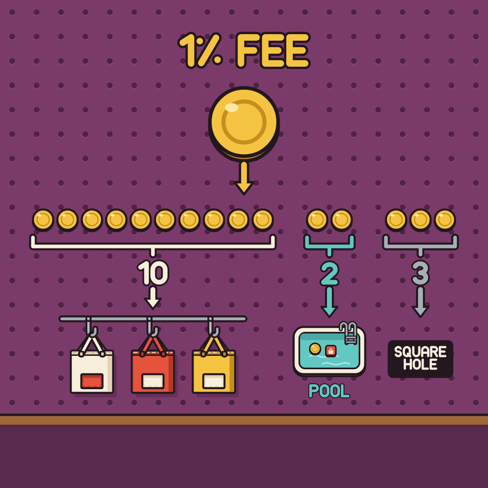
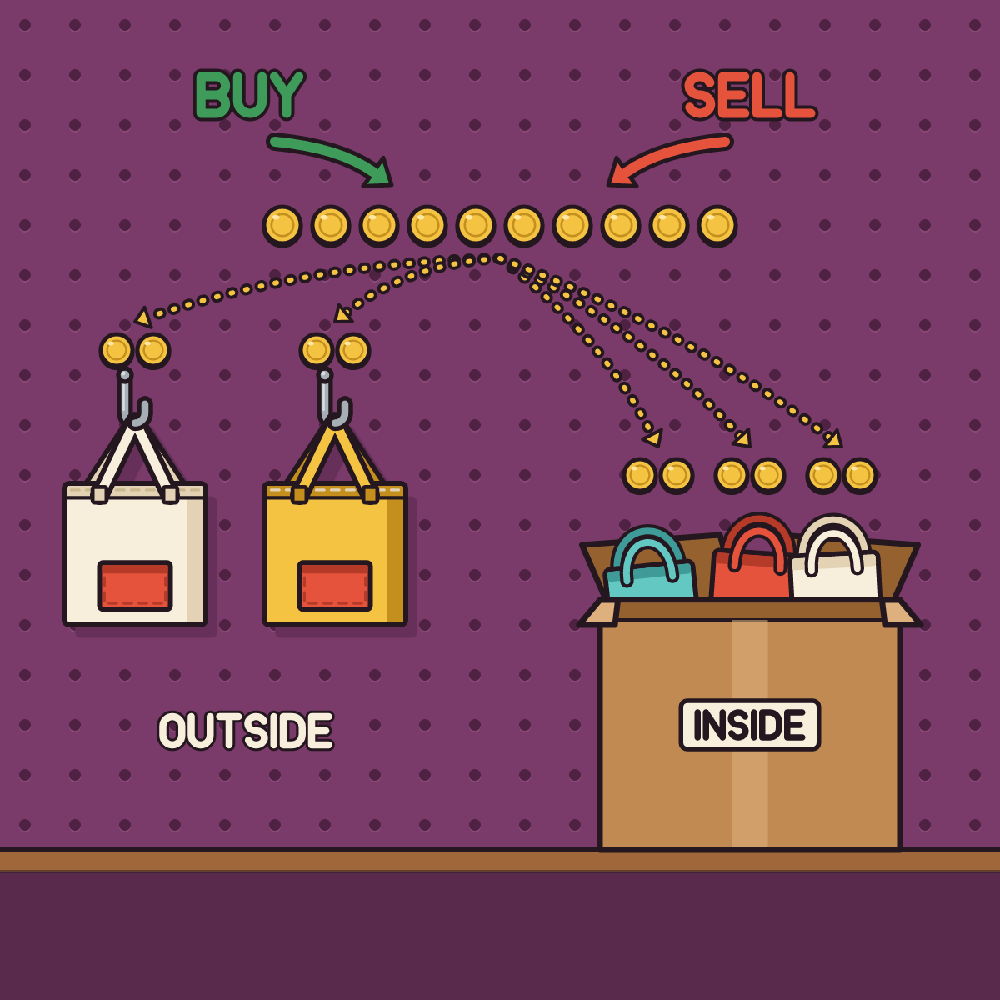
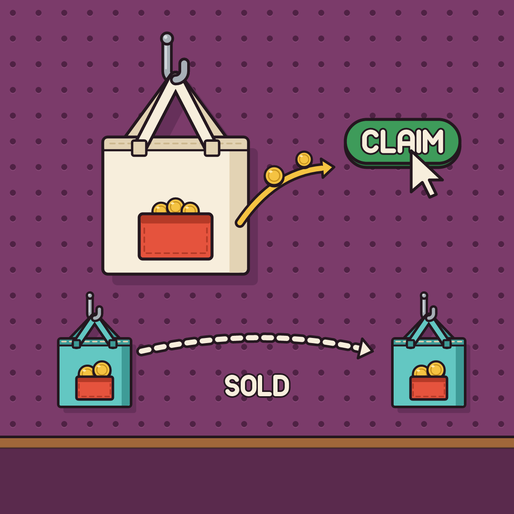
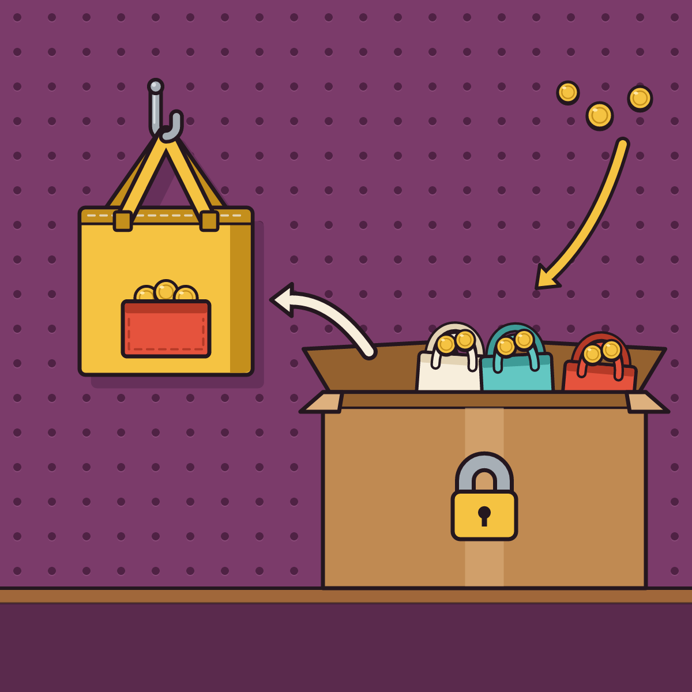
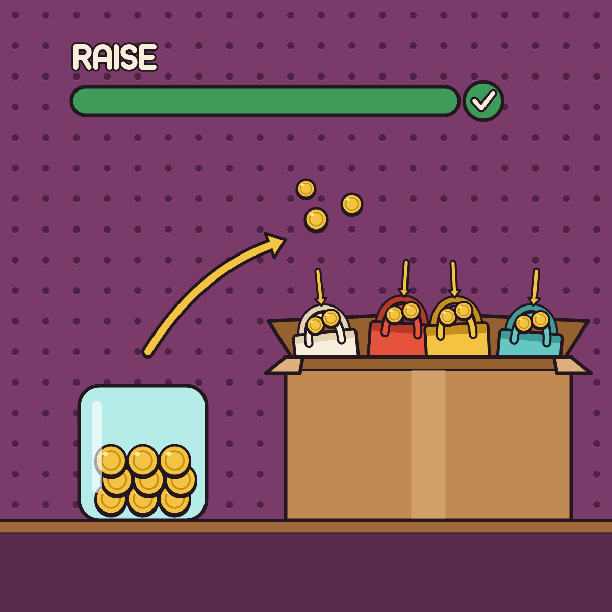
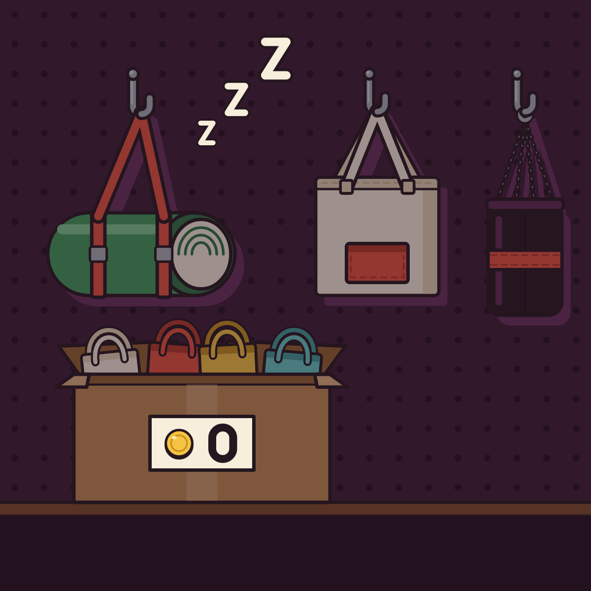

# The bag wall

Seven pictures that show what the fees do. Gold coins are LINK, the coin this box is priced in. Red chips with a
little bag on them are TOTE, the box's token. The cardboard box is the box itself, where bags wait to be taken out,
and the small pool is the box's own pool. Arrows show where the fees go. They show no amounts and no timing.
The bags are generic story symbols, not portraits of numbered NFTs. The active edition's real sample IDs and
traits are shown in the [unique picture and model sheets](unique/README.md).

## 01 · The box

This box holds 420 bags, and every one of them wants to be held.
Anyone can take a bag out with TOTE, and its owner can put it back.

## 02 · Fifteen coins

Every buy and every sale pays a small fee, and the fee splits into 15 coins.
Ten go to the bags, two go to the pool and three go to Square Hole (its platform and its buy-back).

## 03 · The same for every bag

The ten coins are shared by all 420 bags.
Every bag gets the same share, in the box or out of it.

## 04 · Bags outside

A bag outside the box keeps its coins until its owner claims them.
If the bag is sold, its coins go with it.

## 05 · Bags inside

A bag in the box keeps its coins too, and nobody can claim them there.
Whoever takes the bag out gets the coins with it.

## 06 · Waiting for the box

While the box fills its raise, the bags' coins wait in a jar.
When the box graduates, the jar is shared by all 420 bags.

## 07 · A quiet night

Fees only come from trades.
No trades, no coins, and the bags just hang there.
