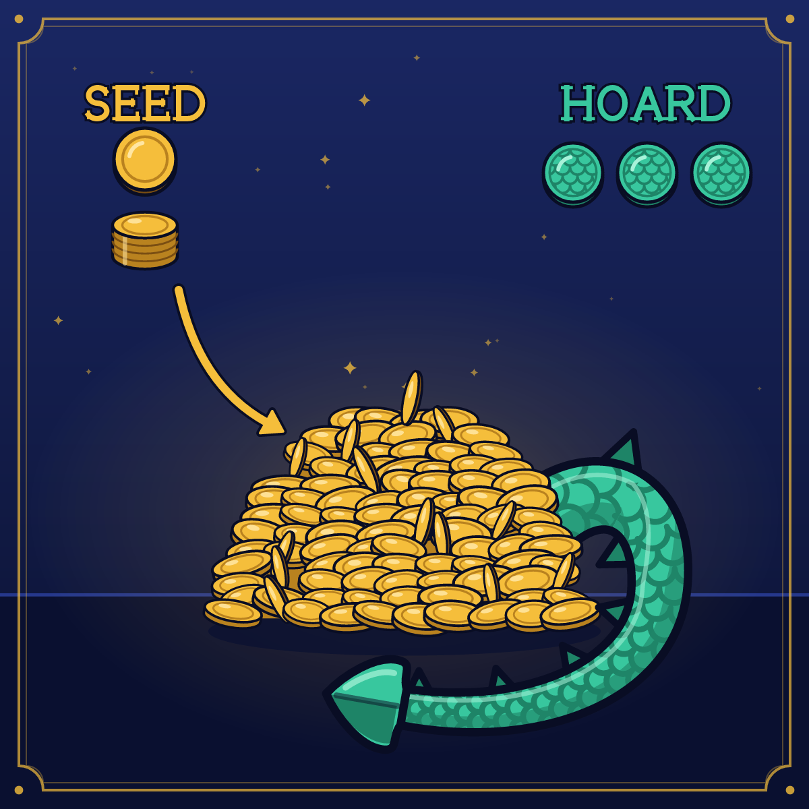
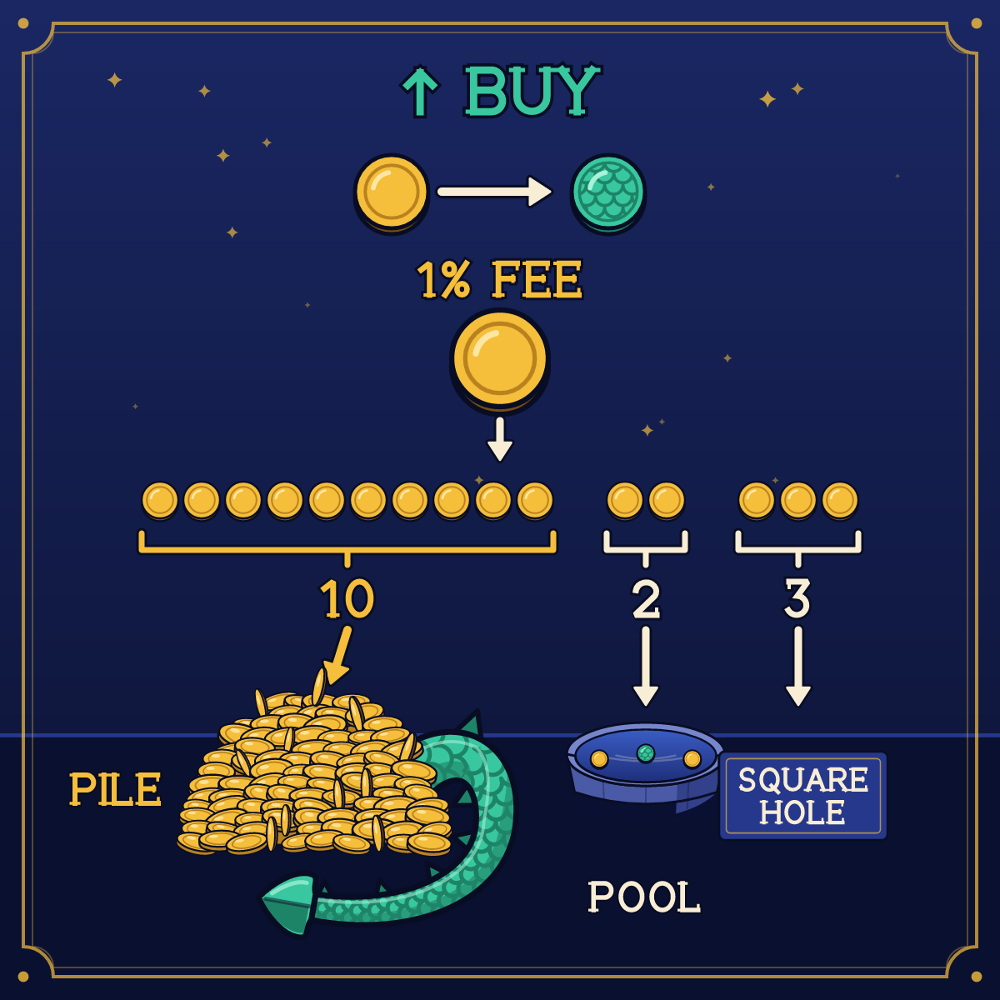
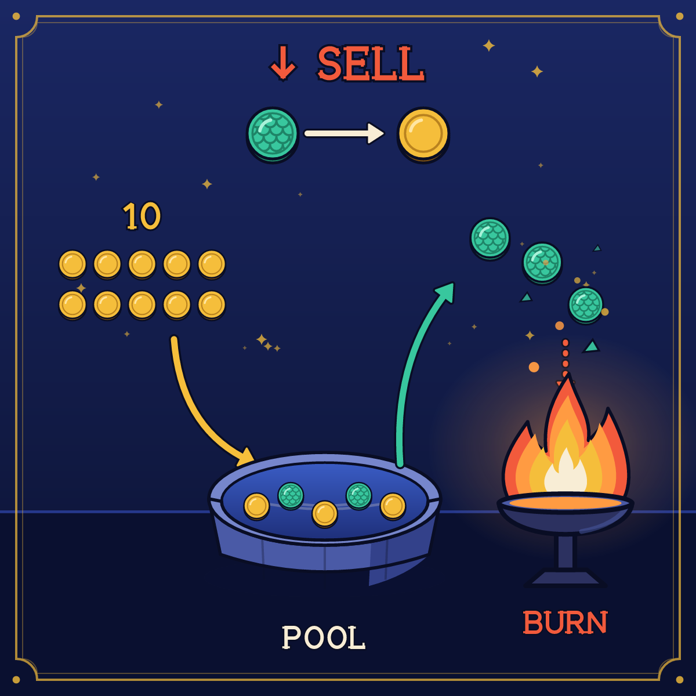
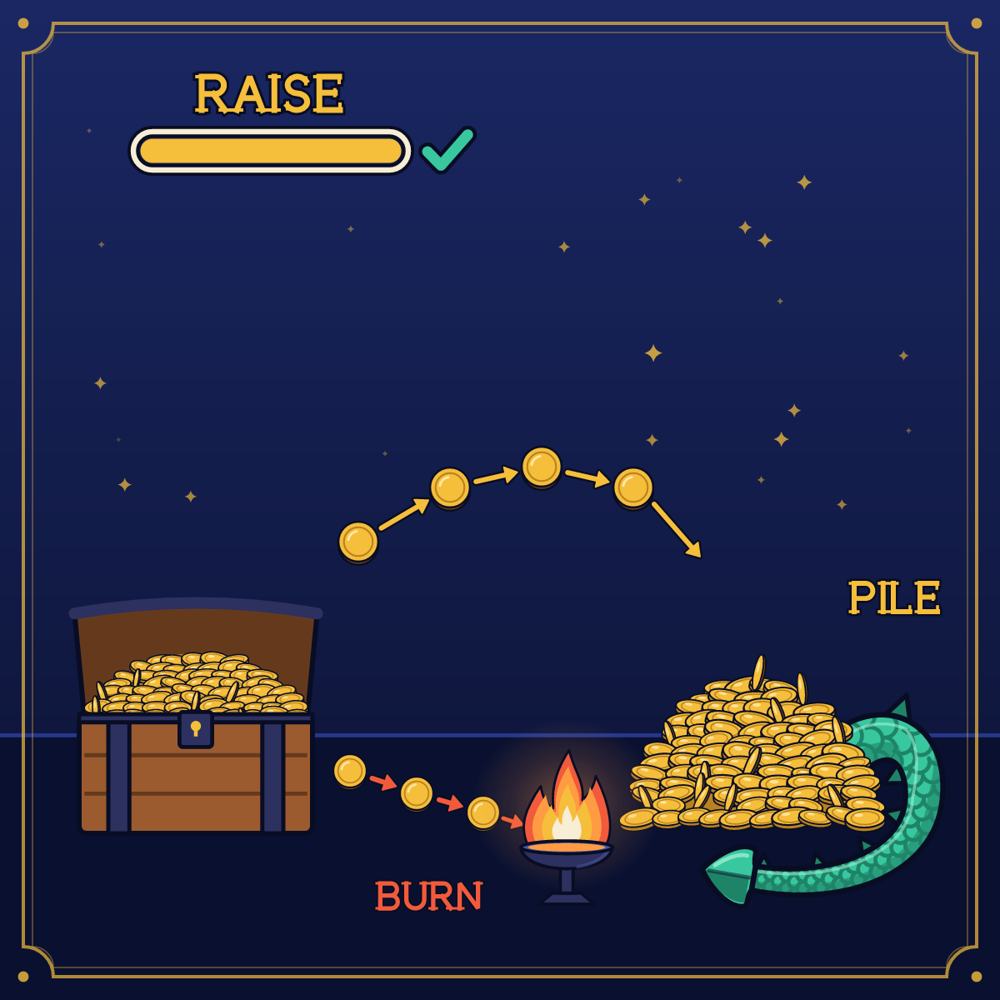
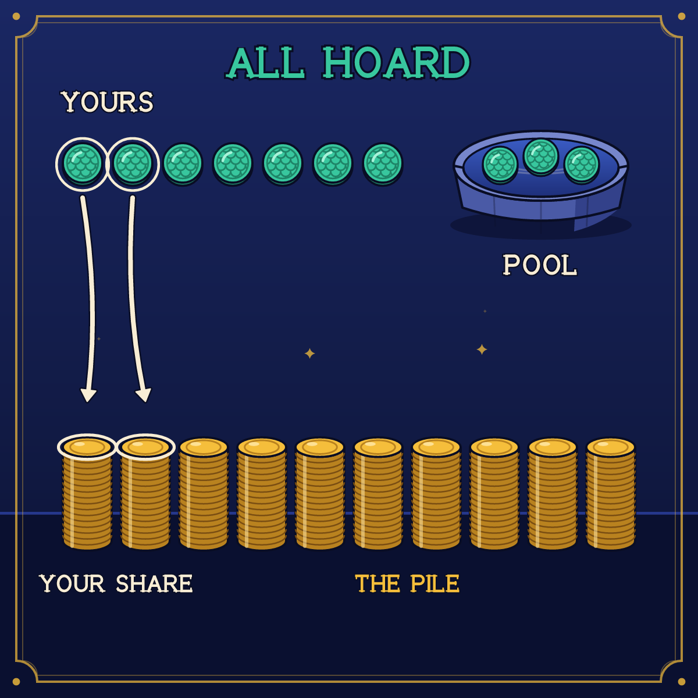
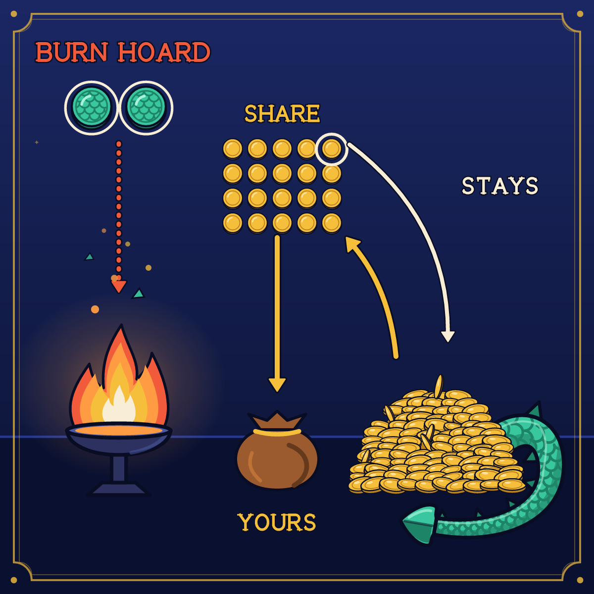
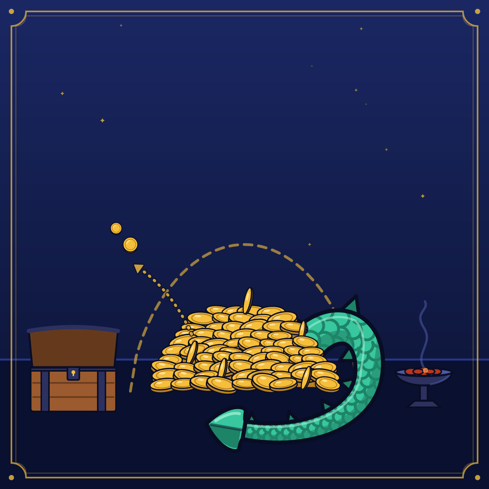

# The dragon's pile

Seven pictures that show what the fees do. Plain gold coins are ETH, the coin the box is priced in. Jade tokens
covered in scales are HOARD. The stone basin is the box's own pool, the chest holds fee coins that wait, and the fire
is a burn. The green tail belongs to the dragon, which is never seen. Arrows show where coins go. They show no
amounts and no timing.

## 01 · The pile

Dragon's Hoard is a token called HOARD with a pile of ETH in the box.
The creator puts the first coins on the pile.

## 02 · Buyers feed the pile

Every buy pays a small fee in ETH, split into 15 parts.
Ten are for the pile, two go to the pool and three go to Square Hole (its platform and its buy-back).

## 03 · Sellers feed the fire

Every sale pays the same small fee.
Its ten parts buy HOARD in the pool, and that HOARD burns.

## 04 · The chest

While the box fills its raise, the fee coins wait in a chest.
Once it graduates, they go on to the pile and the fire, one step at a time.

## 05 · Your part

Your share is your HOARD out of all the HOARD there is.
The HOARD in the pool counts too.

## 06 · Take your share

After graduation, anyone can burn HOARD to take its share of the pile.
One coin in twenty of that share stays on the pile for everyone else.

## 07 · A quiet night

Fees only come from trades.
With no trades no coins arrive, and every share taken makes the pile smaller.
