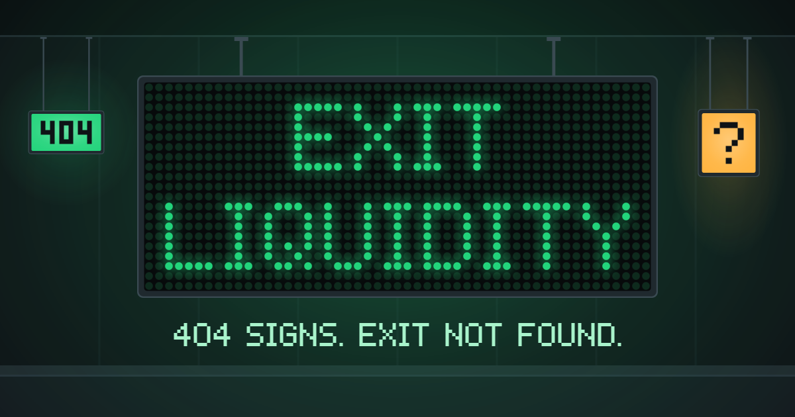

# Exit Liquidity

Load it: build with `node scripts/kits/bundle.mjs exit-liquidity`, then choose `build/exit-liquidity-boxspec-v2.json` in Create → Load settings. First resolve its [public bindings](../../../scripts/kits/README.md#binding-the-setup); the generated inventory lists anything still unresolved.

404 exit signs, and not one of them knows the way out.

This is the brand kit for the Exit Liquidity example box on Square Hole. The token is EXIT and the box is
priced in USDC. Inside the box are 404 signs, and every sign has lost the exit it points to. Buyers' fees make
the box's own pool deeper. Sellers' fees go to the signs.



The kit is ready for review. Nothing in it is deployed or posted, and the founder checks it before any use.

## Files

| File | What it is |
| --- | --- |
| [README.md](README.md) | This page |
| [brand-book.md](brand-book.md) | Name, joke, voice, palette, fonts, logo rules, do and don't, accessibility, homage rules |
| [storybook.md](storybook.md) | The story in seven pictures, showing what the fees do |
| [details.md](details.md) | The box settings in plain words, what owners get, the risks, what still waits |
| [art-notes.md](art-notes.md) | How the art is built, so a creator can extend it |
| [assign.mjs](assign.mjs) | Builds the verified set: each id, 1 to 404, has its own picture, all six traits and no model |
| [assignment.json](assignment.json) | Portable output of `assign.mjs`, with picture filenames relative to the generated directory |
| [assign.test.mjs](assign.test.mjs) | Checks the active assignment, exact picture hashes, complete traits and 2D policy |
| [build-art.mjs](build-art.mjs) | Builds every SVG in `art/` from `src/` and renders each PNG |
| [check.mjs](check.mjs) | Checks every file, pixel size, the assignment, the storybook and the wording |
| [src/](src/) | The art source: palette, sign alphabet, signs, hallway, props, scenes, brand pieces |
| [art/](art/) | Brand pieces, the base-family library, generic fee scenes and word-free references |
| [unique/](unique/) | Active edition generator, fixed seed, six trait layers, reviewed manifest, samples and contact sheets |
| `build/` (generated, uncommitted) | Public bundle: `items/1.png` to `items/404.png`, `items/traits.csv`, settings, list, proofs, inventory and CAR |
| `art/logo.svg`, `art/logo.png` | The mark, 1024 x 1024 |
| `art/logo-48.png` | The same mark at 48 x 48, to show it still reads |
| `art/x-avatar.svg`, `art/x-avatar.png` | X profile picture, 400 x 400 |
| `art/x-banner.svg`, `art/x-banner.png` | X header, 1500 x 500, with a plain corner for the avatar |
| `art/cover.svg`, `art/cover.png` | Link card, 1200 x 630 |
| `art/box-banner.svg`, `art/box-banner.png` | Box page banner, 2400 x 600 |
| `art/items/variant-01` to `variant-12`, `.svg` and `.png` | The 12 base-family pictures used by the generator, 1024 x 1024 each |
| `art/scenes/scene-01` to `scene-07`, `.svg` and `.png` | The storybook pictures, 1200 x 1200 each |
| `art/reference/cover.png`, `box-banner.png`, `scenes/scene-01.png` to `scene-07.png` | The cover, the box banner and the scenes with no lettering, as reference pictures of the kit's world. PNG only |
| [SH-KIT-EXIT-LIQUIDITY.md](SH-KIT-EXIT-LIQUIDITY.md) | Work record for the integrator: decisions, commands, results |
| `.gitattributes` | Keeps the art bytes exact, so the freshness check holds on every checkout |

Brand, base-family and scene PNGs have SVGs next to them. Word-free references and review sheets are PNG only;
unique sample SVGs are regenerated in scratch. The SVGs hold only shapes and load no fonts, images or scripts.

## The 404 signs

Each sign id from 1 to 404 has a distinct generated picture and all six traits: `sign`, `housing`, `route`,
`repair`, `equipment` and `conduit`. Exact values and counts are in [unique/README.md](unique/README.md#traits-and-counts).
The public seed stays `exit-liquidity/404-signs/no-way-out/v1`, and every picture matches the reviewed manifest.
The twelve original sign families remain generator inputs. Only the base `sign` trait follows this rule:

```
variant = ((id - 1) mod 12) + 1, written with two digits
```

Sign 1 and sign 13 share base family 01 but have different pictures. Families 01 to 08 appear 34 times each,
and 09 to 12 appear 33 times each. Sign 404 keeps family 08, with the 404 lettering. Five other trait layers
give it its own appearance. A picture changes nothing about fees or claims.

Exit Liquidity is **2D**, like Link Marines v2. Every active item's model is `null`, and the public bundle has
no GLBs. The generator's GLBs and model sheets are review material only. Rent Free and Bag Holders use 3D;
their separate model policy does not apply to these signs.

The storybook and brand pieces illustrate the world and fees; they do not depict numbered NFTs.
The unique contact sheet labels real sample ids and their traits.

Square Hole collections start at id 1. Check that the deployed collection uses ids 1 to 404 before the
assignment becomes metadata.

## Rebuild and check

From the repository root, with Node 24.22.1 and the workspace dependencies installed:

```sh
node examples/boxes/exit-liquidity/build-art.mjs
node examples/boxes/exit-liquidity/assign.mjs > examples/boxes/exit-liquidity/assignment.json
node examples/boxes/exit-liquidity/check.mjs
node --test examples/boxes/exit-liquidity/assign.test.mjs
node --test examples/boxes/exit-liquidity/unique/unique.test.mjs
node scripts/kits/bundle.mjs exit-liquidity
```

`build-art.mjs` uses `@resvg/resvg-js`, which the workspace already pins in `packages/cards`. Nothing is
downloaded. The same source gives the same bytes every time, and `check.mjs` fails if any SVG or PNG differs
from a fresh build.

`await assignment()` delegates to `buildUniqueSet('exit-liquidity')` in the
[shared interface](../../../scripts/kits/README.md#unique-producer-interface-and-models). It builds into a
fresh `.cache/tmp/kits-unique-exit-liquidity-*` directory and exposes exact paths, hashes and sizes.
The CLI omits that temporary directory and prints relative picture paths, so `assignment.json` stays stable.
`check.mjs` builds the set again, compares every id's traits and picture hash against `unique/manifest.json`,
and checks the portable assignment. The twelve base-family images retain their own source and render checks.
Full generated output stays uncommitted in ignored scratch or `build/`; keep the reviewed manifest and samples
unchanged. The unique suite builds twice in fresh scratch and checks all sample and sheet bytes.

`node examples/boxes/exit-liquidity/build-art.mjs --no-words` builds only `art/reference/`, the same pictures with
no lettering ([art-notes.md](art-notes.md#word-free-references)). `check.mjs` does not read that folder, so rebuild it
after any change to the cover, the box banner or a scene.

## Using the kit

- Show live text next to the pictures. The brand book has the lines, and the storybook has the captions.
- Every live EXIT page shows the chain and the full contract address. Other tokens may use EXIT too.
  Until a contract exists, the line reads "Contract: not deployed".
- When Square Hole launches this box as one of its own, its address also goes on the list of Square Hole's
  own boxes, as decided in F133.
- The example registry still points at local test pictures. Wiring this art into a launch is a separate step,
  listed in [details.md](details.md).
- The kit grants no license yet. The open-source license for its code, text and art is still to be chosen.
