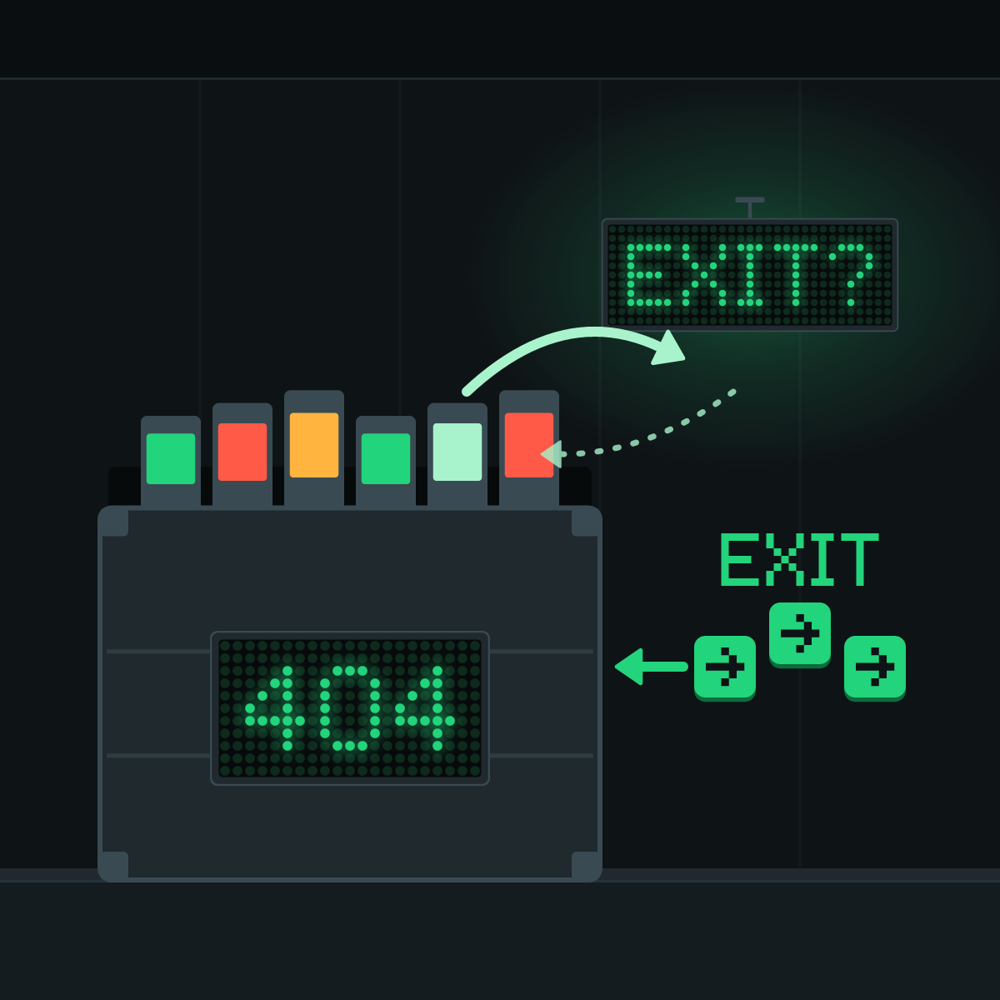
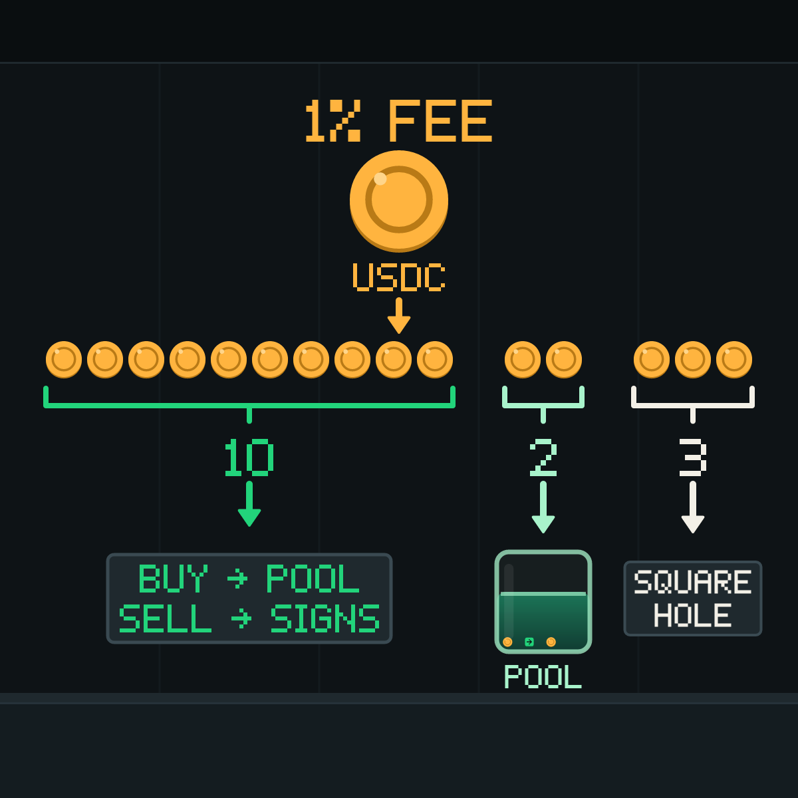
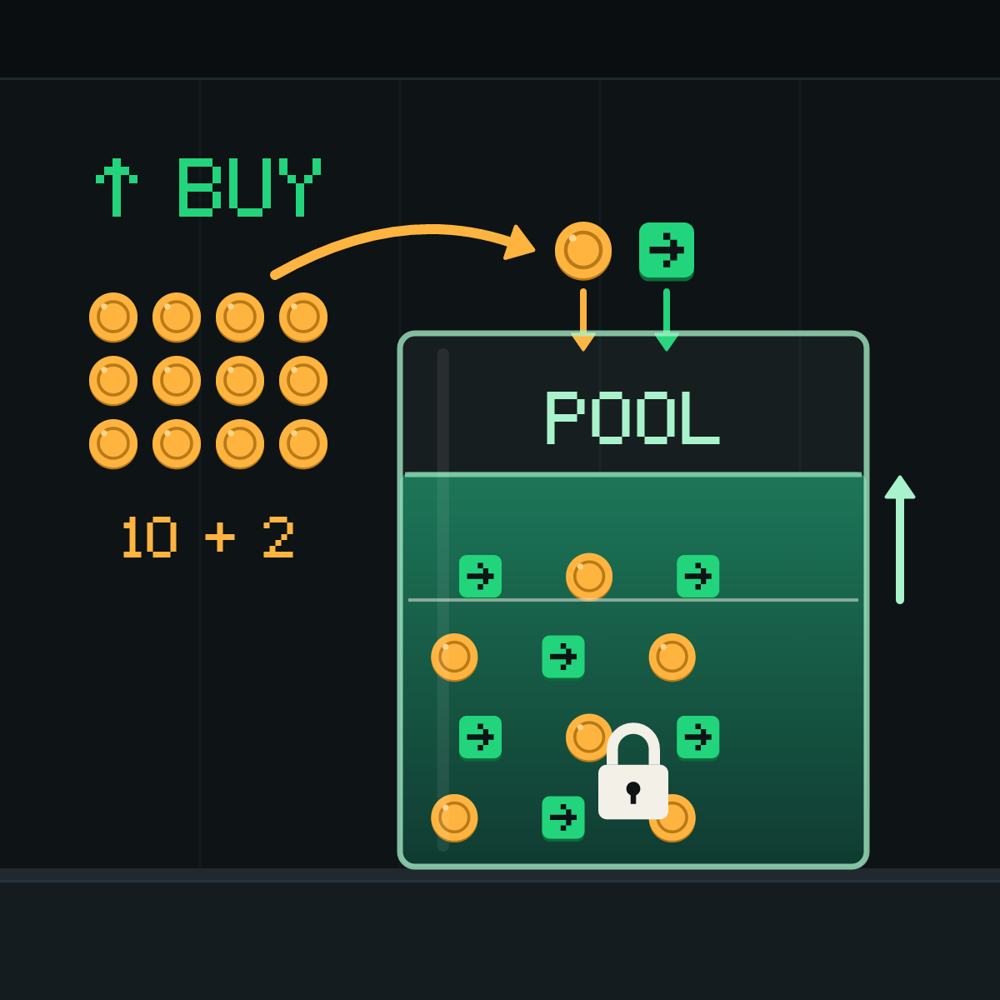
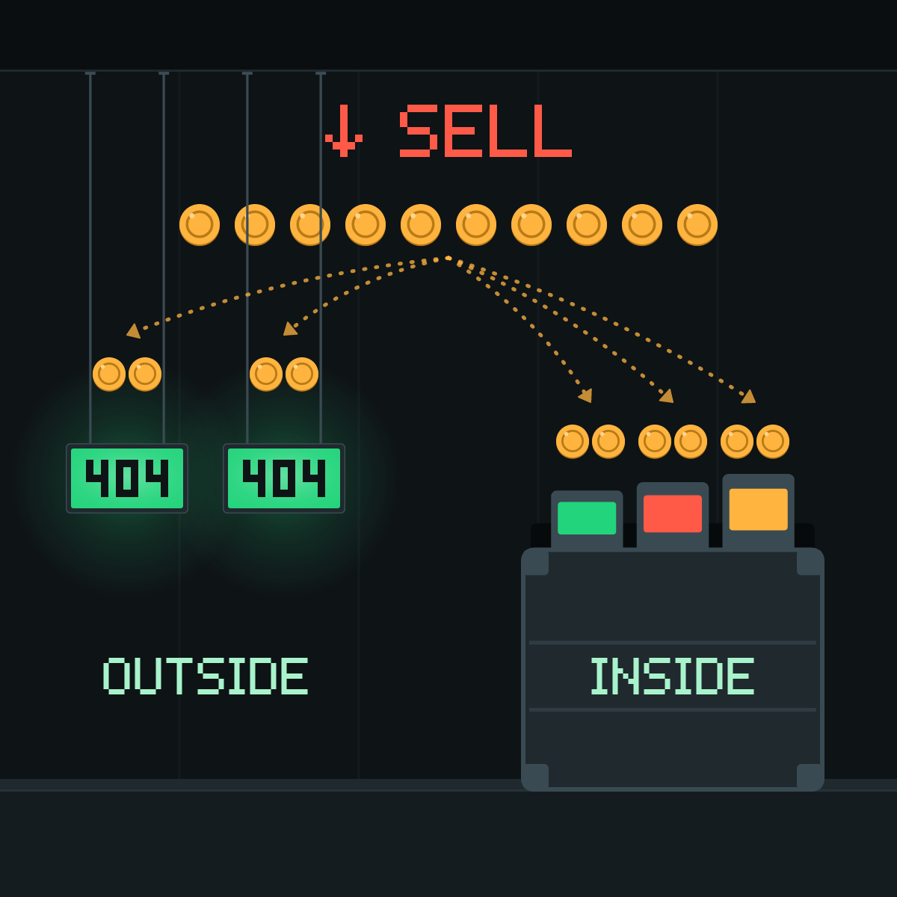
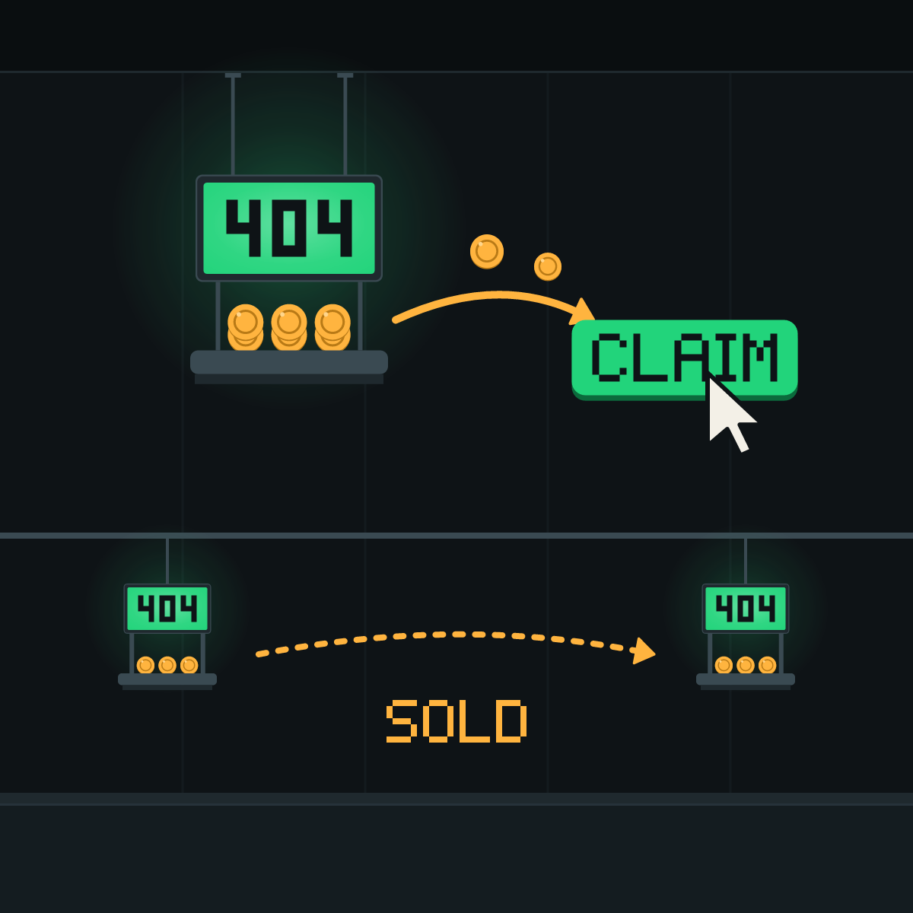
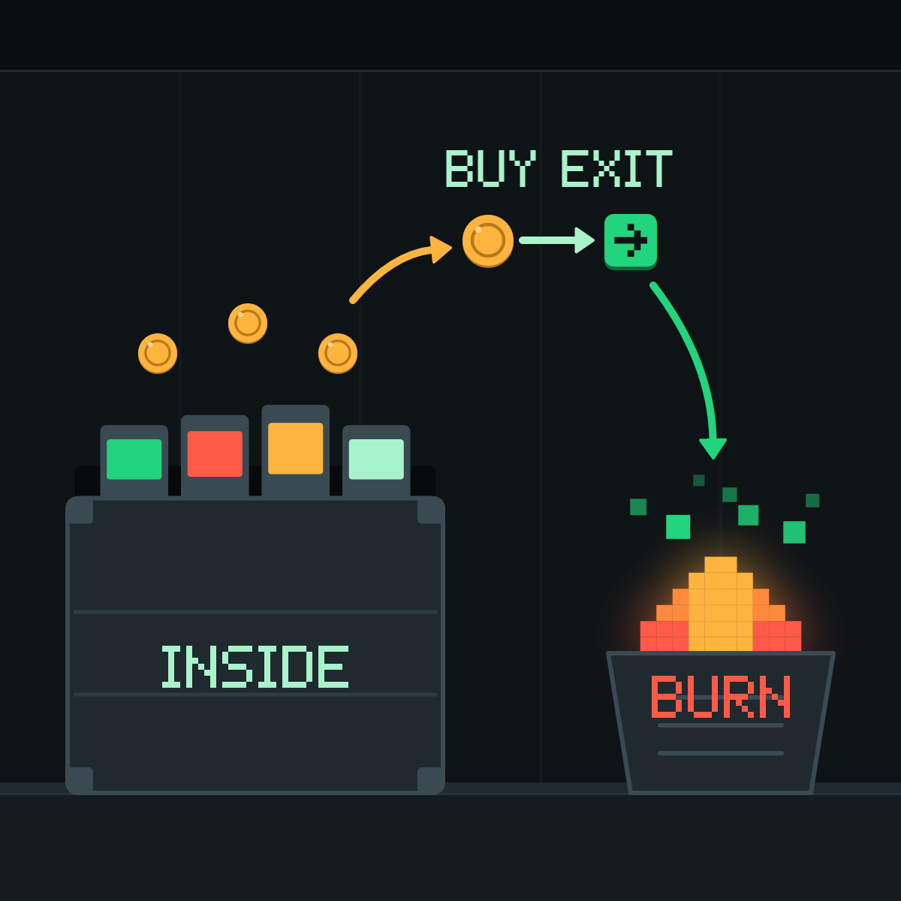
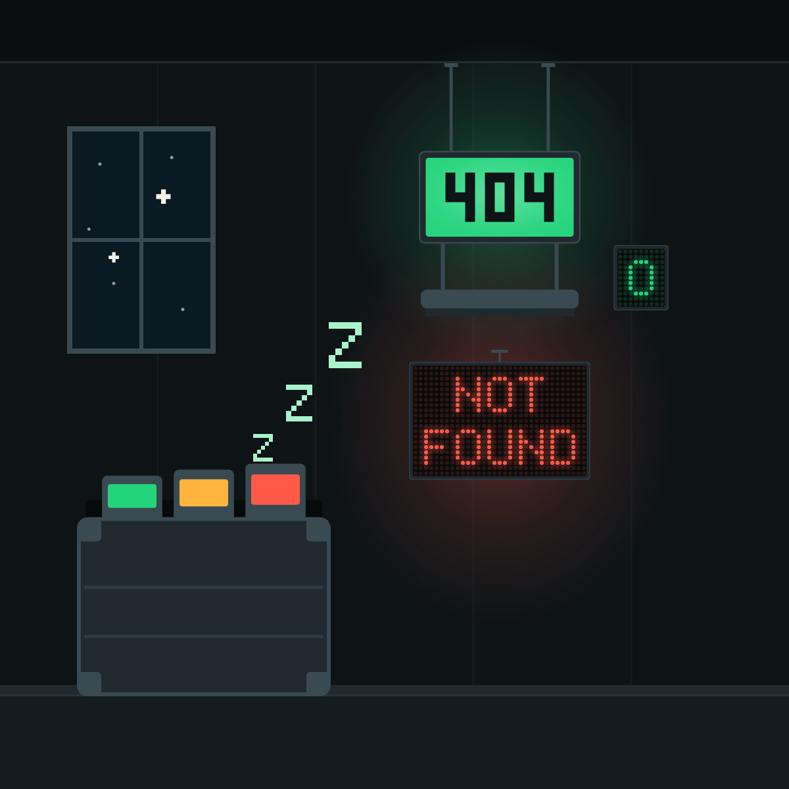

# The hallway with no way out

Seven pictures that show what the fees do once the box has graduated. Amber coins are USDC. Green squares
with an arrow are EXIT. The glass tank is the box's own pool, and the crate is the box itself, where signs wait
to be taken out. Arrows show where the fees go. They show no amounts and no timing.

These are generic fee illustrations, not portraits of numbered NFTs. The active edition has 404 distinct
pictures; [the contact sheet](unique/contact-sheet.png) labels real sample ids and their traits.

## 01 · The box

This box holds 404 signs, and none of them can find the exit.
Anyone can take a sign out with EXIT, or put one back.

## 02 · Fifteen coins

Every trade pays a small fee in USDC, and the fee splits into 15 coins.
Ten follow the box's rule, two go to the pool and three go to Square Hole (its platform and its buy-back).

## 03 · Buyers fill the pool

When someone buys EXIT, the ten coins go into the box's own pool too.
The pool gets deeper, and nobody can ever take that out.

## 04 · Sellers pay the signs

When someone sells EXIT, the ten coins go to the signs.
Every sign gets the same share.

## 05 · Signs outside

A sign outside the box keeps its share as USDC until its owner claims it.
If the sign is sold, the share goes with it.

## 06 · Signs inside

Signs inside the box can't keep coins.
Their share buys EXIT, and that EXIT is burned.

## 07 · A quiet night

Fees only come from trades.
No trades, no coins, and the signs still say 404.
