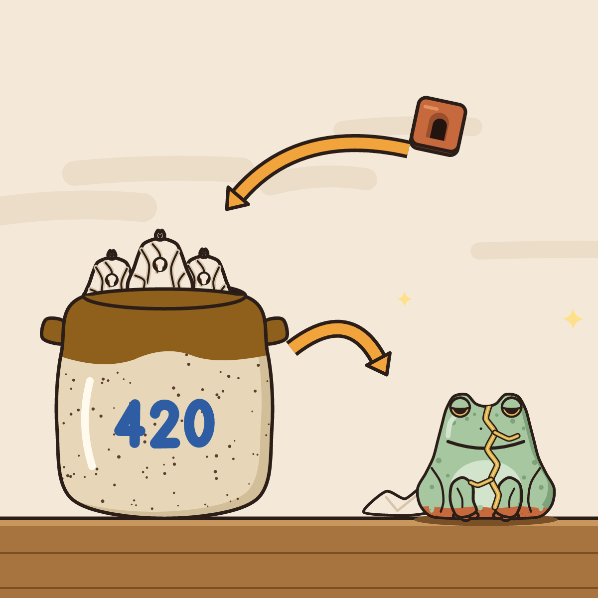
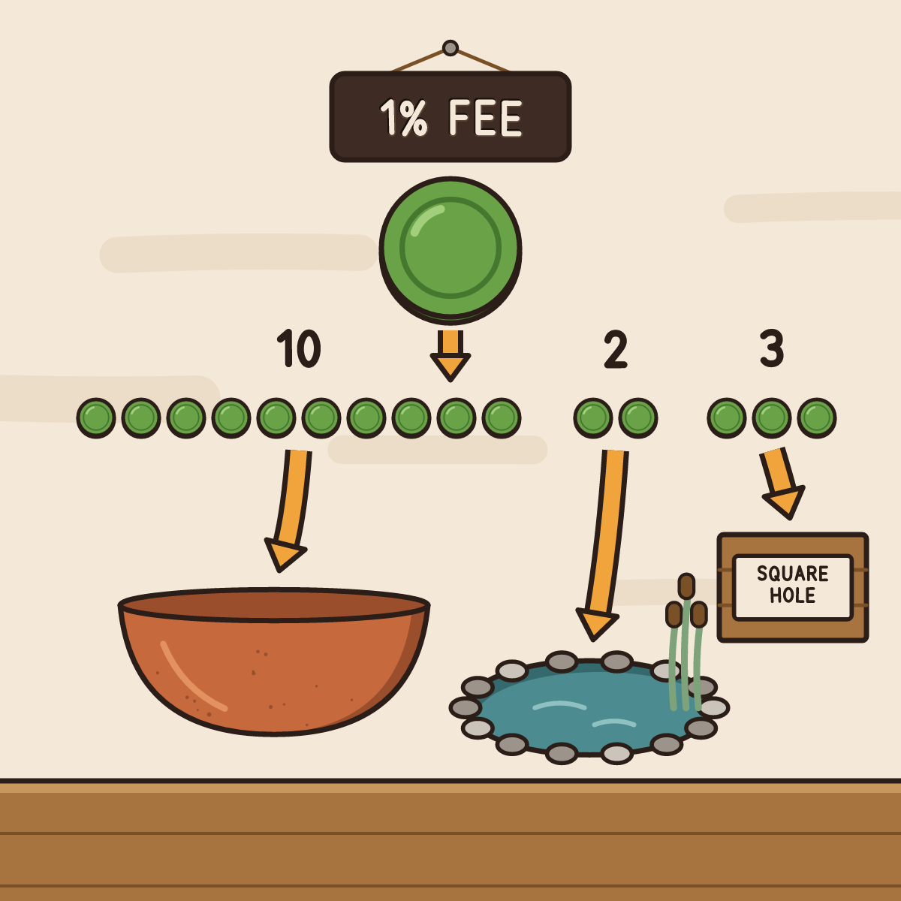
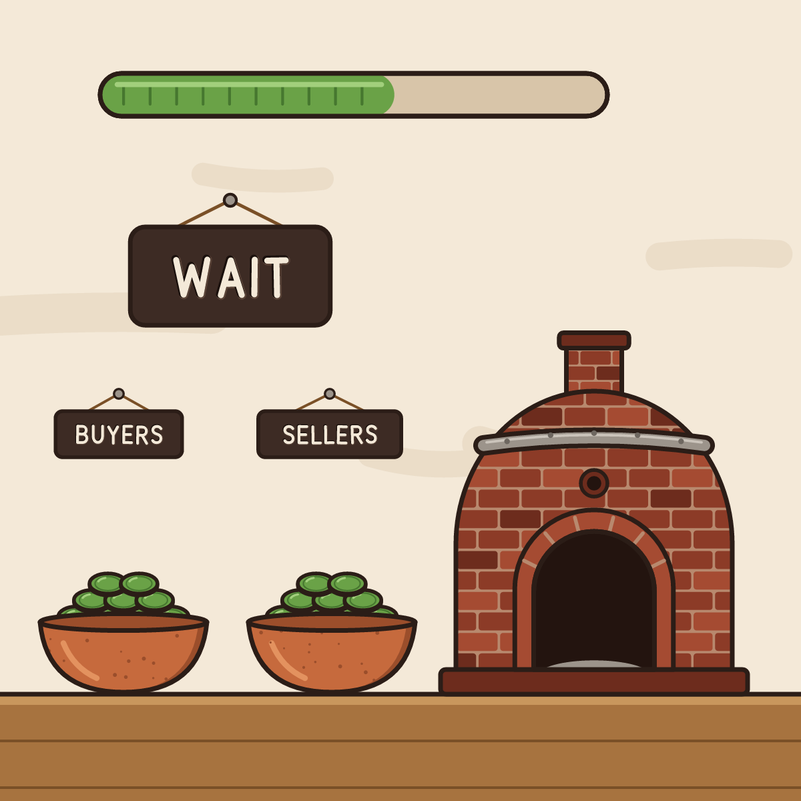
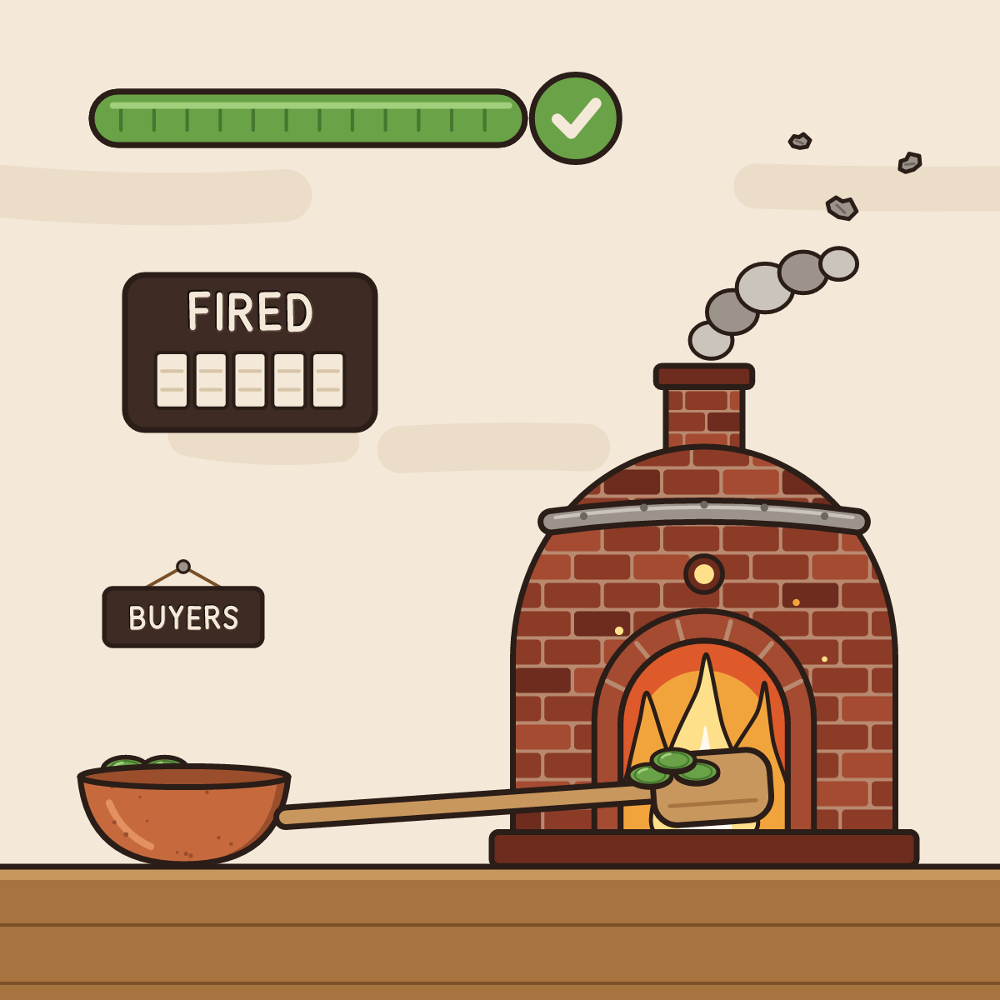
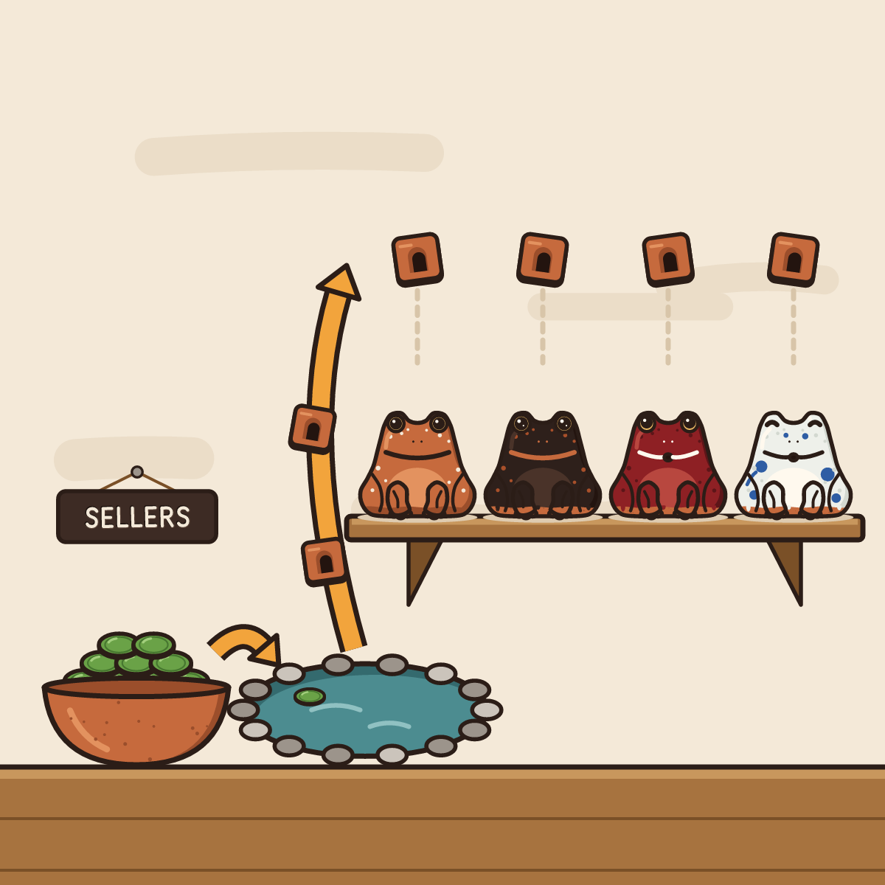
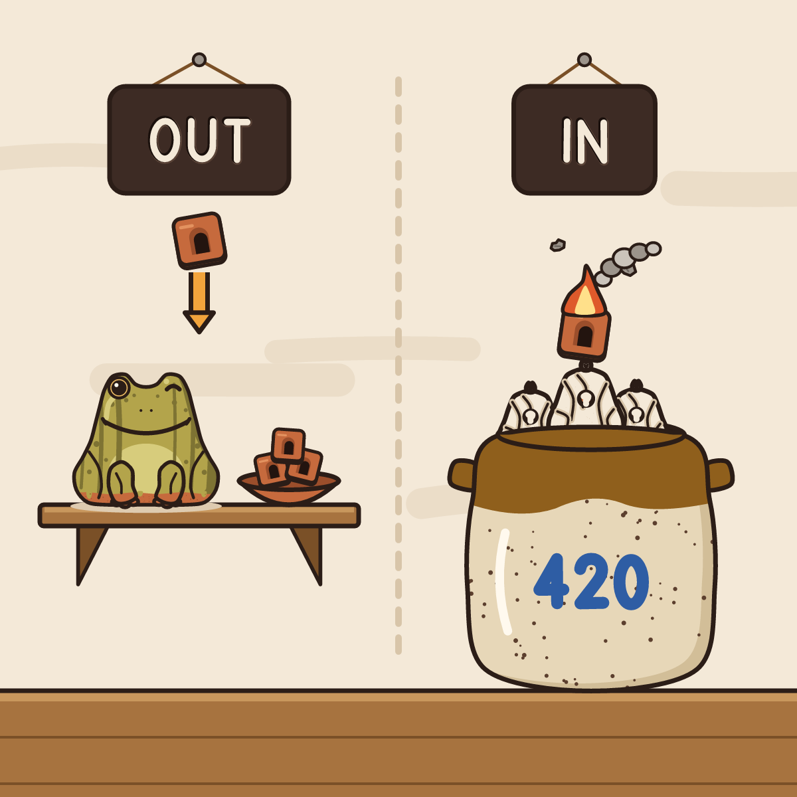
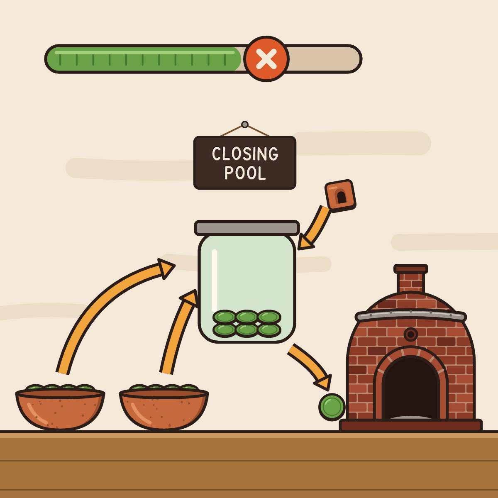

# The kiln

Seven pictures that show what the fees do. Green coins are the frog coin, the coin this box is priced in. Small orange
clay tiles are KILN, the box's token. The big stoneware crock marked 420 is the box, where the toads wait wrapped in
paper. The pond is the box's own pool, and the brick kiln burns what goes into it. Buyers' coins and sellers' coins go
to different places, so the bowls are tagged. Arrows show where things go. They show no amounts and no timing.

## 01 · The box

This box holds 420 clay toads, wrapped up until someone draws one with KILN.
A few came out of the kiln cracked.

## 02 · Fifteen coins

Every buy and every sale pays a small fee in the frog coin, split into 15 coins.
Ten follow the box's choice for that side, two go to the box's own pool and three go to Square Hole (its platform and its buy-back).

## 03 · Waiting

While the box fills its raise, the coins wait by the kiln.
Nothing is fired yet.

## 04 · Fire the kiln

After the box graduates, anyone can fire the kiln, and the buyers' coins are burned for good.
The counter shows how many have been fired.

## 05 · KILN for the toads

The sellers' coins are swapped for KILN in the box's own pool.
The KILN is shared by all 420 toads, the same part for each.

## 06 · Out or in

A toad out of the box keeps its part for its owner to claim.
The part of a toad still inside the box is burned.

## 07 · If the box fails

If the box fails, nothing is fired.
The waiting coins go to the closing pool, where holders hand in KILN for their part.
