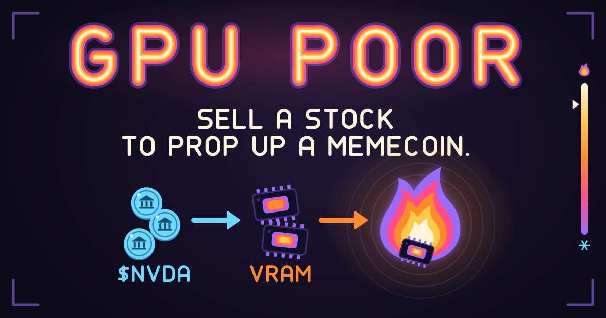

# GPU Poor

Load it: build with `node scripts/kits/bundle.mjs gpu-poor`, then choose `settings/gpu-poor-boxspec-v2.json` in Create → Load settings. First resolve its [public bindings](../../../scripts/kits/README.md#binding-the-setup); the generated inventory lists anything still unresolved.

Too poor for a GPU, so it burns VRAM to stay warm.

This is the brand kit for the GPU Poor example box on Square Hole. The token is VRAM. The box is priced in $NVDA,
Nvidia's stock, and holds nothing else. The exact price coin in the example registry is NVDAon, Ondo's tokenized
Nvidia stock. There is no collection, no shop and no pile. Every trade pays a small fee in $NVDA. On both sides,
buying and selling, ten of its 15 parts buy VRAM in the box's own pool, and that VRAM is burned. The founder's
headline for it is "Sell a stock to prop up a memecoin."



The kit is ready for review. Nothing in it is deployed or posted, and the founder checks it before any use.

This is version 2. It names the stock, as the founder decided. Text and art say $NVDA, text says Nvidia where a
sentence needs the company, and no logo appears. Version 1 never named the stock and stays at the git tag
`kit-gpu-poor-v1`. [SH-KIT-GPU-POOR.md](SH-KIT-GPU-POOR.md) records what changed and why. Nvidia and Ondo did not
make, approve or endorse this box.

## Files

| File | What it is |
| --- | --- |
| [README.md](README.md) | This page |
| [brand-book.md](brand-book.md) | Name, headline, joke, voice, palette, fonts, logo rules, do and don't, accessibility, homage rules |
| [storybook.md](storybook.md) | The story in seven pictures, showing what the fees do |
| [details.md](details.md) | The box settings in plain words, what a holder gets, the risks, what still waits |
| [art-notes.md](art-notes.md) | How the art is built, so a creator can extend it, the later GPUs included |
| [build-art.mjs](build-art.mjs) | Builds every SVG in `art/` from `src/` and renders each PNG |
| [check.mjs](check.mjs) | Checks every file, pixel size, the storybook, the registry settings, the GPU rule, the wording, every word the pictures draw and its size in a post |
| [src/](src/) | The art source, with the palette, tube alphabet, heat, props, GPU card, scenes and brand pieces |
| `art/logo.svg`, `art/logo.png` | The mark, 1024 x 1024 |
| `art/logo-48.png` | The same mark at 48 x 48, to show it still reads |
| `art/x-avatar.svg`, `art/x-avatar.png` | X profile picture, 400 x 400 |
| `art/x-banner.svg`, `art/x-banner.png` | X header, 1500 x 500, with a plain corner for the avatar |
| `art/cover.svg`, `art/cover.png` | Link card, 1200 x 630 |
| `art/box-banner.svg`, `art/box-banner.png` | Box page banner, 2400 x 600 |
| `art/scenes/scene-01` to `scene-07`, `.svg` and `.png` | The storybook pictures, 1200 x 1200 each |
| `art/reference/cover.png`, `box-banner.png`, `scenes/scene-01.png` to `scene-07.png` | The cover, the box banner and the scenes with no lettering, as reference pictures of the kit's world. PNG only |
| `art/later/gpu-preview.svg`, `art/later/gpu-preview.png` | Twelve of the later GPU items, 1800 x 1200. A preview for a later step, not part of this box |
| [SH-KIT-GPU-POOR.md](SH-KIT-GPU-POOR.md) | Work record for the integrator, with decisions, facts, commands and results |
| `.gitattributes` | Keeps the art bytes exact, so the freshness check holds on every checkout |

Every PNG has its SVG next to it. The SVGs hold only shapes. They load no fonts, images or scripts.

## No items in this box

GPU Poor is a token box. It has no item pictures, so the kit has no `assign.mjs` or `assignment.json`, and
`check.mjs` makes sure none appear by mistake. The box's settings can never change after it is created, so this
box will never hold GPUs.

## The later GPUs

A later step adds GPU items in a box of their own. The look is ready for them. Today the empty dashed GPU in the
pictures is the joke, because the box cannot afford one. The same parts in `src/gpu.mjs` can fill that outline.

```
code = shuffle(id), with ids 1 to 1,024
fans, shroud, heat, fix, accent = the five pairs of bits of code, two bits each
```

There are five parts with four choices each, and 4 x 4 x 4 x 4 x 4 is 1,024. The fixed shuffle in `gpuCode(id)`
makes neighbouring ids look different, and every mix of parts appears exactly once across ids 1 to 1,024. Each
choice appears on exactly 256 GPUs, so no GPU is rarer than another, and a picture changes nothing about fees or
claims. `art/later/gpu-preview.png` shows twelve of them. The registry row for that step, and what still has to be
decided about it, is in [details.md](details.md).

## Rebuild and check

From the repository root, with Node 24 and the workspace installed:

```sh
node examples/boxes/gpu-poor/build-art.mjs
node examples/boxes/gpu-poor/check.mjs
```

`build-art.mjs` uses `@resvg/resvg-js`, which the workspace already pins in `packages/cards`. Nothing is
downloaded. The same source gives the same bytes every time, and `check.mjs` fails if any SVG or PNG differs
from a fresh build.

`node examples/boxes/gpu-poor/build-art.mjs --no-words` builds only `art/reference/`, the same pictures with no
lettering ([art-notes.md](art-notes.md#word-free-references)). `check.mjs` does not read that folder, so rebuild it
after any change to the cover, the box banner or a scene.

## Using the kit

- Show live text next to the pictures. The brand book has the lines, and the storybook has the captions.
- The ticker is VRAM, the ticker of the original idea, in this kit and in the example registry.
- Every live VRAM page shows the chain and the full contract address. Other tokens may use VRAM too.
  Until a contract exists, the line reads "Contract: not deployed".
- Wherever $NVDA, Nvidia or Ondo is named, add the line "The stock coin may not be offered to US persons." and the
  line "Nvidia and Ondo did not make, approve or endorse this box." The box page also says "Ondo can pause the stock
  coin. Then this box waits too."
- On a test network the price coin is a stand-in with the same symbol. It is not Ondo's NVDAon and follows no stock,
  so a test page that shows this art says so.
- When Square Hole launches this box as one of its own, its address also goes on the list of Square Hole's
  own boxes, as decided in F133.
- The example registry still points at local test pictures. Wiring this art into a launch is a separate step,
  listed in [details.md](details.md).
- The kit grants no license yet. The open-source license for its code, text and art is still to be chosen.
