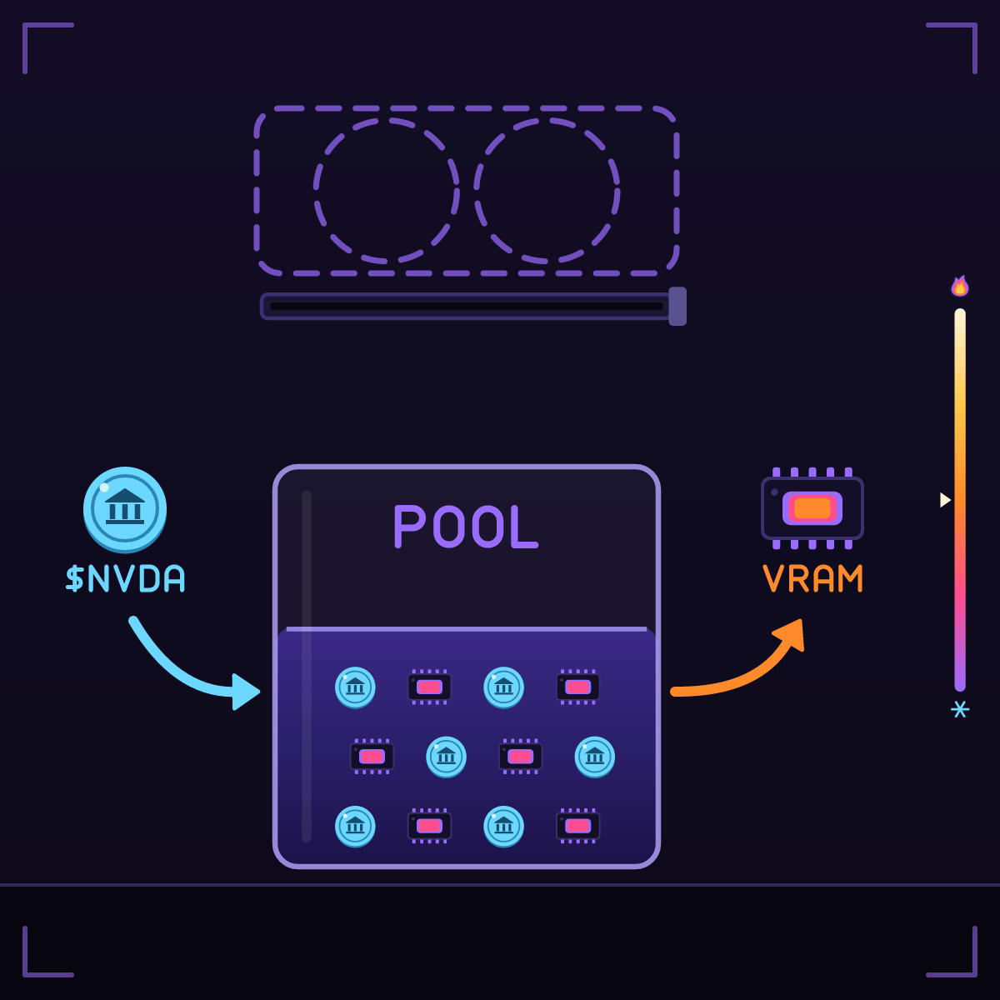
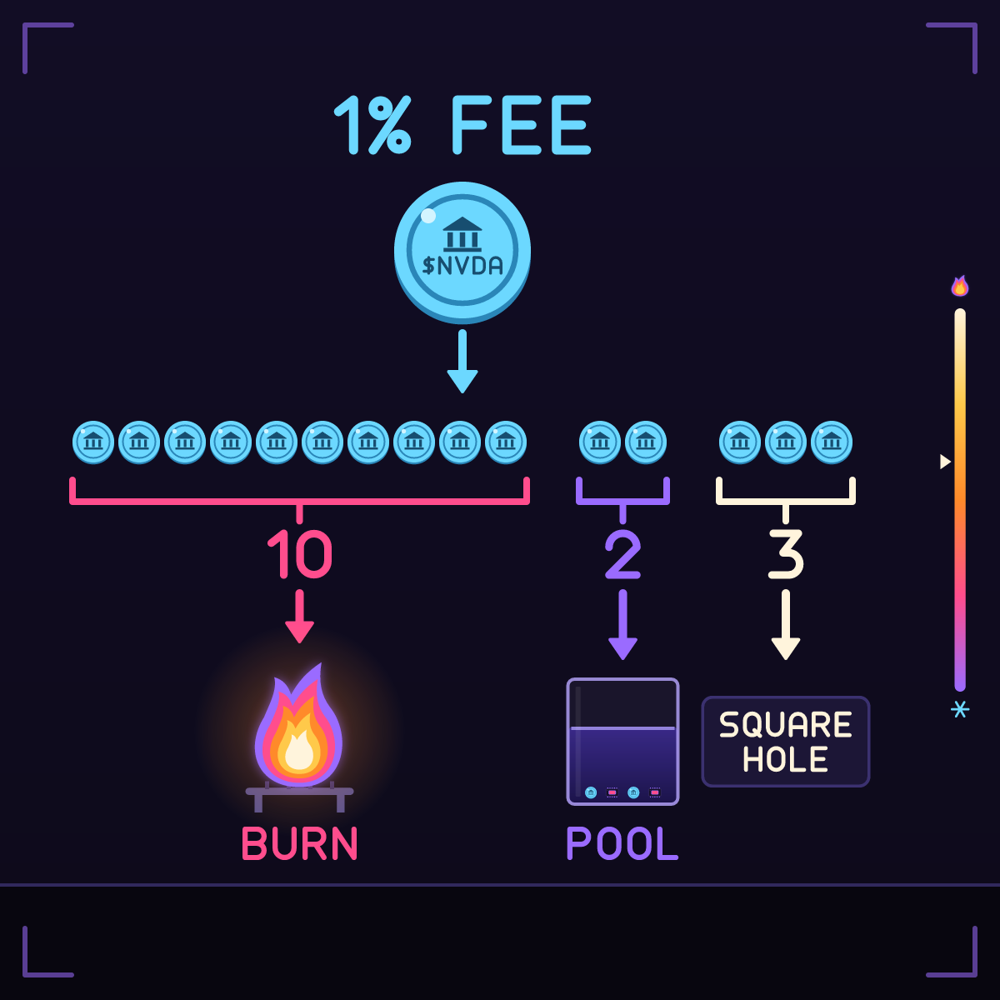
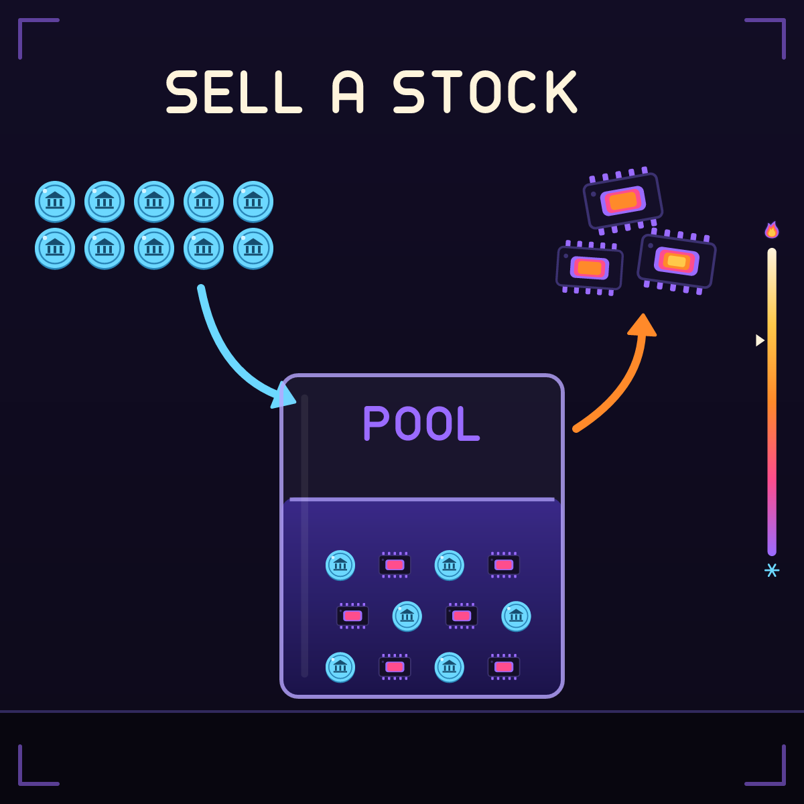
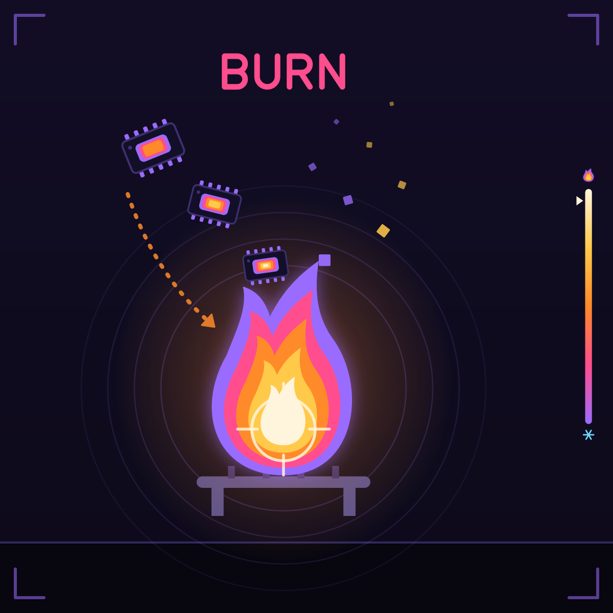
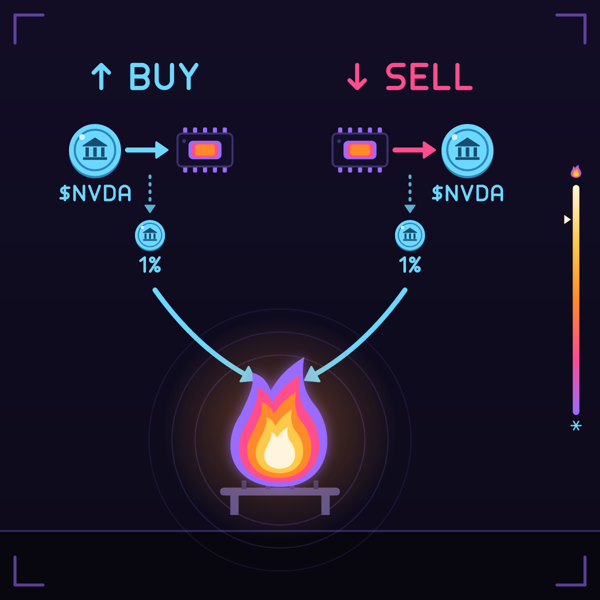
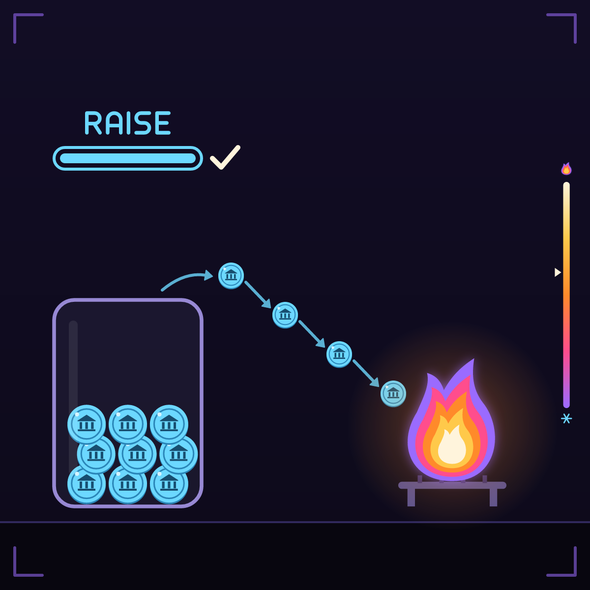
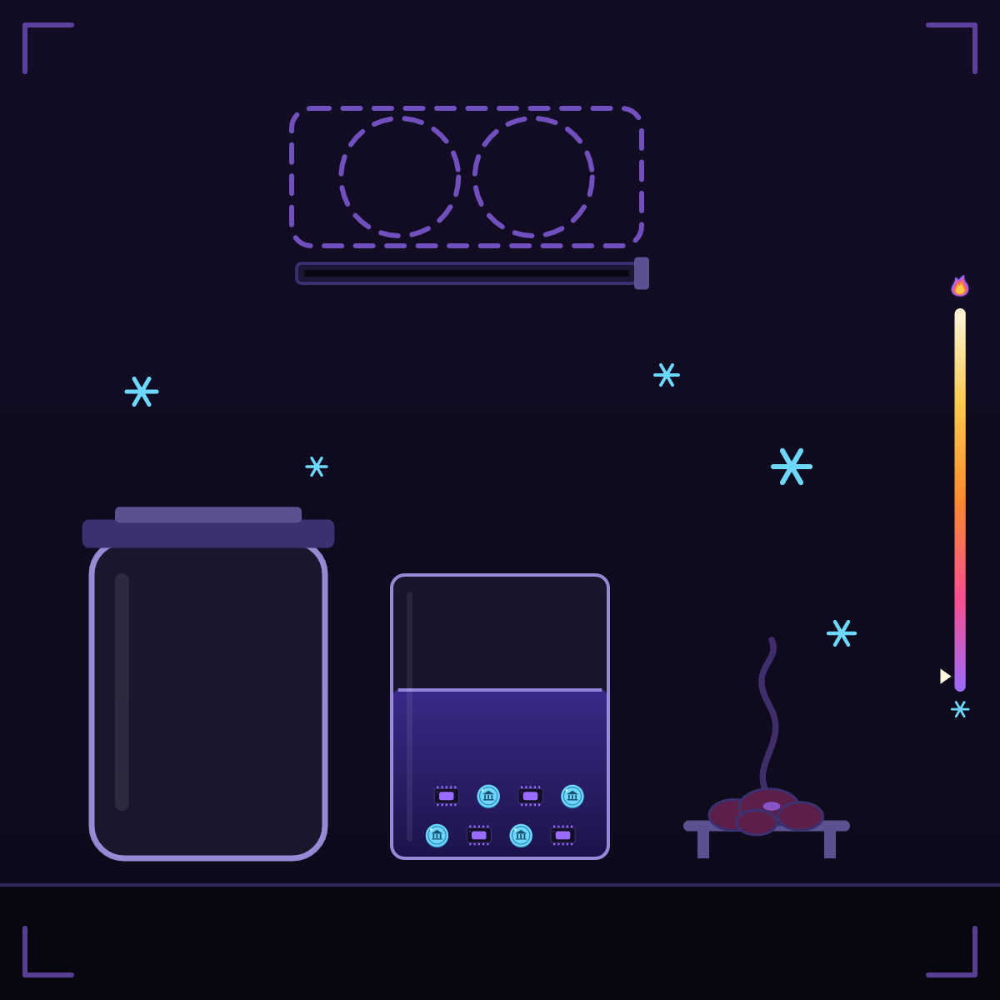

# The room with no GPU

Seven pictures that show what the fees do. Ice-blue coins with a small building are $NVDA, Nvidia's stock, the
coin the box is priced in. Small chips are VRAM. The big fee coin says $NVDA on it, and in some pictures the names
are written under the coins and chips. The glass tank is the box's own pool, the jar holds fee coins that wait, and
the fire is a burn. The scale on the right of every picture shows how warm the room is. Arrows show where the fees
go. They show no amounts and no timing.

## 01 · No GPU

GPU Poor can't afford a GPU, so all it has is a token called VRAM.
You trade VRAM for $NVDA, Nvidia's stock, in the box's own pool.

## 02 · Fifteen parts

Every trade pays a small fee in $NVDA, and the fee splits into 15 parts.
Ten go to the burn, two go to the pool and three go to Square Hole (its platform and its buy-back).

## 03 · Sell a stock

The box sells the ten fee parts in its own pool.
It gets VRAM back, and the $NVDA goes into the pool.

## 04 · Burn the VRAM

That VRAM goes into the fire and is gone for good.
After every burn there is less VRAM than before.

## 05 · Both sides

Buyers and sellers both pay the fee.
Both sides feed the same fire.

## 06 · Small steps

While the box fills its raise, the ten fee parts wait in a jar.
Once it graduates, they go to the fire in small steps.

## 07 · A cold night

Fees only come from trades.
No trades, no fire, and the room stays cold.

---

The $NVDA in these pictures is a stock coin from Ondo, a token that follows Nvidia's stock. The stock coin may not be
offered to US persons. Nvidia and Ondo did not make, approve or endorse this box.
