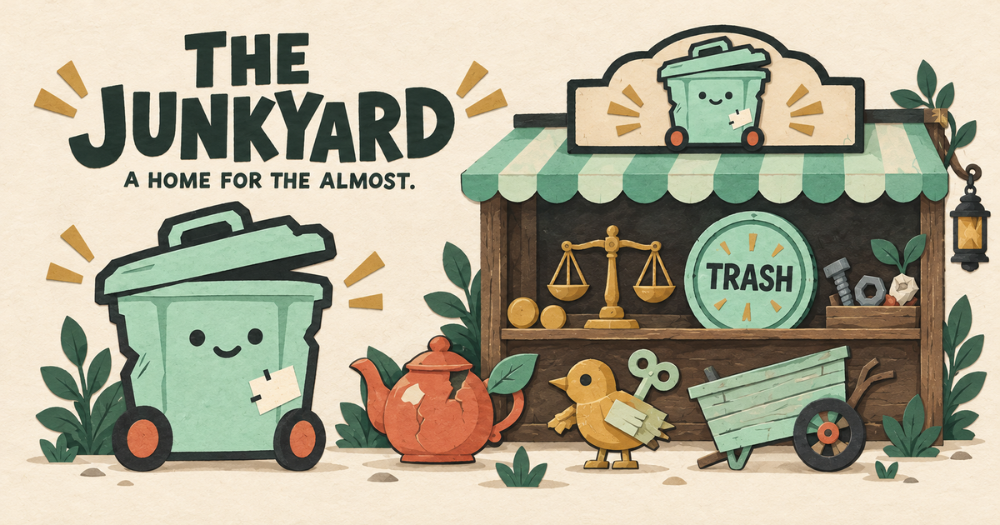

# The Junkyard

Sepolia uses the creator Safe and tGOLD. Both settings commands now use the same kit builder and free-tier logo. Supply a freshly quoted `creatorBuy` after the native listing raise update; the old 0.3-ETH-equivalent buy exceeds the new 0.1-ETH raise. Enter ids 1 and 2 for each of the five Test Junk collections when Load settings asks for starters.

Load it: build with `node scripts/kits/bundle.mjs junkyard`, then choose `settings/junkyard-boxspec-v2.json` in Create → Load settings. First resolve its [public bindings](../../../scripts/kits/README.md#binding-the-setup); the generated inventory lists anything still unresolved.

A home for the almost. The coin is $TRASH.



Start with the [storybook](storybook.md). Read the [brand book](brand-book.md) for the look and voice.
The [details](details.md) explain the shop, holder claims and risks.
The [prompt record](prompts.md) keeps each image request and its references in order.

This is a brand kit for an example box. It is not a live shop or a promise of payment.
The pictures use invented objects to explain digital collectibles. No physical toy or metal coin is included.
Check the settings before using this kit for a live box.

| Asset | Size | Use |
|---|---|---|
| [Logo](art/logo.png) | 1024 × 1024 | Main mark; minimum 48 × 48 |
| [Avatar](art/x-avatar.png) | 400 × 400 | Social profile |
| [Social banner](art/x-banner.png) | 1500 × 500 | Calm bottom-left area for the avatar |
| [Cover](art/cover.png) | 1200 × 630 | Link preview |
| [Box banner](art/box-banner.png) | 1600 × 600 | Box page |
| [Story pictures](storybook.md) | 1200 × 800 each | Eight scenes |

Each picture has an untouched source beside it with the suffix `-original.png`.
The first version of the pick scene is kept as `scene-04-first-original.png` too.
[assets.json](assets.json) records dimensions and SHA-256 checksums.

Run from the repository root:

```sh
node --test examples/boxes/junkyard/check.test.mjs
node examples/boxes/junkyard/check.mjs
```

The check covers the file list, PNG data, dimensions, checksums, copy rules, the approved shop lines, links and short captions.
People still need to inspect the art and read the settings. The check cannot judge the meaning of a picture.
