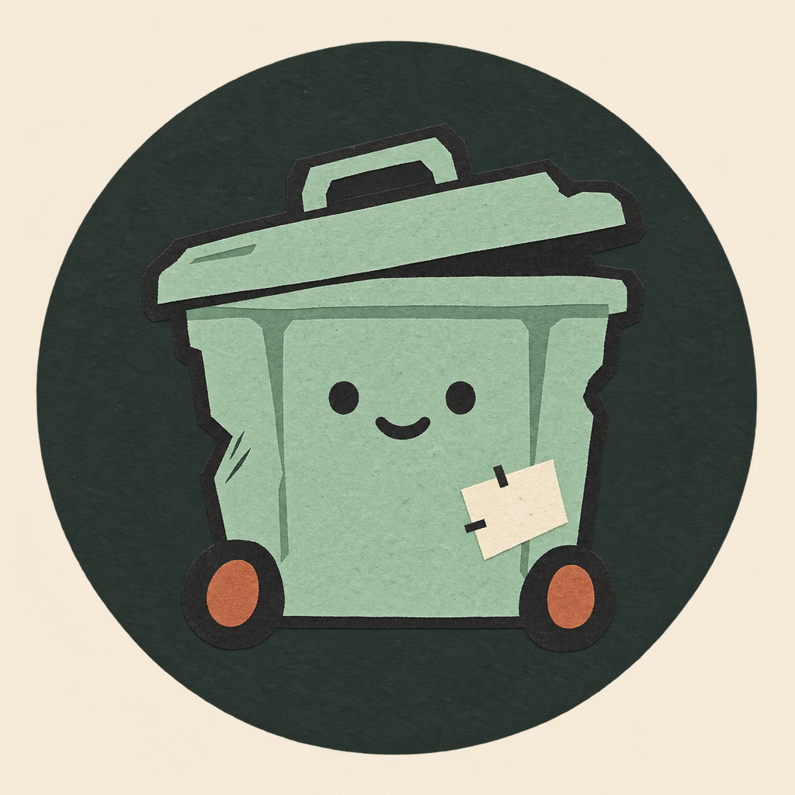

# The Junkyard brand book

## Name and joke

Name: The Junkyard. Ticker: TRASH. Write the coin as $TRASH in prose.

One-sentence joke: Finally, a shop where a missing wheel counts as character.

## Story hook

A tiny scrapyard opens a shelf for things that almost work.
A chipped teapot, a crooked bird and a cart with one wheel find a place there.
The bin has dents too. It keeps the shelf tidy and the rules plain.

The objects stand for NFTs, which are digital collectibles.
The gold scale stands for the gold token used for holder claims.
The mint coin stands for $TRASH, used by the shop.
Neither kind of coin is a physical gift.

## Voice and tone

Sound like a kind shopkeeper with a short list of rules.
Use small words and one idea per sentence. Laugh with the objects, never at their owners.
Explain a wait or a refusal without blame. Let the joke sit beside the rule.

Example lines:

- “One wheel. Plenty of character.”
- “Choose the bird you can see.”
- “This shelf needs its last resident.”
- “The new collection needs a week before gives can start.”
- “Your gold share is ready to claim.”
- “The weekly room is used up. Please check next week.”
- “Fees fill the shop up to a ceiling, then go to holders.”

Use the claim line only when a funded claim is ready.
Use the fee line as written, with the warning for every shop box beside it: whoever picks the collections decides who can sell into a budget the fees pay for.
A full shop only means its budget reached the ceiling, with fees counted.
Do not promise payment, safety, scarcity or a future buyer.

## Palette

| Name | Hex | Job |
|---|---|---|
| Soot | #24332F | Text, outlines and dark panels |
| Paper | #F5EBD8 | Background and light text |
| Mint | #9BC7AD | Bin, $TRASH coins and shop awning |
| Gold | #D8AD4B | Scale and gold claim coins |
| Rust | #B65D43 | Repairs, wheels and small accents |

Use soot text on paper, mint or gold. Use paper text on soot.
Keep rust out of small text. Add words and shapes when color carries a rule.
The art has paper grain, so sample colors from this table when building controls.

## Type

Use two free Google Fonts, both under the SIL Open Font License.

- [Bricolage Grotesque](https://fonts.google.com/specimen/Bricolage+Grotesque), weight 700, for short headings. Fallback: `system-ui, sans-serif`.
- [Atkinson Hyperlegible](https://fonts.google.com/specimen/Atkinson+Hyperlegible), weights 400 and 700, for body text and controls. Fallback: `Arial, sans-serif`.

Keep body text at least 16 px with a line height of 1.5.
Set controls in sentence case. Save capitals for the short name on signs.
Image lettering is drawn art, not a supplied font file. Keep interface text as real text.
This kit contains font links only. A site that hosts font files must keep their license files too.

## Logo use

Use the supplied square mark at 48 px or larger.
Leave clear space equal to one quarter of the bin body's width on every side of the mark.
Do not let a title, border or another mark enter that space.
Keep the full lid, wheels and dark disk. Place it on a plain field.
Use the supplied avatar for a circular profile crop.
For the social banner, reserve the lower-left 30% of the width and lower 45% of the height for the avatar.

## Do and don't

| Do | Don't |
|---|---|
| Give each object one clear dent or repair | Make dirt or damage frightening |
| Show a chosen item in plain view | Use mystery boxes or chance wheels |
| Keep mint shop coins apart from gold claim coins | Show fees in the shop without its ceiling |
| Use the same bin, scale and paper texture | Stretch the mark or add a shine effect |
| Explain waiting and claim steps | Use countdown pressure or promises |
| Put captions beside illustrations | Hide a rule inside tiny image text |

## Accessibility

Use text contrast of at least 4.5:1, or 3:1 for large text.
Use soot on paper for the safest default. Keep a visible focus ring and controls at least 44 px tall.
Never use color alone to distinguish shop coins from gold: keep the TRASH label and plain gold disks too.
Supply the story captions and alt text wherever a scene appears.
Use empty alt text for a repeated decorative banner if the nearby heading already names the shop.
Keep the reading order the same as the scene order. Respect reduced motion; these assets are still pictures.

## Homage and IP

The homage is to repair benches, paper craft and second-hand shelves.
Do not copy a brand, product shape, person, mascot, known character or real NFT artwork.
Do not add partner marks to the scale or coins. The bin and props here are invented.
PAXG is named in the details to identify the gold token. Its name grants no endorsement.
The cute art does not target children; it makes the rules easier to understand.
The pictures do not prove any rights in a collectible offered by someone else.
