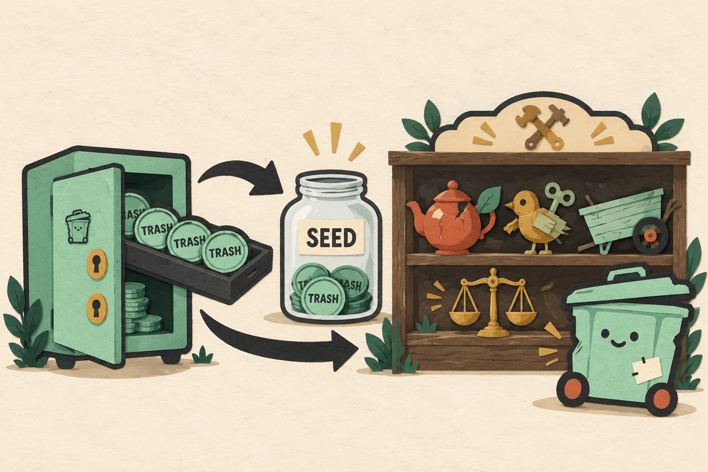
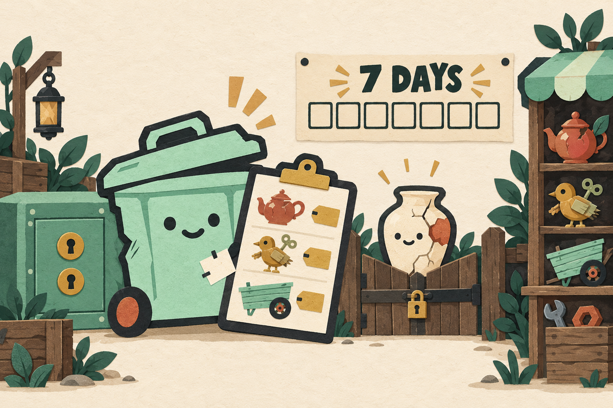
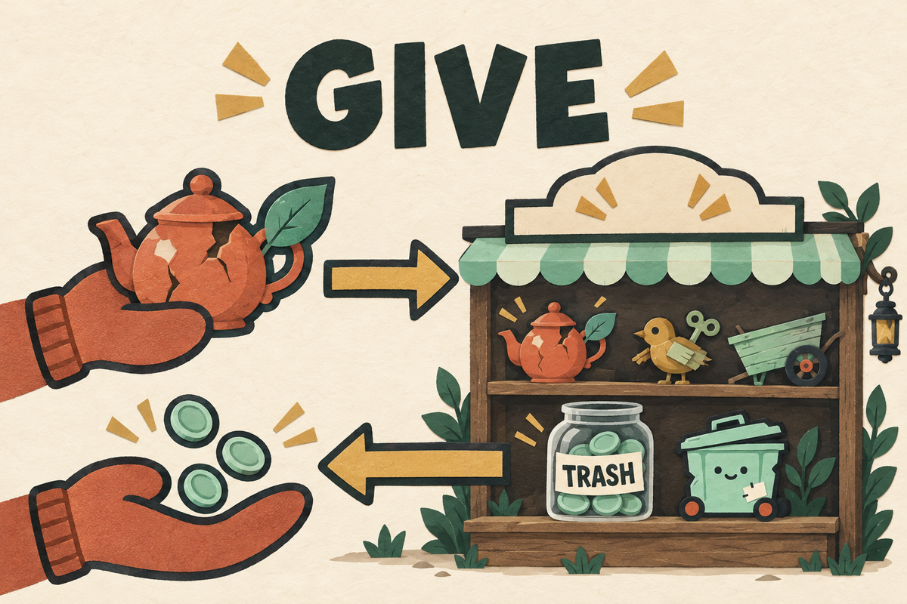
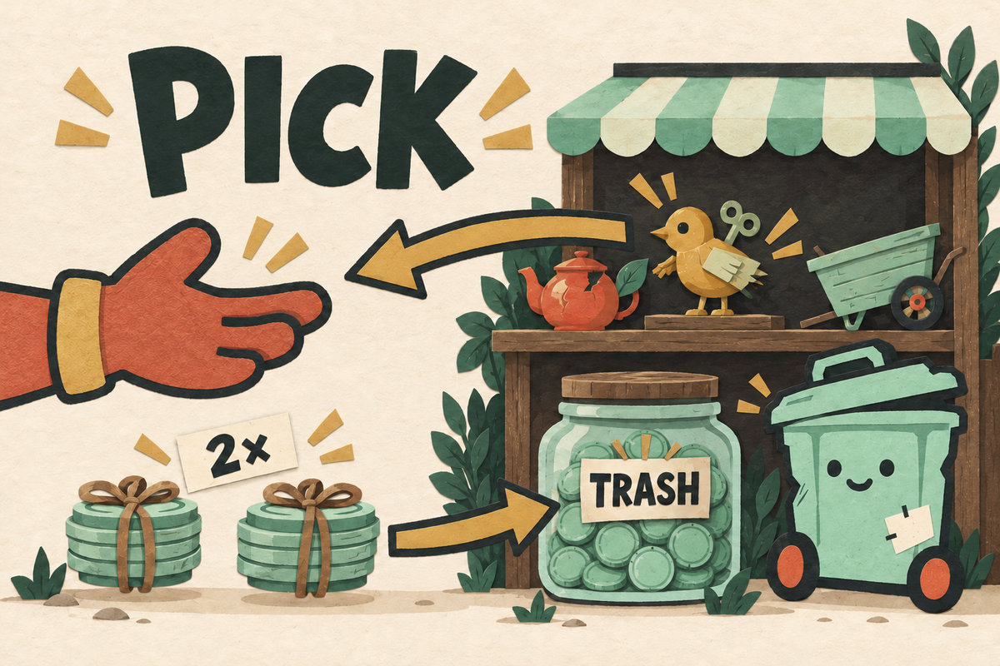
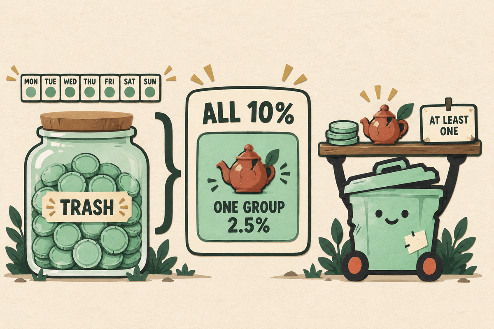
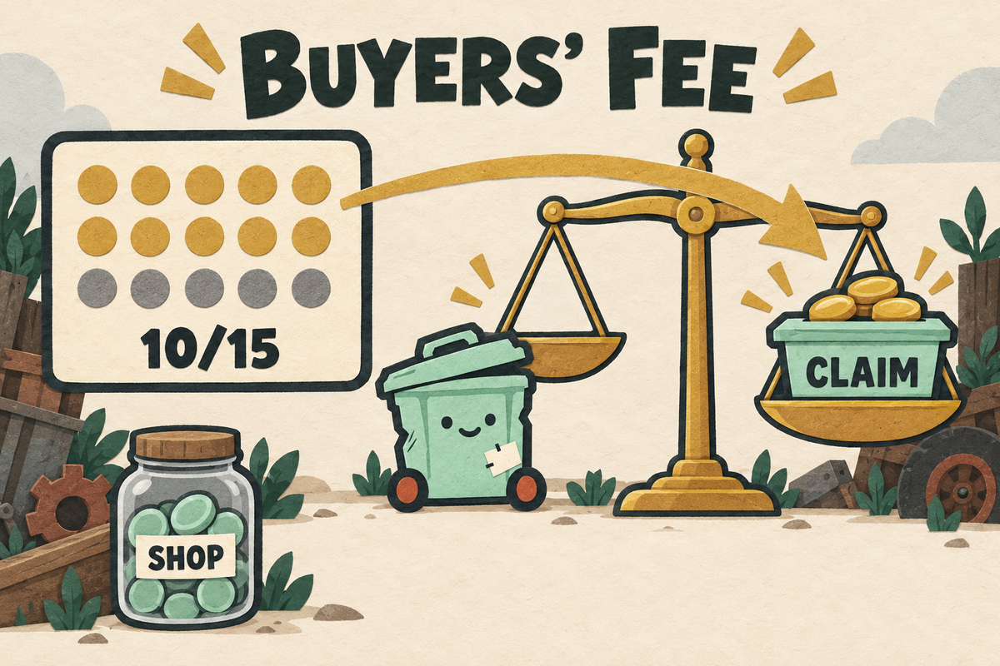
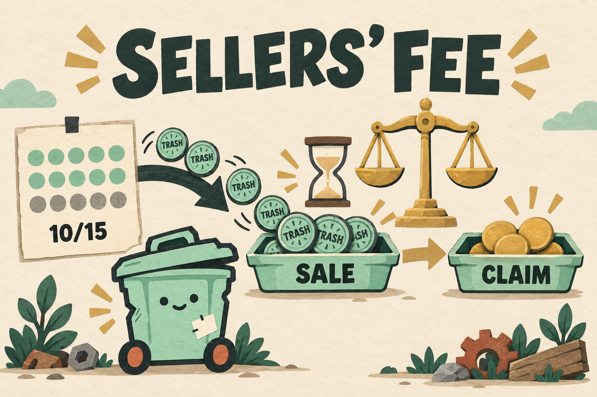
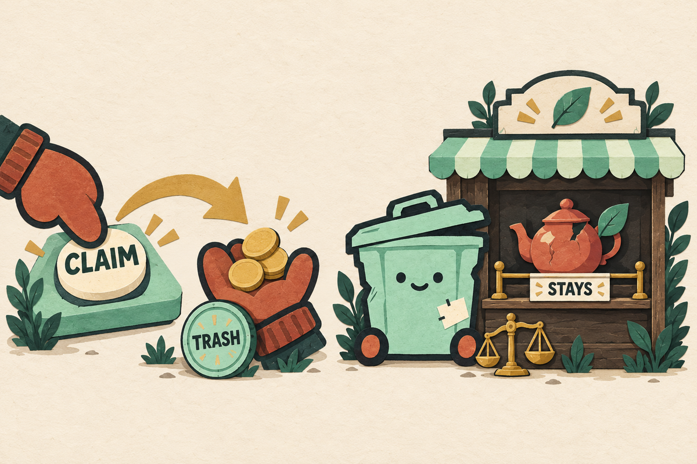

# A shelf for the almost

These objects stand for digital collectibles. The coins are picture symbols, not set amounts.

## 01. Open the gate

The Junkyard Safe puts $TRASH in the shop budget and brings the first items.
That gives the little shop a place to start.

## 02. Join the list

The Safe gives each collection a fixed $TRASH tier on its list.
A new collection waits 7 days before gives can start.

## 03. Give an item

Give an accepted item to the shop, and its budget pays you $TRASH.
The item goes onto the shelf for someone else to choose.

## 04. Pick that bird

Pick the exact item you want and pay 2x its give amount in $TRASH.
Your payment goes into the shop budget, so it can help pay for later gives.

## 05. Leave room for a week

Each week, gives normally use at most 10% of the budget, with 2.5% for one collection.
Each limit makes room for one cheapest active give if the budget can cover it.

## 06. Gold from the buyers' fee

When people buy $TRASH, 10 of each 15 fee parts are for holders in gold.
That gold goes toward claims, not into the shop budget.

## 07. The sellers' fee

The sellers' fees fill the shop up to a ceiling of 2x its seed, then go to holders in gold.
Fees from before graduation work the same way: the shop takes only what it wants, and the rest goes to holders.

## 08. Ask for your share

Holders ask to claim their own ready gold share; it is not sent by itself.
Back in the shop, the last item stays on the shelf.

