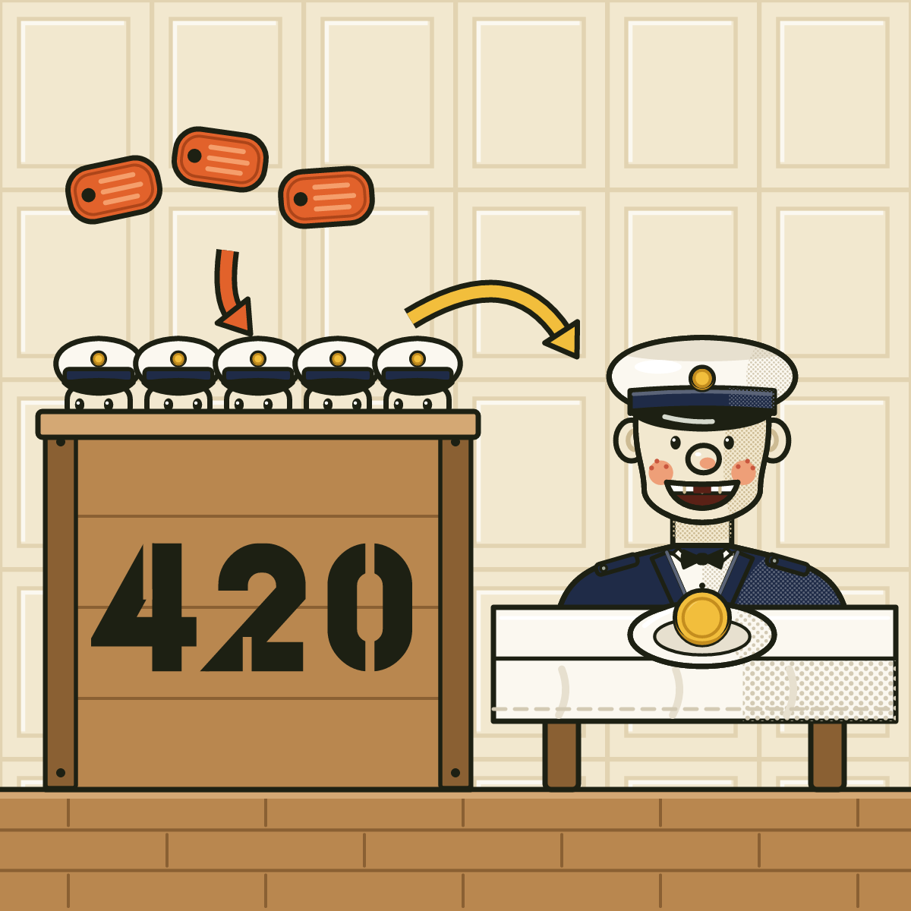
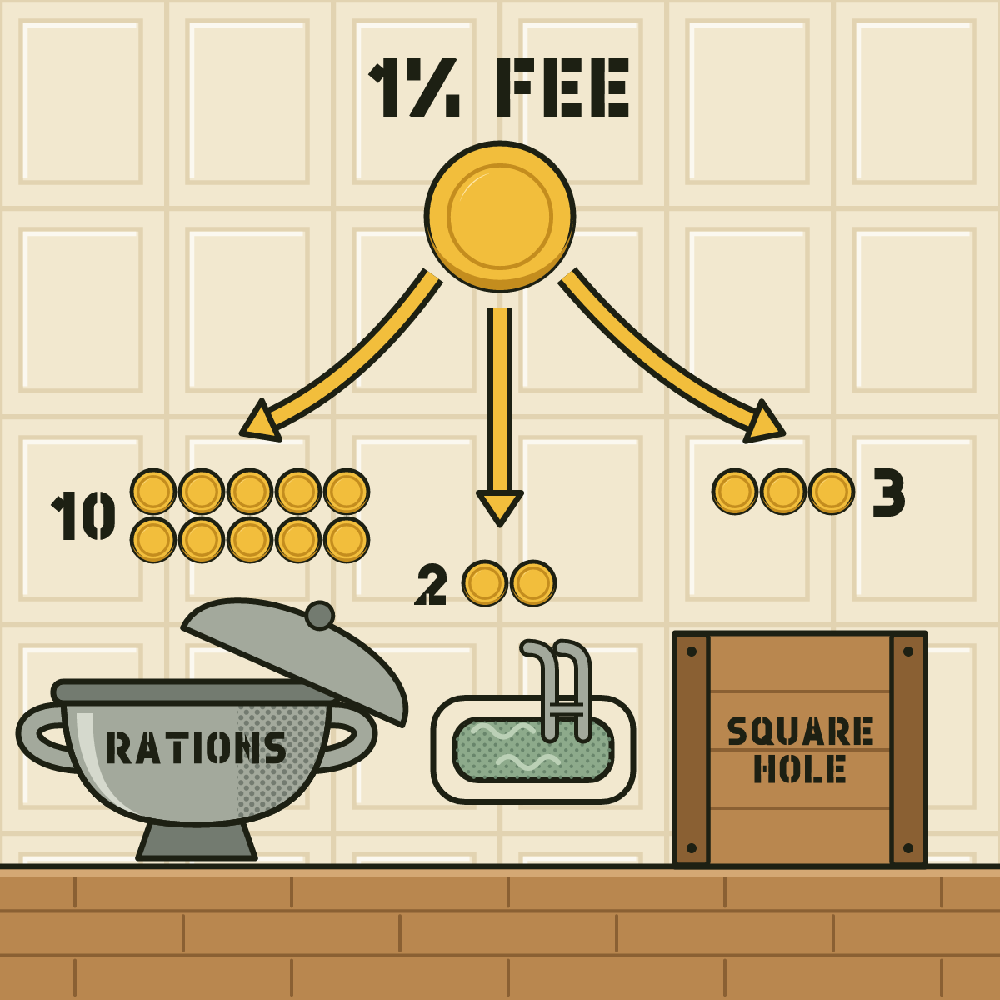
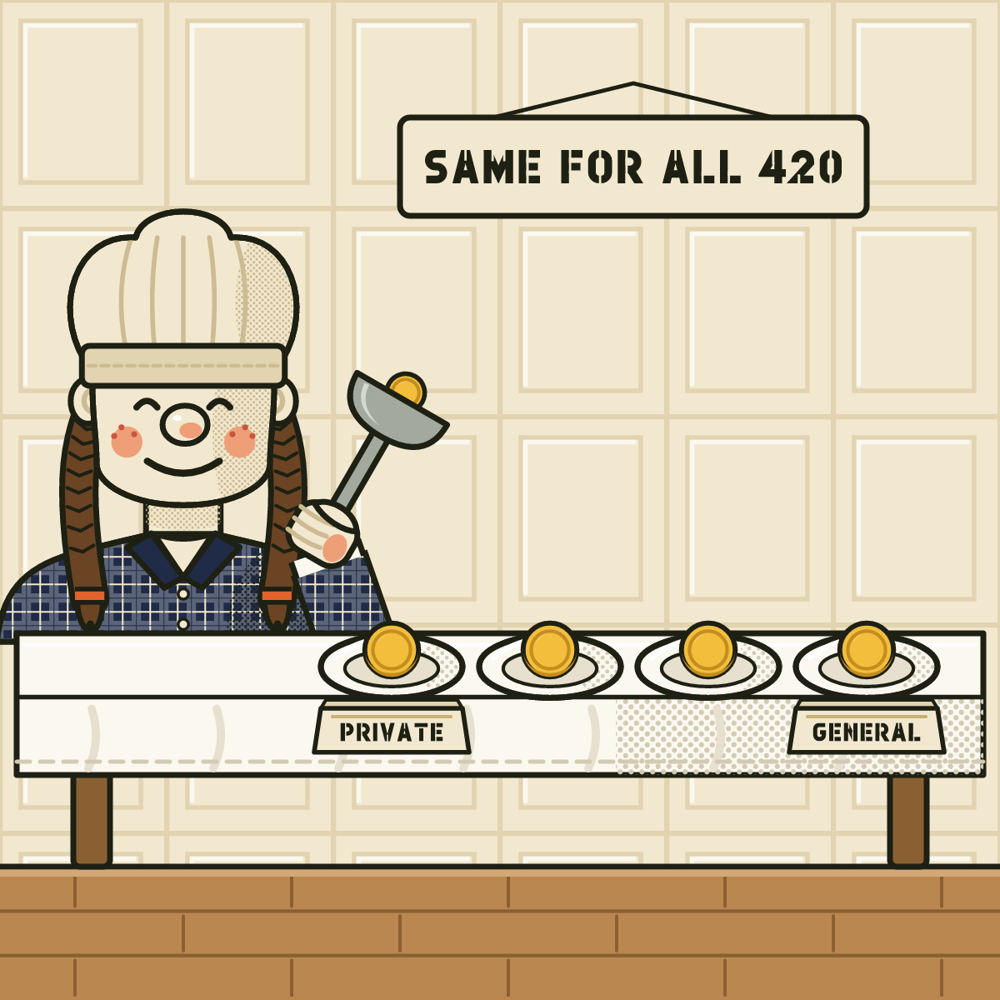
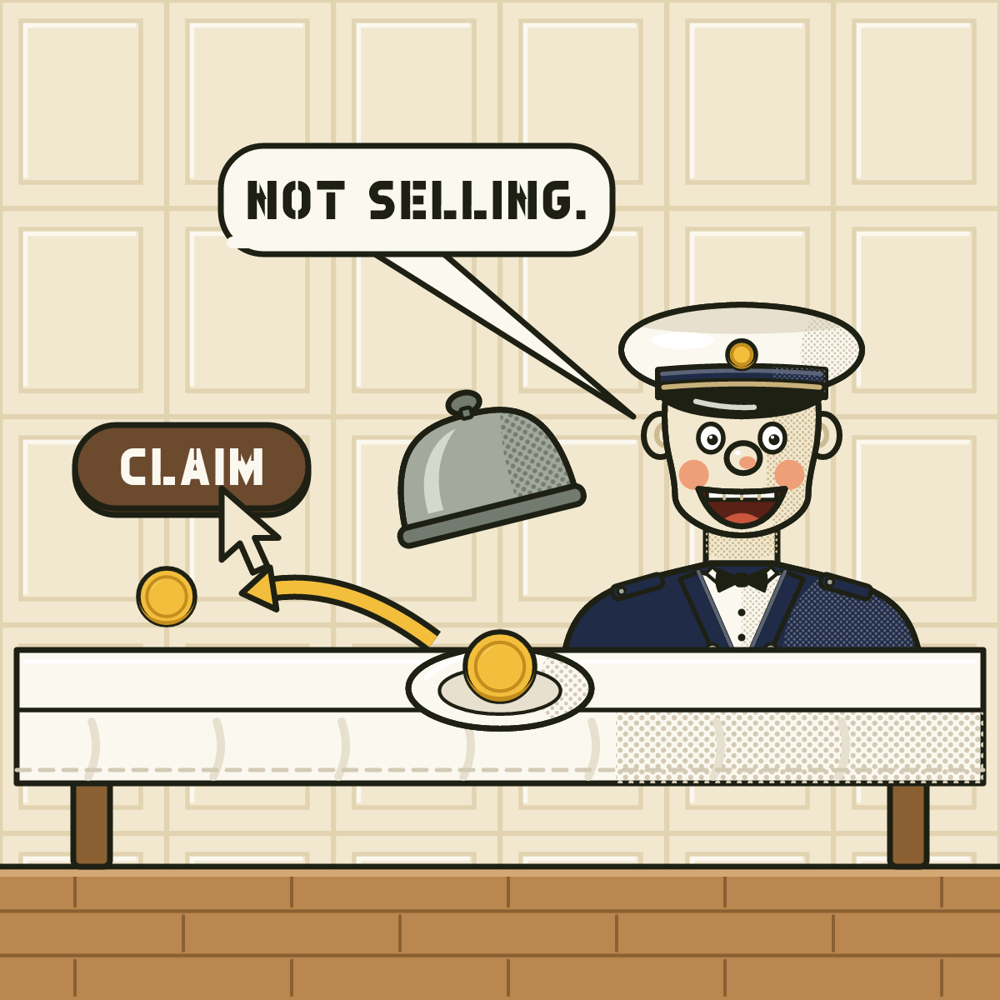
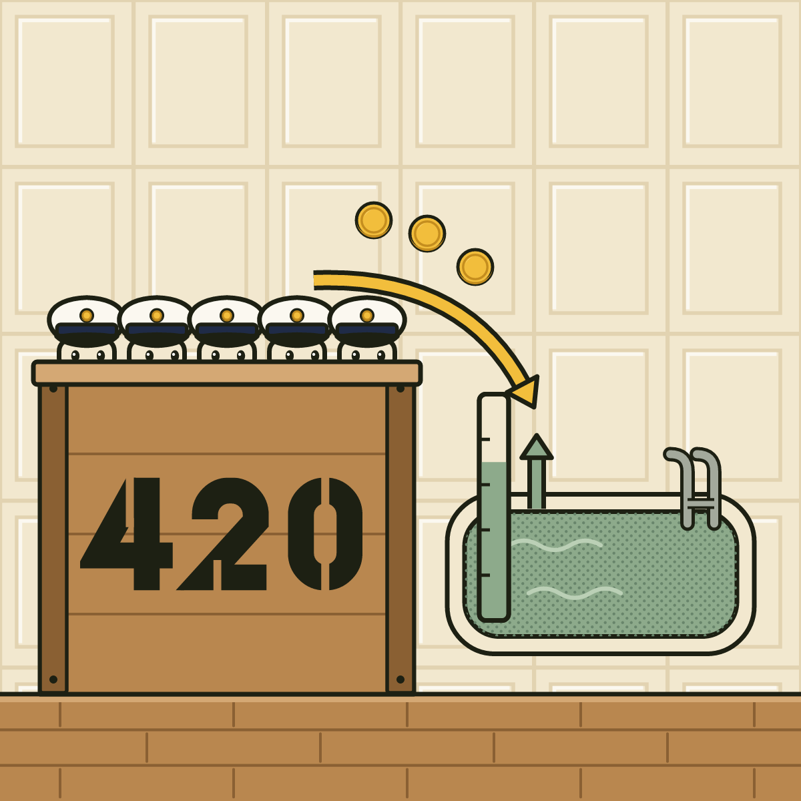
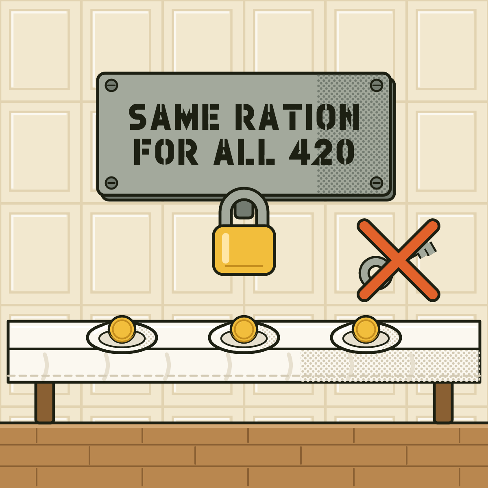
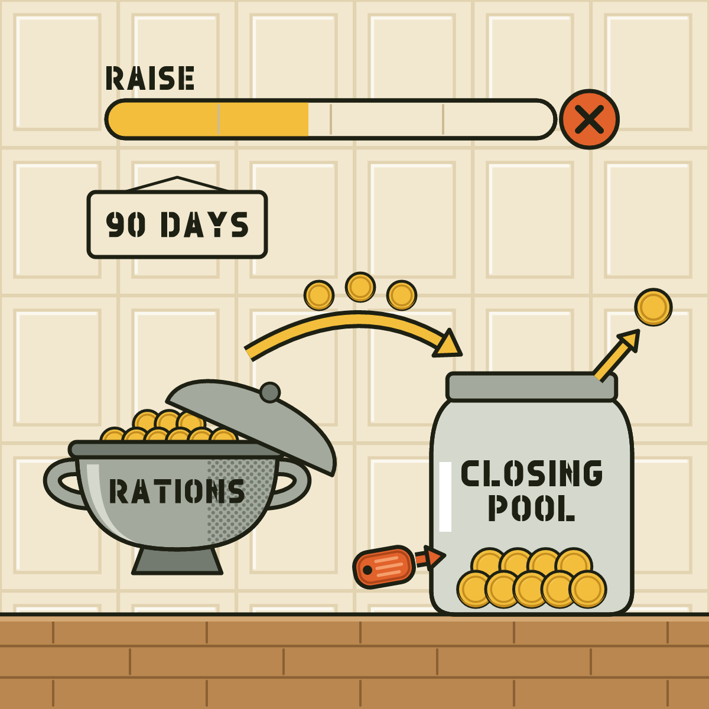

# Mess night

Seven pictures that show what the fees do. Gold coins are LINK, the coin this box is priced in. A white plate with one
gold coin on it is one marine's ration, and every plate holds the same. A steel cloche covers a ration that waits for
its owner. Orange dog tags are MARINE, the box's token. The wooden crate is the box itself, where marines wait to be
taken out, and the steel tureen holds the rations before they are shared out. The small pool is the box's own pool.
Arrows show where the fees go. They show no amounts and no timing.
The characters illustrate the fee rules and ranks; none identifies a numbered NFT. Real portrait ids and traits
appear on the [sample sheet](unique/contact-sheet.png).

## 01 · The box

This box holds 420 marines.
After it graduates, anyone can take one out with the box's token.

## 02 · Fifteen coins

Every buy and every sale pays a small fee in LINK, and the fee splits into 15 coins.
Ten go to the marines' rations, two go to the pool and three go to Square Hole (its platform and its buy-back).

## 03 · The same ration

The ten coins are shared out equally among all 420 marines.
The Private gets the same ration as the General.

## 04 · A marine you own

A marine that someone owns keeps its ration under the cloche until its owner claims it in LINK.
Only the owner can claim it, and nobody can stop the claim.

## 05 · Still in the box

A marine still in the box sends its ration into the box's own pool.
The pool gets deeper while the marines wait.

## 06 · Rules that stay

Nobody can change these rules once the box is created.
No one holds a key, Square Hole included.

## 07 · If the box fails

If the raise misses its 90 days, the box fails and no rations are served.
The rations waiting in the box join the closing pool, where holders hand in the box's token for their part.
