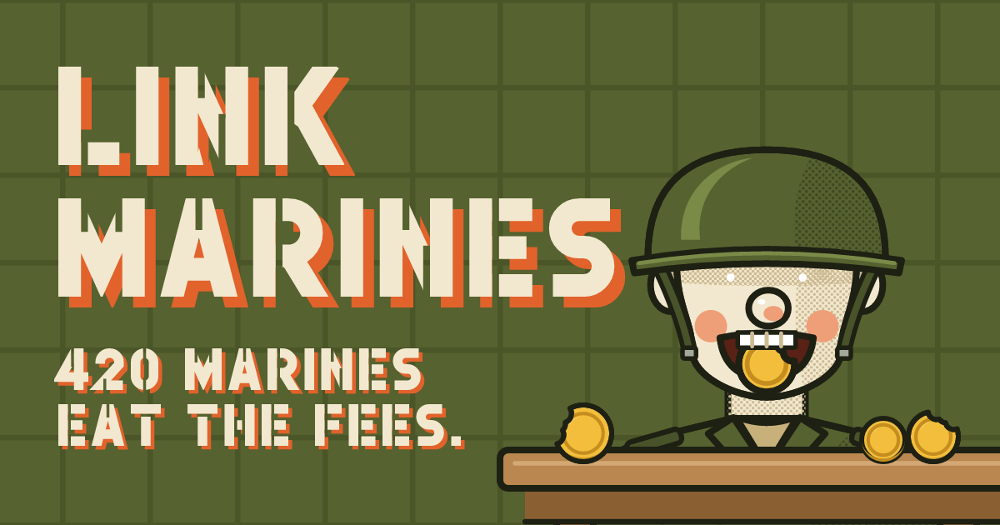

# Link Marines

Sepolia launches [Link Marines version 2](../link-marines-v2/README.md): 420 marines, tLINK rations on both fee sides and inside shares to the box's own pool. This folder retains the version 1 Eat kit.

Load it: build with `node scripts/kits/bundle.mjs link-marines`, then choose `build/link-marines-boxspec-v2.json` in Create → Load settings. First resolve its [public bindings](../../../scripts/kits/README.md#binding-the-setup); the generated inventory lists anything still unresolved.

These marines love their coin so much that they eat it.

This is the brand kit for the Link Marines example box on Square Hole. The token's ticker is MARINE. The box is
priced in a community coin, LINK in the example registry, and holds a new collection of 420 marines. Every buy and
every sale pays a small fee in the price coin. On both sides, the box's share of that fee is eaten. After the box
graduates, anyone can run the step that sends the eaten coins to an address nobody has a key for, so they are out of
circulation for good. The marines can be taken out of the box and put back, and no fees ever go to them.



The kit is ready for review. Nothing in it is deployed or posted, and the founder checks it before any use.

## Files

| File | What it is |
| --- | --- |
| [README.md](README.md) | This page |
| [brand-book.md](brand-book.md) | Name, ticker, joke, cover line, voice, palette, fonts, logo rules, do and don't, accessibility, homage rules |
| [storybook.md](storybook.md) | The story in seven pictures, showing what the fees do |
| [details.md](details.md) | The box settings in plain words, what owners get, the risks, what still waits |
| [art-notes.md](art-notes.md) | How the art is built, so a creator can extend it |
| [assign.mjs](assign.mjs) | Gives each marine id, 1 to 420, one of the 12 pictures and a squad |
| [assignment.json](assignment.json) | The full output of `assign.mjs` |
| [build-art.mjs](build-art.mjs) | Builds every SVG in `art/` from `src/` and renders each PNG |
| [check.mjs](check.mjs) | Checks every file and pixel size, the assignment, the clear space, the avatar corner, the margins, the palette, the contrast table, the storybook, the registry settings and the wording |
| [src/](src/) | The art source: palette, stencil alphabet, pen, tiled wall, faces, hats, tools, marines, coins, items, props, scenes, brand pieces |
| `art/logo.svg`, `art/logo.png` | The mark, 1024 x 1024 |
| `art/logo-48.png` | The same mark at 48 x 48, to show it still reads |
| `art/x-avatar.svg`, `art/x-avatar.png` | X profile picture, 400 x 400 |
| `art/x-banner.svg`, `art/x-banner.png` | X header, 1500 x 500, with a bare corner for the avatar |
| `art/cover.svg`, `art/cover.png` | Link card, 1200 x 630 |
| `art/box-banner.svg`, `art/box-banner.png` | Box page banner, 2400 x 600, with all twelve marines at one table |
| `art/items/variant-01` to `variant-12`, `.svg` and `.png` | The 12 marine pictures, 1024 x 1024 each |
| `art/scenes/scene-01` to `scene-07`, `.svg` and `.png` | The storybook pictures, 1200 x 1200 each |
| `art/reference/cover.png`, `box-banner.png`, `scenes/scene-01.png` to `scene-07.png` | The cover, the box banner and the scenes with no lettering, as reference pictures of the kit's world. PNG only |
| [SH-KIT-LINK-MARINES.md](SH-KIT-LINK-MARINES.md) | Work record for the integrator, with decisions, facts, commands and results |
| `.gitattributes` | Keeps the art bytes exact, so the freshness check holds on every checkout |

Every PNG has its SVG next to it. The SVGs hold only shapes. They load no fonts, images or scripts.

## The 420 marines

Each marine id from 1 to 420 shows one of 12 pictures, by one fixed rule.

```
variant = ((id - 1) mod 12) + 1, written with two digits
squad   = ((id - 1) div 12) + 1
```

Marine 1 shows variant 01, the private. Marine 12 shows variant 12, the night watch, and marine 13 starts again at
01. 420 is 12 x 35, so the marines form 35 squads of 12, every squad has one marine of each kind, and every picture
appears exactly 35 times. Marine 420 is the night watch of squad 35. No picture is rarer than another, and a picture
or a squad changes nothing about fees or the box.

| Variant | Marine | Variant | Marine | Variant | Marine |
| --- | --- | --- | --- | --- | --- |
| 01 | Private | 05 | Pilot | 09 | Officer |
| 02 | Sergeant | 06 | Diver | 10 | Mechanic |
| 03 | Cook | 07 | Jungle | 11 | Scout |
| 04 | Bugler | 08 | Arctic | 12 | Night watch |

Square Hole collections start at id 1. Check that the deployed collection uses ids 1 to 420 before the
assignment becomes metadata.

## Rebuild and check

From the repository root, with Node 24 and the workspace installed:

```sh
node examples/boxes/link-marines/build-art.mjs
node examples/boxes/link-marines/assign.mjs > examples/boxes/link-marines/assignment.json
node examples/boxes/link-marines/check.mjs
```

`build-art.mjs` uses `@resvg/resvg-js`, which the workspace already pins in `packages/cards`. Nothing is
downloaded. The same source gives the same bytes every time, and `check.mjs` fails if any SVG or PNG differs
from a fresh build.

`node examples/boxes/link-marines/build-art.mjs --no-words` builds only `art/reference/`, the same pictures with no
lettering ([art-notes.md](art-notes.md#word-free-references)). `check.mjs` does not read that folder, so rebuild it
after any change to the cover, the box banner or a scene.

## Using the kit

- Show live text next to the pictures. The brand book has the lines, and the storybook has the captions.
- The pictures never label the price coin. The coins are plain gold discs, so the art also fits a copy of this box
  priced in another community coin. Only the name lettering says LINK. Name the coin in live text.
- Every public page carries the "not affiliated" line from the brand book. The people behind LINK did not make,
  approve or endorse this box.
- Every live MARINE page shows the chain and the full contract address. Other tokens may use MARINE too. Until a
  contract exists, the line reads "Contract: not deployed".
- When Square Hole launches this box as one of its own, its address also goes on the list of Square Hole's own boxes,
  as decided in F133.
- The box's recipe is Eat on both sides, step 1 of v2.1, and the registry row is ready with it. See
  [details.md](details.md).
- The example registry uses this kit's logo and still points at local test pictures for the cover and the items. Wiring this art into a launch is a separate step,
  listed in [details.md](details.md).
- The kit grants no license yet. The open-source license for its code, text and art is still to be chosen.
