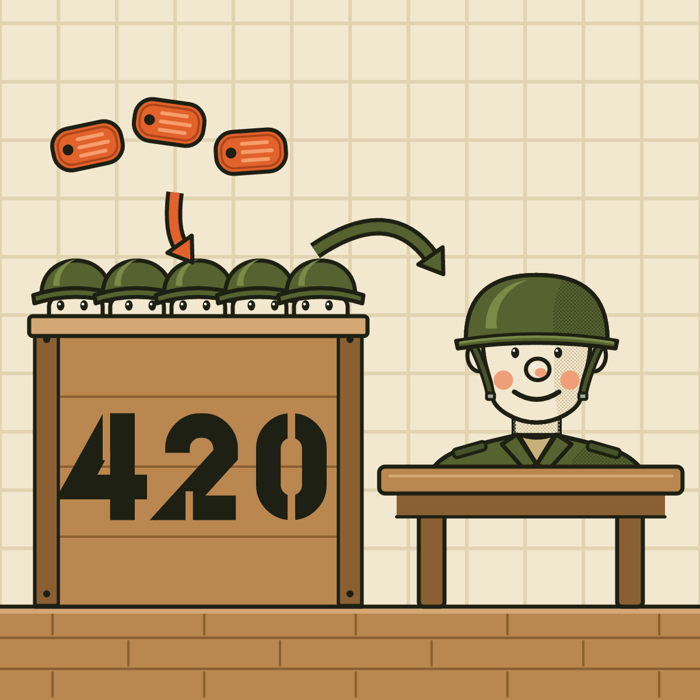
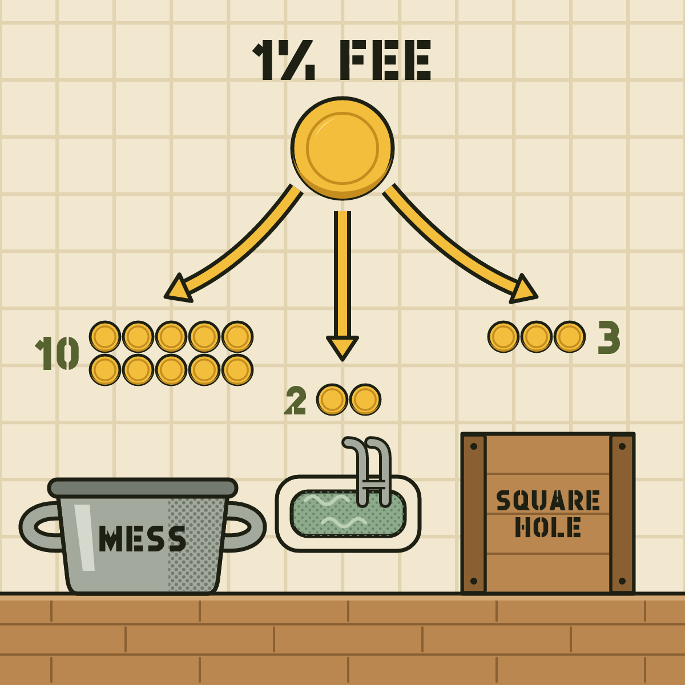
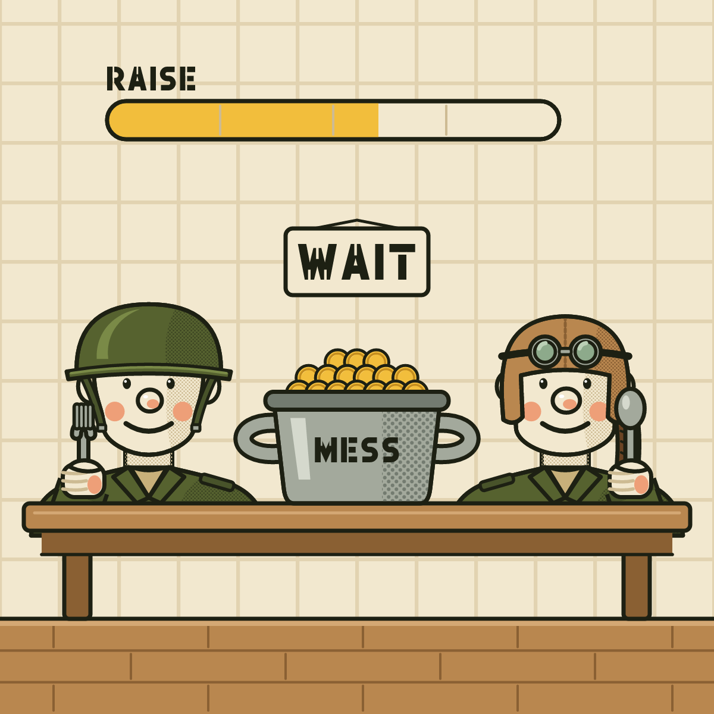
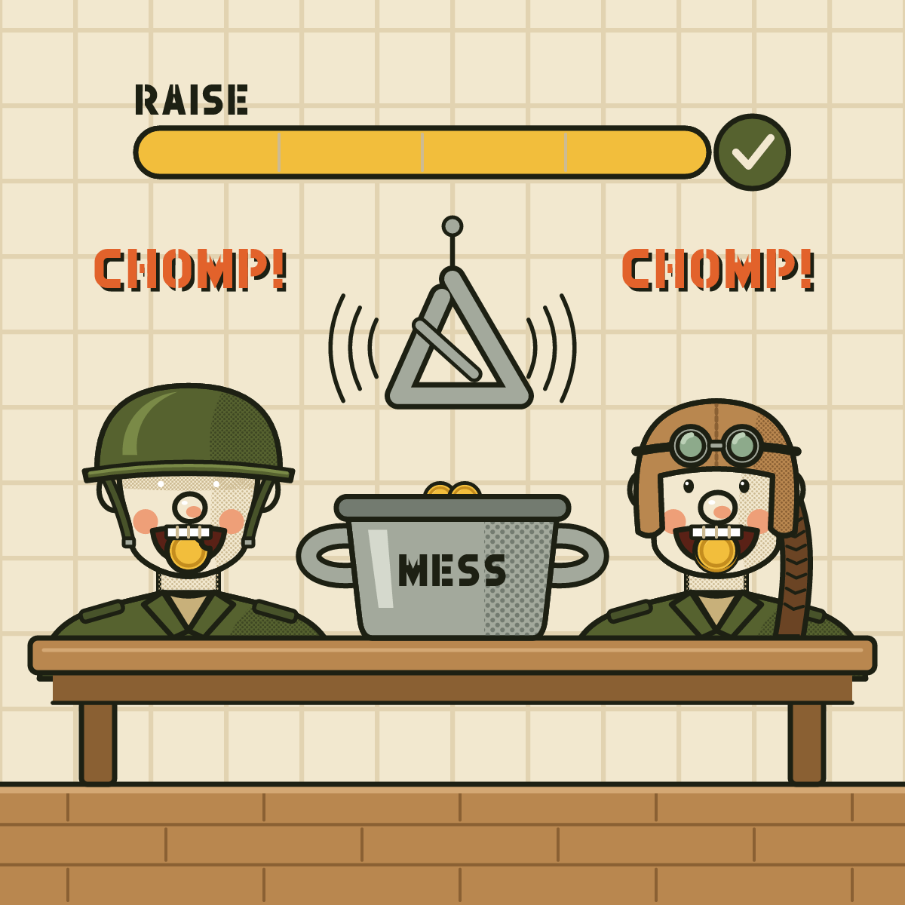
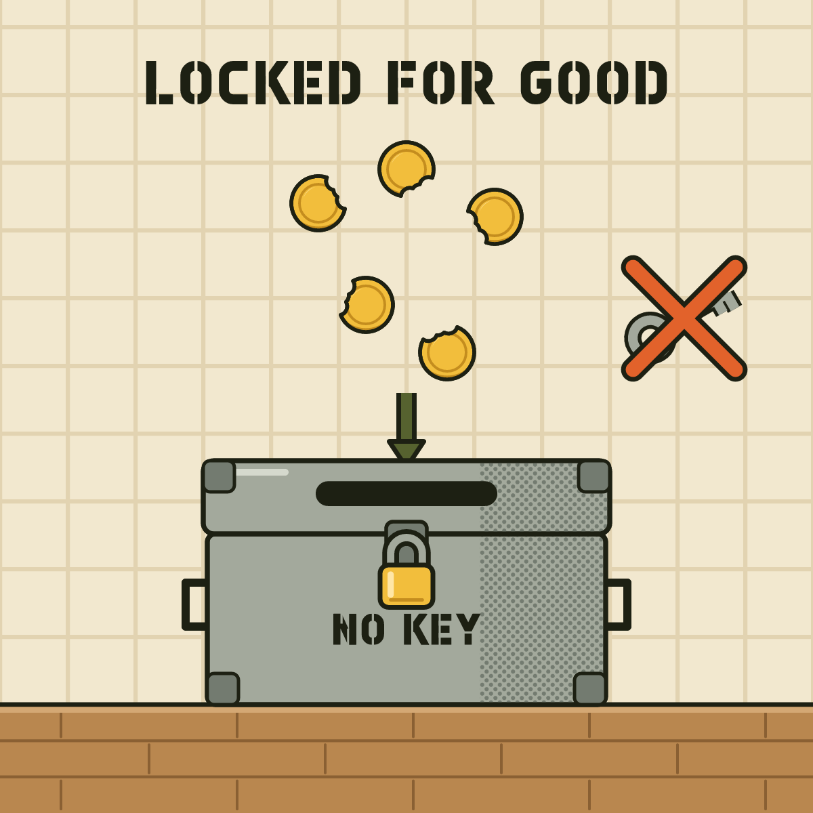
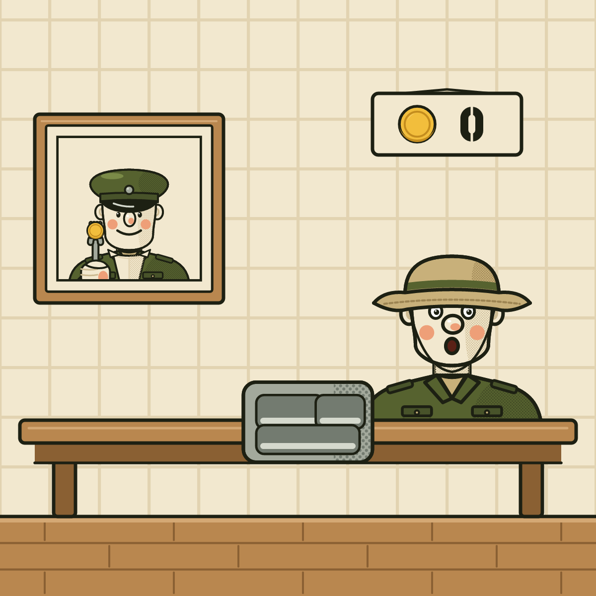
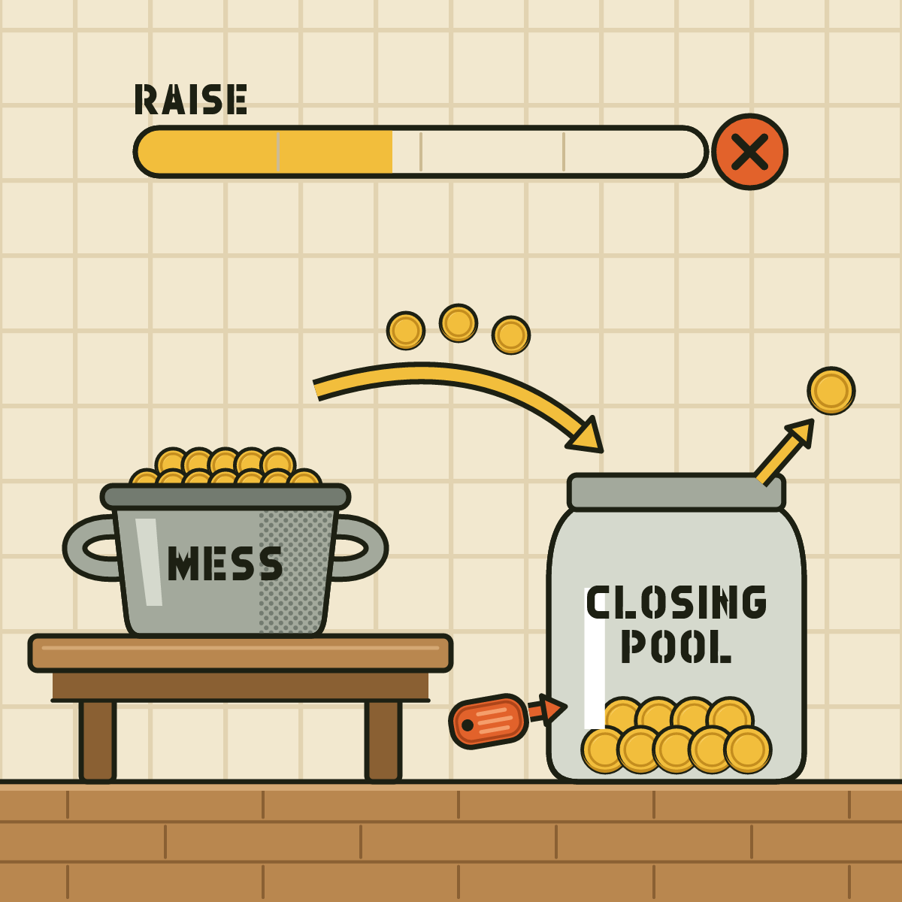

# The mess hall

Seven pictures that show what the fees do. Gold coins are LINK, the coin this box is priced in. A gold coin with a
bite out of it is a coin the marines have eaten. Orange dog tags are MARINE, the box's token. The wooden crate is the
box itself, where marines wait to be taken out. The steel mess tin holds the fees until the marines eat them, and the
small pool is the box's own pool. Arrows show where the fees go. They show no amounts and no timing.

## 01 · The box

This box holds 420 marines.
After it graduates, anyone can take one out with the box's token.

## 02 · Fifteen coins

Every buy and every sale pays a small fee, and the fee splits into 15 coins.
Ten go to the mess tin, two go to the pool and three go to Square Hole (its platform and its buy-back).

## 03 · Waiting for the box

While the box fills its raise, nobody eats.
The coins wait in the mess tin.

## 04 · Chow time

After the box graduates, anyone can ring the bell, and the marines eat the coins in the tin.
No trades means no coins, and nothing to eat.

## 05 · The locker with no key

This box's coin cannot be burned, so the eaten coins go into a locker with no key.
Nobody can take them out again.

## 06 · Nothing for the marines

The marines never get any coins.
A marine is a picture you own, with no share of the fees.

## 07 · If the box fails

If the box fails, nobody eats.
The coins in the tin join the closing pool, where holders hand in the box's token for their part.
