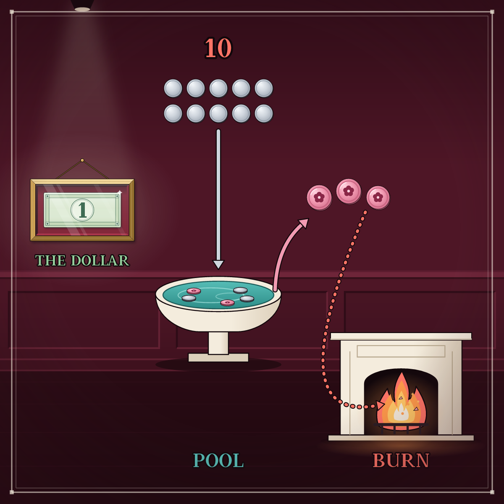
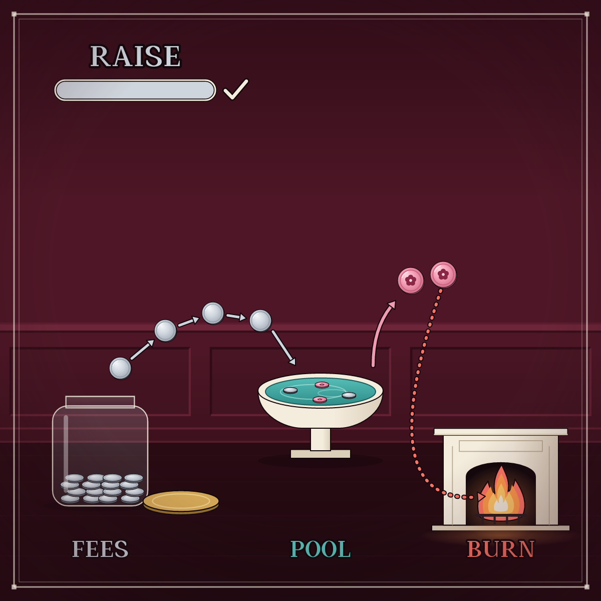
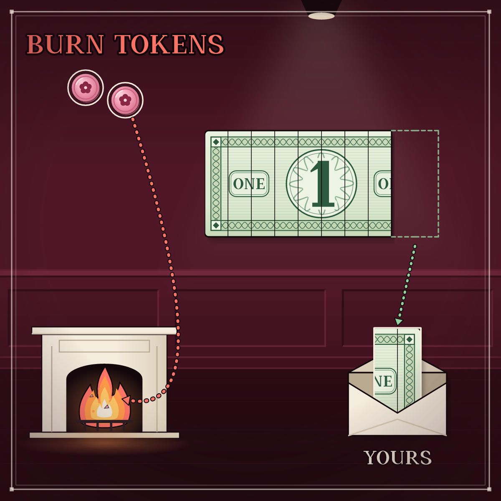
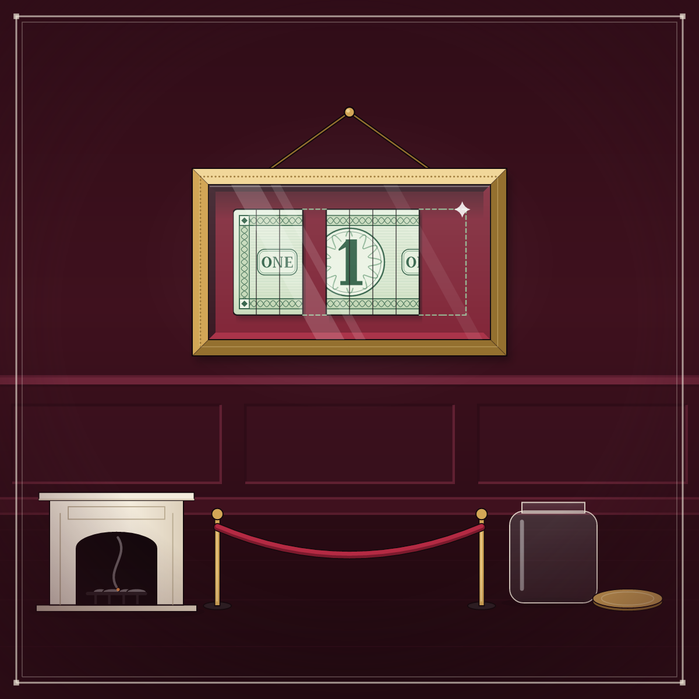

# The dollar under glass

Seven pictures that show what the fees do. The green cartoon bill, framed under glass, is the dollar in the box. It
stands for the one USDC in the coin pile. Plain silver coins are USDC on the move, the coin the box is priced in.
Rose tokens with a rosette are the token 1. The fountain is the box's own pool, the jar holds fee coins that wait,
and the fireplace is a burn. Arrows show where things go. They show no amounts and no timing.

## 01 · The dollar

This box has a token called 1, and one dollar of USDC inside.
The creator puts the dollar in, and a billion tokens share it.

## 02 · Every trade pays a fee

Every buy and every sale pays a small fee in USDC, cut into 15 parts.
Ten are for the fire, two go to the pool and three go to Square Hole (its platform and its buy-back).

## 03 · Ten parts for the fire

The ten parts buy the token 1 in the pool, and it burns for good.
Fewer tokens are left to share the same dollar.

## 04 · Waiting in a jar

While the box fills its raise, the coins for the fire and the pool wait in a jar.
After graduation they go on, one small step at a time.

## 05 · Your slice

Two of the ten tokens are yours, so two of the ten strips are your slice.
The tokens in the pool count too.

## 06 · Take your slice

After graduation, anyone can burn the token to take its slice of the dollar.
The burned tokens are gone for good.

## 07 · Closing time

No fee goes into the coin pile, so fees never add to the dollar.
Every slice taken makes the dollar a little smaller.
