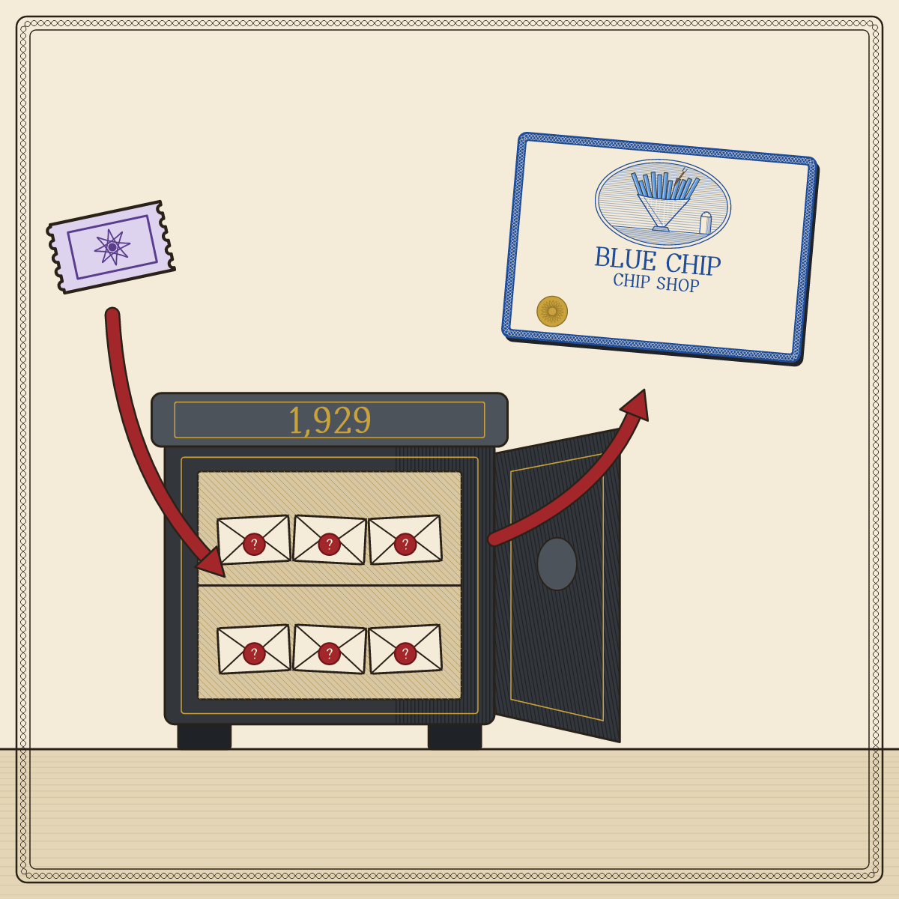
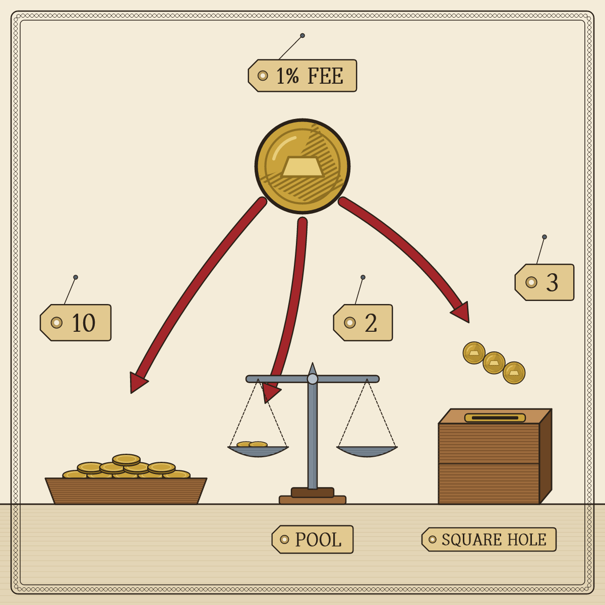
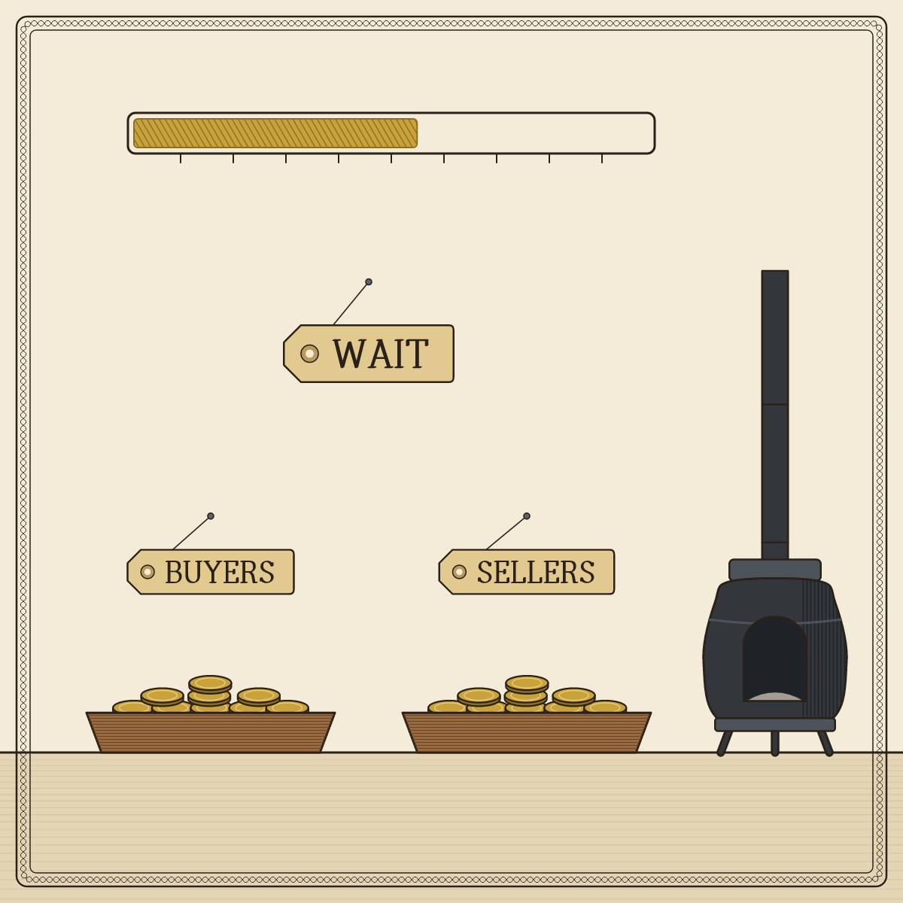
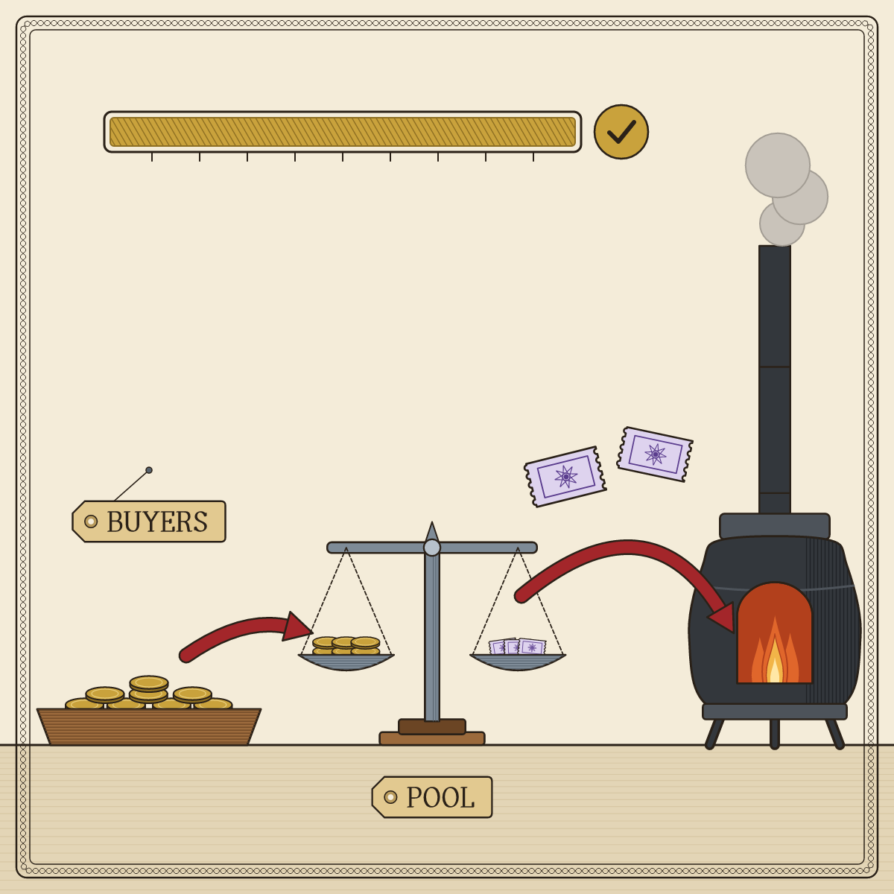
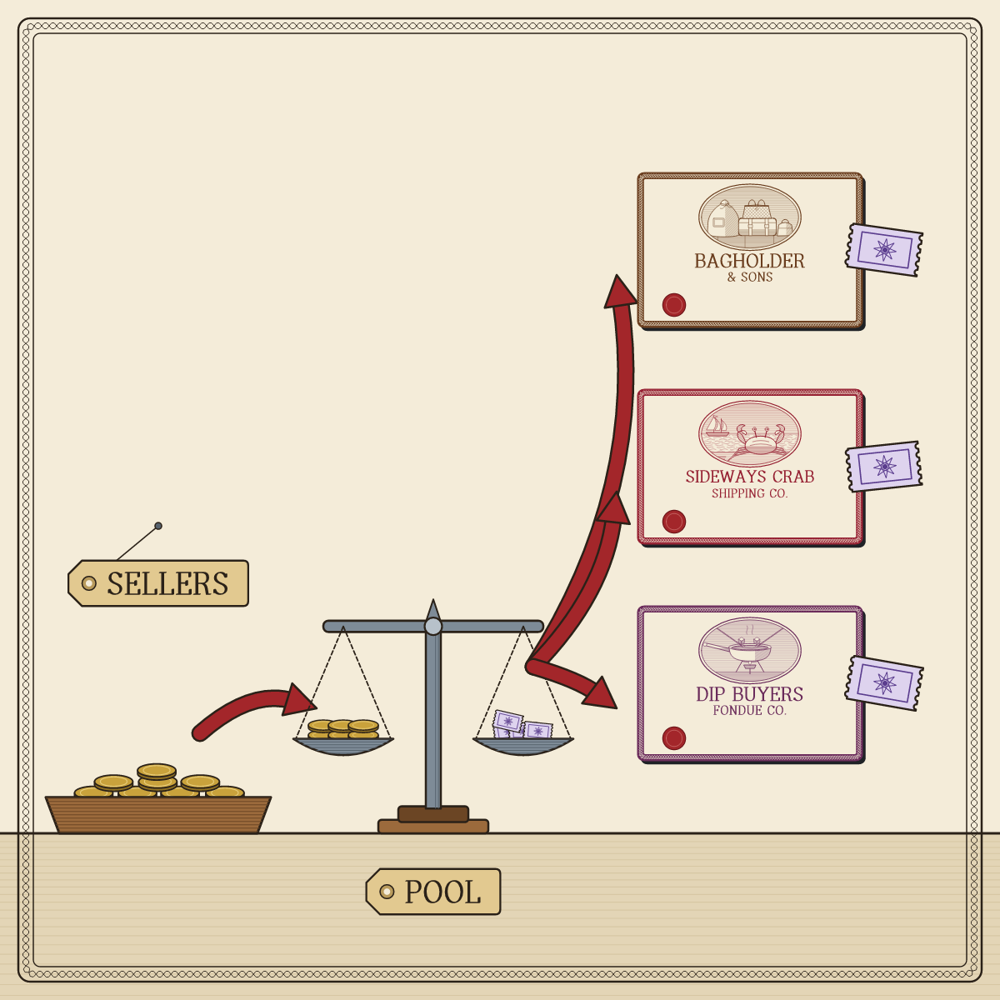
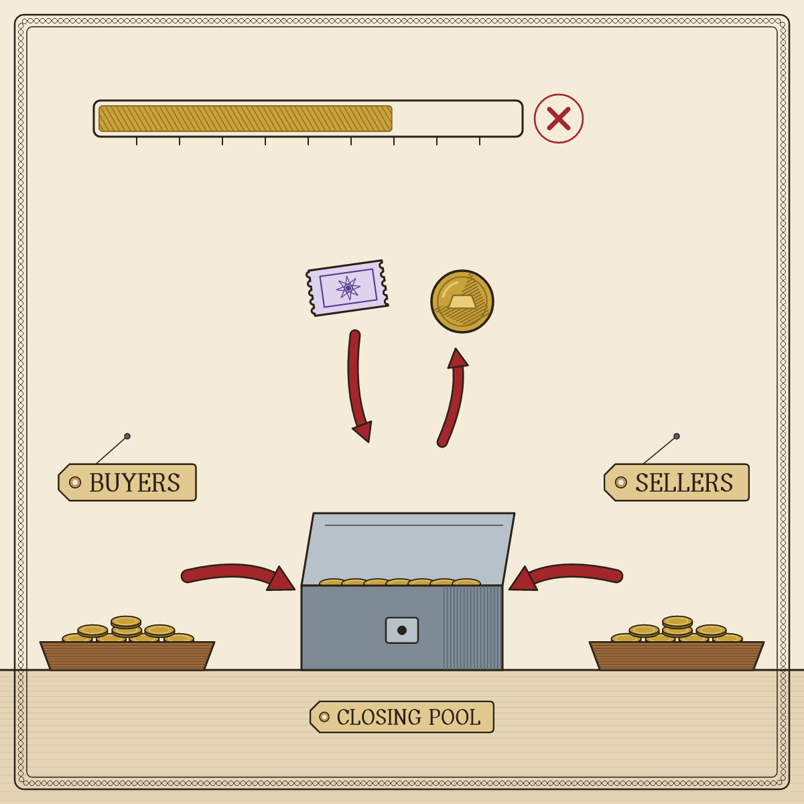

# The transfer office

Seven pictures that show what the fees do. Gold coins are the gold coin, the coin Gold Certificates is priced in.
Lilac coupons are SCRIP, the box's token. The iron safe marked 1,929 is the box, where the certificates wait sealed in
envelopes. The balance scale is the box's own pool, which swaps coins for SCRIP, and the stove burns SCRIP. Buyers'
coins and sellers' coins go to different places, so the trays are tagged. Arrows show where things go. They show no
amounts and no timing.

For Paper Certificates, the same seven pictures are in `art/paper/scenes/` with steel index coins in place of the gold
coins, and every caption reads the same with "the index coin".

## 01 · The box

This box holds 1,929 joke share certificates, sealed in envelopes until someone draws one with SCRIP.
Twelve of them are blue chips.

## 02 · Fifteen coins

Every buy and every sale pays a small fee in the gold coin, split into 15 coins.
Ten follow the box's choice for that side, two go to the box's own pool and three go to Square Hole (its platform and its buy-back).

## 03 · Waiting

While the box fills its raise, the coins wait.
Nothing is swapped and nothing is burned yet.

## 04 · Burn the SCRIP

After the box graduates, the buyers' coins are swapped for SCRIP in the box's own pool, and that SCRIP is burned.
The gold coin goes into the pool.

## 05 · SCRIP for the certificates

The sellers' coins are swapped for SCRIP too.
The SCRIP is shared by all 1,929 certificates, the same part for each.

## 06 · Out or in

A certificate out of the box keeps its part for its owner to claim.
The part of a certificate still inside the box is burned.

## 07 · If the box fails

If the box fails, nothing is swapped or burned.
The waiting coins go to the closing pool, where holders hand in SCRIP for their part.
