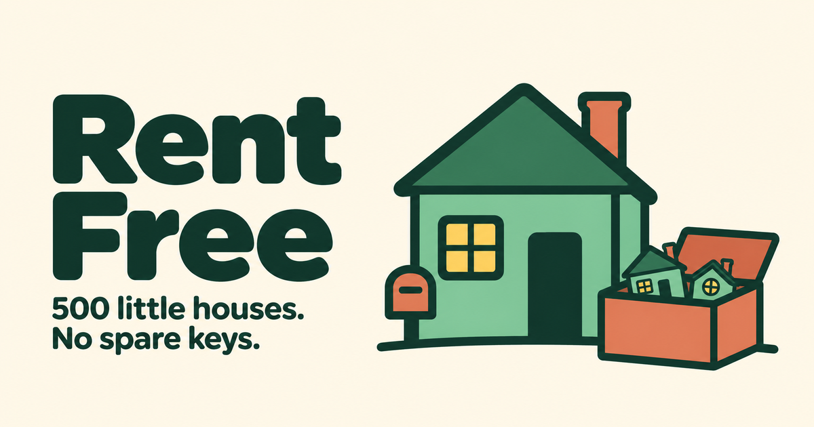

# Rent Free

Build it with `node scripts/kits/bundle.mjs rent-free`.
Rent Free uses 3D models for all 500 houses. In Create, Load settings takes its settings file, then the numbered
pictures, models (`1.glb` …) and `traits.csv` from the bundle's `items/` folder, and keeps every model commitment.
See the [public bindings](../../../scripts/kits/README.md); the generated inventory lists what still waits.

Five hundred little houses, living Rent Free in your head.

This is the brand kit for the Rent Free example box on Square Hole. The token is RENT and the box is priced in USDC.
Inside the box are 500 little houses. Buyers' fees go to the houses outside the box in USDC, which the kit calls
"rent", and the share of houses still in the box buys RENT and burns it. Sellers' fees buy RENT and burn it, which the
kit calls "property tax". Both words are jokes. Nobody lives in these houses.



The active edition has 500 distinct pictures and 500 distinct models from the fixed seed in `unique/`.
The original brand pictures in `art/` and the twelve base models in `models/` stay byte for byte.
Nothing here is deployed or posted. Every house gets the same part of the fees, whatever its art.

## Files

| File | What it is |
| --- | --- |
| [README.md](README.md) | This page |
| [brand-book.md](brand-book.md) | Name, ticker, joke, voice, palette, fonts, logo rules, do and don't, accessibility, homage rules |
| [storybook.md](storybook.md) | The story in seven pictures, showing what the fees do |
| [details.md](details.md) | The box settings in plain words, where each fee goes with the fee pies' numbers, what owners get, the risks, what still waits |
| [art-notes.md](art-notes.md) | How the art was made, its look and symbols, and how to extend it |
| [assign.mjs](assign.mjs) | Builds the verified unique set through the shared kit tooling; keeps the base family helper |
| [assignment.json](assignment.json) | All 500 ids, six traits each, picture and model filenames, SHA-256 hashes and byte counts, fixed seed and 3D policy |
| [assign.test.mjs](assign.test.mjs) | Checks the complete assignment, CLI regeneration and stable base families |
| [preview.mjs](preview.mjs) | Renders `art/logo-48.png` from the mark with resvg |
| [check.mjs](check.mjs) | Checks every file, pixel size and picture byte, the calm areas, the palette, contrast, assignment, registry facts, fee numbers, storybook and wording |
| [art/](art/) | Original brand pictures, twelve family references, generic scenes and fee pies |
| [models/](models/README.md) | Twelve base house models and their source, renderer, comparison sheet and library checks |
| [unique/](unique/README.md) | Active edition generator, exact trait counts, reviewed full manifest, selected samples and labelled sheets |
| `art/logo.png` | The mark, 1024 x 1024 |
| `art/logo-48.png` | The same mark at 48 x 48, to show it still reads |
| `art/x-avatar.png` | X profile picture, 400 x 400 |
| `art/x-banner.png` | X header, 1500 x 500, with a bare corner for the avatar |
| `art/cover.png` | Link card, 1200 x 630 |
| `art/box-banner.png` | Box page banner, 1800 x 600 |
| `art/houses/variant-01.png` to `variant-12.png` | The 12 base family references, 512 x 512 each |
| `art/scenes/scene-01.png` to `scene-08.png` | The story pictures, 768 x 768 each. The storybook uses 01 to 07 |
| `art/fees/fees-1600x900.png`, `art/fees/fees-1080x1080.png` and their SVGs | The fee pies from the landing page, wide and square |
| Every `*-original.png` in `art/` | The untouched output of the image generator beside each picture. Where one sheet gave several pictures, each original is the whole sheet |
| [SH-KIT-RENT-FREE.md](SH-KIT-RENT-FREE.md) | Historical record of the original brand kit and repeated-picture assignment |
| `.gitattributes` | Keeps the art bytes exact, so the check holds on every checkout |

The original brand art is raster, made with an image generator, so it has no SVG source. The fee pies are vector.
The active edition generates a front-view SVG and PNG from the same trait geometry as each house's GLB model.
The story scenes and brand pictures illustrate the box and its fees; they do not depict numbered NFTs.

Scene 08, a quiet night with an empty mailbox, stays with the art as it came, but it is not part of the story. Its sky
has a crescent, which reads as a hype sign in coin talk, so the storybook leaves it out.

## The 500 houses

Each id from 1 to 500 has its own picture and model. Its six traits are `house`, `door`, `window`, `post`, `plant`
and `step`, in that order. All values and exact counts are listed in [unique/README.md](unique/README.md#traits-and-exact-counts).
The twelve base families follow the original rule:

```
house = ((id - 1) mod 12) + 1, written with two digits
```

Ids 1 and 13 share family 01, with different visible traits and different picture and model hashes.
Families 01 to 08 appear 42 times each, and 09 to 12 appear 41 times each. Id 500 uses family 08.
Every pair of houses differs in at least two traits. The table describes the base families.

| Family | Name | What it looks like | Houses |
| --- | --- | --- | --- |
| 01 | Cottage | A dark green roof, a clay chimney, one window and a dark door. The mark is this house | 42 |
| 02 | Townhouse | Tall and narrow, with a flat roof, two windows stacked and a clay door | 42 |
| 03 | Bungalow | A low dark roof, a chimney, two windows and a plant pot by the door | 42 |
| 04 | A-frame | A steep dark roof with wide eaves and a round window over the door | 42 |
| 05 | Awning | A chimney, one window and a scalloped clay awning over the door | 42 |
| 06 | Arch roof | A round arched roof, a chimney, a round window and a door with a knob | 42 |
| 07 | Clay roof | A clay roof with a diamond window, two windows and a dark door | 42 |
| 08 | Step gable | A stepped gable, two tall narrow windows and a dark door | 42 |
| 09 | Lean-to | One sloping roof with a clay edge, a chimney, one big window and a clay door | 41 |
| 10 | Clay dome | A round clay roof, a chimney, a wide window and a dark door | 41 |
| 11 | Dormer | A dark green roof with a dormer window, one window and a butter arched door | 41 |
| 12 | Roof garden | A flat roof with three green bushes, one window and a clay door | 41 |

Square Hole collections start at id 1. Check that the deployed collection uses ids 1 to 500 before the assignment
becomes metadata.

## Rebuild and check

From the repository root, with Node 24.22.1 and the workspace installed:

```sh
export PATH="$HOME/.nvm/versions/node/v24.22.1/bin:$PATH"
node examples/boxes/rent-free/assign.mjs > examples/boxes/rent-free/assignment.json
node examples/boxes/rent-free/check.mjs
node --test examples/boxes/rent-free/assign.test.mjs
node --test examples/boxes/rent-free/unique/unique.test.mjs
node --test examples/boxes/rent-free/models/models.test.mjs
node examples/boxes/rent-free/unique/build.mjs --out .cache/tmp/rent-free-full
node examples/boxes/rent-free/unique/check.mjs --from .cache/tmp/rent-free-full
```

Choose a fresh or empty directory for the explicit full build. It writes `picture-1.png` through `picture-500.png`,
their SVG sources, `model-1.glb` through `model-500.glb` and `manifest.json`. Full output stays uncommitted under
`.cache/tmp/`; only the reviewed manifest and selected samples live in `unique/`. Assignment asset paths are relative
to a full output directory, so they contain no machine path. Both `assign.mjs` and `check.mjs` call the shared
`buildUniqueSet` and verify a fresh full build against the reviewed manifest before using it.

`preview.mjs` only rebuilds the small brand mark with the pinned resvg. `check.mjs` compares it with a fresh render
and preserves every original brand-art check. The unique and model suites separately verify edition uniqueness and
the twelve base models. See [art-notes.md](art-notes.md) for the sources. No command downloads anything.

## Using the kit

- Show live text next to the pictures. The brand book has the lines, and the storybook has the captions.
- Write "rent" and "property tax" in quotes every time, with the plain words next to them.
- Every live RENT page shows the chain and the full contract address. Other tokens use RENT too. Until a contract
  exists, the line reads "Contract: not deployed".
- When Square Hole launches this box as one of its own, its address also goes on the list of Square Hole's own boxes,
  as decided in F133.
- The example registry still points at local test pictures. Wiring this art into a launch is a separate step, listed
  in [details.md](details.md).
- The kit grants no license yet. The open-source license for its code, text and art is still to be chosen, and
  counsel should look at the rights to the generated pictures first.
