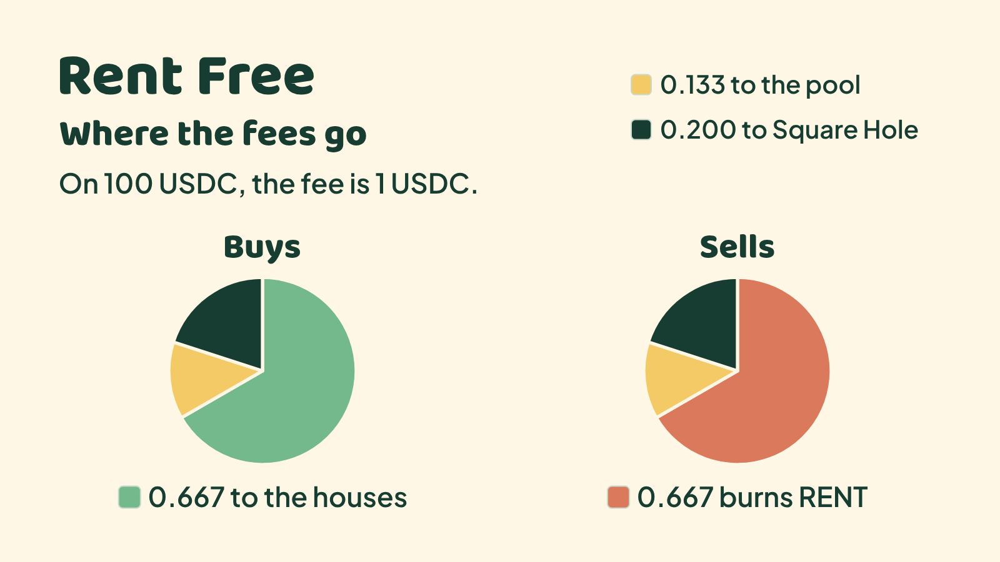

# What is in the Rent Free box

A token called RENT, priced in USDC, and a new collection of 500 little houses. Every fee is paid in USDC. Two thirds
of every buyer's fee is shared equally by the 500 houses. A house outside the box keeps its share in USDC for its owner
to claim, and the kit calls that "rent". The share of a house still in the box buys RENT in the box's own pool and
burns it. Two thirds of every seller's fee buys RENT and burns it too, and the kit calls that "property tax". The site
calls the houses "items", the place where they wait "the vault", the buyers' choice "To items" with "Burn" for items in
the vault, and the sellers' choice "Burn".

The idea comes from Square Hole's research round on stocks, real-world assets, memes and DeFi
([round 2b](../../../docs/research/round2b-stonks-rwa-memes-defi.md)). It is a box of 500 little houses where unclaimed
"rent" moves with the house and the houses still in the box burn RENT. The research warns that the word "rent" can be
read as a promise of money, so the copy has to stay a joke. This kit keeps it one. "rent" is always in quotes, with the
plain words next to it. The original brand art stays unchanged. The active edition builds 500 distinct pictures and
models from those twelve house families and the reviewed trait design.

## The settings in plain words

These are the settings in [`rent-free.json`](../../../packages/box-spec/examples/v2/rent-free.json), explained with the
[registry notes](../../../packages/box-spec/examples/v2/README.md). Nobody can change them after the box is created.
This page explains them. It quotes no market amounts.

| Setting | In the file | In plain words |
| --- | --- | --- |
| Name and ticker | `Rent Free`, `RENT` | A fixture choice. The name and the ticker are not cleared, and other tokens already use RENT. |
| Status | `ready` | The local test life runs on today's code. Nothing is deployed. |
| Template | `collection-burn` (`Collection that burns`) | The creator starts from "NFTs · To items · Burn" on the create page and changes the sellers' side to Burn. |
| Price coin | `USDC`, `6` decimals | The fees, the "rent", the raise and any failure claim are all in USDC. |
| Contents | `collection` of `500` `Houses` | 500 new NFTs with ids 1 to 500. |
| Art | `open` | Each of the 500 houses has its own public picture and 3D model. `assign.mjs` records its six traits and both asset hashes from the verified unique set. |
| Seed | none | Nothing else goes into the box when it is created. |
| Pick fee | `100` basis points | Taking out a house you choose costs 1% more RENT, and that extra RENT is burned. |
| Raise | `listing-fixed` | Square Hole's USDC listing sets how much the raise is. The creator does not pick it. A listing can change its amount for future boxes, so this kit repeats no number. |
| Deadline | `30` days | The raise has 30 days to fill. |
| Royalties | `0`, `none` | Selling a house on a marketplace pays no royalty. |
| Buyers' fees | `items`, inside `burn` | The site calls this To items, with Burn for houses in the vault. The buyers' share is split equally across all 500 houses. A house outside the box keeps its part in USDC for its owner. The part of a house inside buys RENT and burns it. |
| Sellers' fees | `burn` | The site calls this Burn. The sellers' share buys RENT in the box's own pool and burns it. |
| Creator buy | zero | The creator buys nothing at launch (registry notes). |
| Life | `graduate` | The local test expects the raise to fill and the box to graduate. |
| Checks | `fee-conservation`, `page-state`, `own-pictures`, `graduation`, `supply-burn`, `item-claim` | The test proves that no fee goes missing, the page shows the right state with the box's own pictures, the box graduates, burns make the supply smaller, and a house's owner can claim its exact part. |

## Where each fee goes

Every trade pays a 1% fee in USDC. A buy pays it on the USDC going in. A sale pays it on the USDC coming out.

The fee is split into 15 equal parts.

- **10 parts** follow the box's choice for that side. Buyers' parts go to the houses. Sellers' parts buy RENT and burn
  it.
- **2 parts** always go into the box's own pool.
- **3 parts** go to Square Hole (its platform and its buy-back). This part is the same for every box.

Leftover dust from rounding goes to the pool while the box is live.

**An example.** The fee pies show one trade, and their numbers are the ones in this table.

<!-- fee-example:start -->
| On a trade of 100 USDC | A buy | A sale |
| --- | --- | --- |
| The fee, 1% | 1 USDC | 1 USDC |
| 10 parts, the box's choice | 0.667 USDC to the houses | 0.667 USDC buys RENT and burns it |
| 2 parts, the box's own pool | 0.133 USDC | 0.133 USDC |
| 3 parts, Square Hole (its platform and its buy-back) | 0.200 USDC | 0.200 USDC |

The square version for phones is [`fees-1080x1080.png`](art/fees/fees-1080x1080.png). The numbers are rounded to three
places, and they leave out the small tips described below. Each house's part of the 0.667 USDC from that one buy is
one 500th of it, about 0.0013 USDC.
<!-- fee-example:end -->

**The buyers' 10 parts, to the houses.** Each buyers' share is split into 500 equal parts, one for each house.

- Before graduation, every house is still in the box, so the buyers' share waits in USDC. When the box graduates, all
  of it is used as the share of houses still in the box. It buys RENT and burns it.
- After graduation, each house outside the box gets its equal part in USDC, kept for its owner to claim. That is the
  "rent".
- The equal parts of the houses still inside buy RENT in the box's own pool, and that RENT is burned. They use the same
  buy step as the sellers' share below.
- Leftovers from rounding go to the box's own pool.

**The sellers' 10 parts, the "property tax".** They wait in USDC until the box graduates. Then anyone can run the buy
step. It spends the waiting USDC on RENT in the box's own pool and burns that RENT.

- Whoever runs the buy step may keep a tip of at most 5% of what it spends.
- The step waits until enough USDC has gathered, takes at most one step in a block, and moves the pool's price by at
  most about half a percent, so a big heap is bought in several steps.
- The buy pays the usual 1% fee like any buy, and that fee is split again like every buyers' fee.
- Square Hole's keeper is built to run the buy step.

**The collect step.** Fees reach the box in batches. Anyone can run the step that collects a batch, and Square Hole's
keeper is built to run it once a batch is big enough. Whoever runs it may keep a tip from a buyers' batch, at most 5%
of it and never more than a cap set for each box. The tip comes off before the batch is split.

**The pool's 2 parts.** After graduation, anyone can run the step that adds them, and its runner may keep a tip of at
most 5% of what the step moves. About half of the USDC buys RENT in the pool, and then the USDC and the RENT go in
together as liquidity the box owns. The pool refuses every attempt to add outside liquidity or to take liquidity out.

**Graduation.** Before graduation, the first buyers' fees, up to one thousandth of the raise, are set aside to pay
whoever runs the graduation step. If the box fails instead, that part is split like any fee.

**What a burn does.** Burned RENT is gone for good, so the supply gets smaller. A burn sets no price and protects no
value.

**When nothing happens.** Fees only come from trades. There is no schedule. No buys means no "rent", and no sales means
no "property tax".

**The launch window.** For the first 6.4 minutes after the box opens, every buy goes through the launch router and
pays a launch tax on top of the fee. The tax starts at about 93% and drops every 12 seconds, down to about 8% in the
last step, and then ends. It goes into the box's own pool after graduation, or into the failure claim if the box fails.

## What each owner gets

**A RENT holder** holds the box token. The fees go to the houses, to burns, to the box's own pool and to Square Hole
(its platform and its buy-back), so holding RENT gives no share of them. After graduation, RENT is how a house leaves
the box.

- There are no draws in this box. Every house is in plain sight, and you choose the one you take out by its number.
- One house costs the RENT outside the vault divided by the houses still inside, rounded up. You also pay the 1% pick
  fee, and that part is burned. The rest stays in the vault, held for that house.
- Putting a house back gives you one house's share of RENT at that moment, rounded down, minus a 5% fee that is
  burned. This can be more or less RENT than was paid.
- The last house always stays in the vault.
- Quotes move between the moment you look and the moment you sign. Every take-out and put-back has a limit you set and
  a deadline.

**A house owner** owns the NFT, with its distinct picture and model, and can claim the USDC the house collected while it was out of the box.

- Only the current owner can claim, one house per claim, and only while the house is out of the box. There is no
  minimum, no tip and no time limit. The owner pays the gas.
- Nobody sends the USDC. It waits on the house until its owner claims it.
- The USDC stays with the house. Sell or give the house away, and its unclaimed "rent" goes with it.
- Put the house back in the box, and its unclaimed "rent" stays with it for whoever takes it out next. So claim first.
- While a house is in the box, its new parts buy and burn RENT. It collects nothing for anyone.
- Sometimes a claim has to wait for the fee records to catch up. Anyone can run that catch-up, and nothing is lost
  while it waits.
- Every house gets the same part. All 500 pictures and models are distinct. The six traits (`house`, `door`, `window`,
  `post`, `plant`, `step`) change the art and leave each house's share of fees unchanged.

## Risks in plain words

- RENT and the houses can lose all their value. There may be no buyer when you want to sell.
- The "rent" is a share of trading fees. Nobody lives in these houses, there is no land under them, and nobody pays to
  stay. It comes only from buys, so it can be tiny or nothing, and it stops when trading stops.
- Each buyers' share is split 500 ways, so one house's part of a single fee is very small, and the gas to claim can be
  larger than the part.
- A house inside the box gets nothing. Its part is burned.
- USDC can lose its link to the dollar, and its issuer can freeze addresses.
- A burn makes the supply smaller. It sets no price.
- The raise can miss its 30 days, and then the box fails. If the raise fills but the box has not graduated 7 days
  later, anyone can fail it too. After a failure no fee buys or burns RENT, no house gets "rent", and no house leaves
  the box. The USDC waiting on both sides joins the closing pool, and the 500 houses go back to the creator. Holders
  hand in RENT to claim their part of what is left. That is no promise to get everything back. Failure claims close a
  year after the failure, and what is left after that goes to Square Hole's buy-back.
- Taking a house out ties up RENT in the vault, and putting it back costs 5% of the house's share.
- "Property tax" is a joke. No tax is paid to anyone, and nothing here is tax advice.
- These contracts have internal reviews and tests. They have had no outside audit so far.
- Anyone can copy the name, the ticker and these pictures. Check the chain and the full contract address every time.

## What still waits

**For counsel**

- The word "rent" and the houses' share. A house outside the box collects USDC from the buyers' fees, and it can be
  sold with its unclaimed "rent". Question 34 of the [counsel pack](../../../docs/legal/counsel-pack-2026-10.md) asks
  whether item payouts are a tradable revenue right. The research flags the word "rent" as well. Counsel should
  confirm that the quotes and the plain words next to them keep anyone from reading it as a promise of money or as a
  home to live in.
- The "property tax" joke. Counsel should confirm that it cannot be read as a real tax or as tax advice.
- The ticker. Other tokens already use RENT, and it has not been checked against other names and marks.
- The generated art. The original references were made with an image generator; the unique edition uses authored
  geometry and trait layers. Counsel should confirm the rights to publish and license them.
- The license. The open-source license for this kit's code, text and art is not chosen yet.

**For a v2.1 step**

Nothing. This box pays house owners in USDC, the price coin, which today's contracts already do. The v2.1 steps in the
registry are eating the price coin, paying items in the box token and sending fees into a pile. This box uses none of
them.

**For the launch**

- The registry still points at local test pictures. Using this art needs the metadata and hosting step, and the
  deployed collection must use ids 1 to 500.
- `assign.mjs` consumes the shared verified unique set, preserving the reviewed seed, all six traits and both asset
  hashes for every id. Keep those bytes and the twelve base families stable.
- Rent Free's model policy is `3d`. The settings and bundle commit every model through Create's own model reader,
  and Load settings needs the numbered models with the pictures. Final list publication is T05.
  See the [shared tooling instructions](../../../scripts/kits/README.md#unique-producer-interface-and-models).
- Every live page shows the chain and the full contract address. When Square Hole launches the box itself, the address
  also goes on its list of own boxes (F133). Until then the line reads "Contract: not deployed".
- The box page shows its banner as a 4:1 strip. The box banner is 1800 x 600, and the strips the page cuts off are
  bare cream.

## Sources

- [`rent-free.json`](../../../packages/box-spec/examples/v2/rent-free.json) and the
  [registry notes](../../../packages/box-spec/examples/v2/README.md): the settings, the creator buy and the test life.
- [Round 2b research](../../../docs/research/round2b-stonks-rwa-memes-defi.md), the Rent Free entry: the idea, the 500
  houses, unclaimed "rent" that moves with the house, houses in the box that burn RENT, and the warning about the word.
- [Decision log](../../../docs/decisions/DECISION-LOG.md): F86 (G), the current owner claims and unclaimed money moves
  with the NFT; F118 to F120, the simpler core with fees in the price coin; F122, the 7-day escape and the failure
  claim; F123, listing raises; F127, claim-only payouts and buy-back-and-burn for items in the vault; F133, own boxes
  listed by address.
- [Plain words](../../../packages/box-spec/plain-words.v2.json): To items, Burn, and the vault.
- [Fee split](../../../packages/contracts/src/box-v2/BoxReceiverV2Base.sol): 10, 2 and 3 parts of 15, the houses'
  share held until graduation, the inside share sent to the buy step, and the tips.
- [Receiver](../../../packages/contracts/src/box-v2/BoxReceiverV2.sol): the collect step, the buy step and its burn,
  and the failure route.
- [Hook](../../../packages/contracts/src/box-v2/BoxHookV2.sol) and
  [launch router](../../../packages/contracts/src/box-v2/BoxLaunchRouterV2.sol): the 1% fee on both sides, the buy
  step paying the usual fee, the 6.4-minute window and its tax table.
- [Item ledger](../../../packages/contracts/src/box-v2/ItemLedgerV2.sol): equal parts, owner-only claims of one house,
  USDC that stays with the house, and leftovers to the pool.
- [Vault](../../../packages/contracts/src/box-v2/BoxVaultV2.sol) and
  [quotes](../../../packages/contracts/src/box-v2/libraries/VaultViews.sol): taking houses out and putting them back,
  the 1% pick fee, the 5% fee and the last house.
- [Coordinator](../../../packages/contracts/src/box-v2/BoxCoordinatorV2.sol): graduation and its share of the early
  fees, failing a box, and the year-long claim.
- [Keeper plan](../../../packages/keeper/src/plan.ts): the collect step, the pool's step and the buy step.
- [Counsel pack](../../../docs/legal/counsel-pack-2026-10.md): question 34.
- The fee pies: branch `sh-landing-rung1`, folder `docs/marketing/explainers/examples/rent-free/`, copied unchanged.
