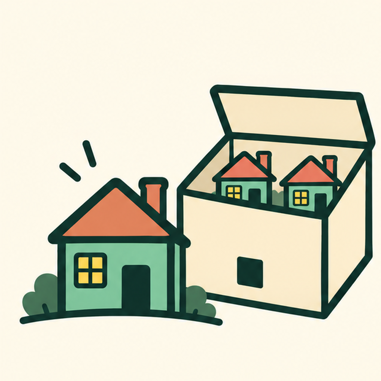
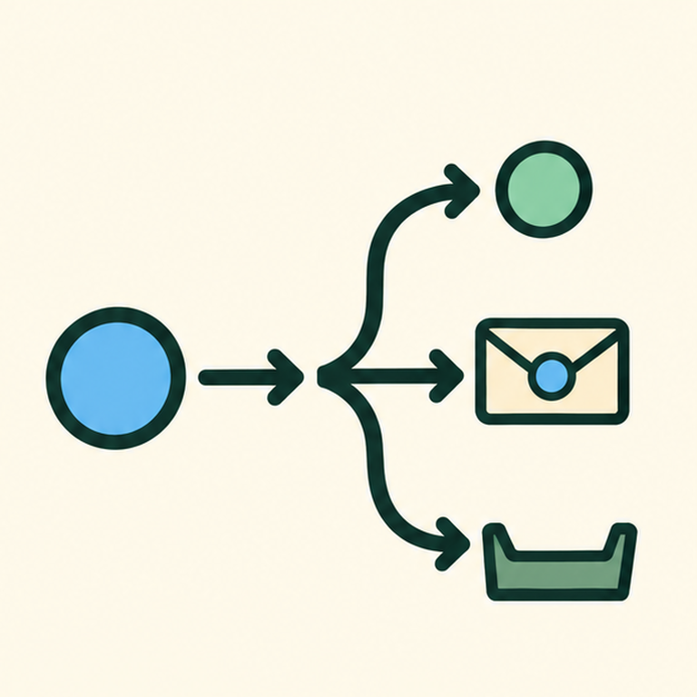
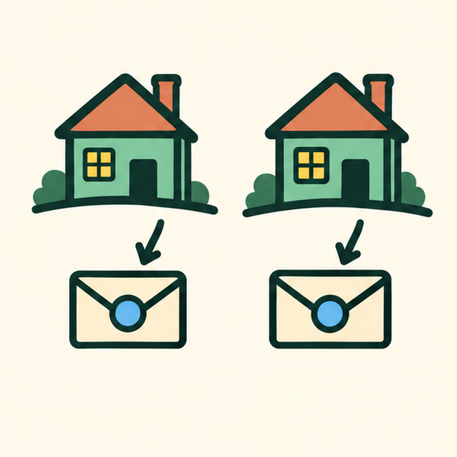
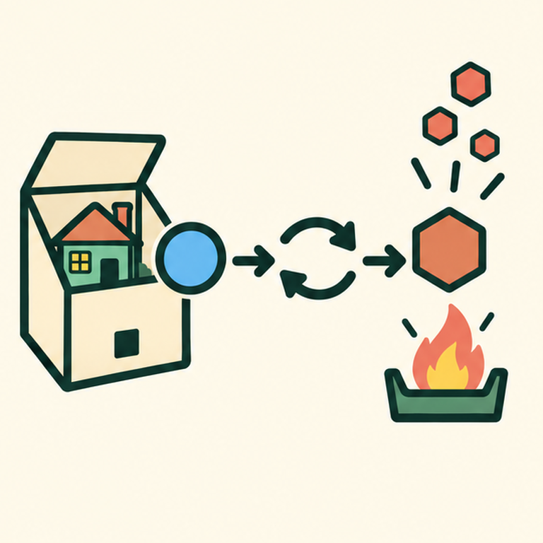
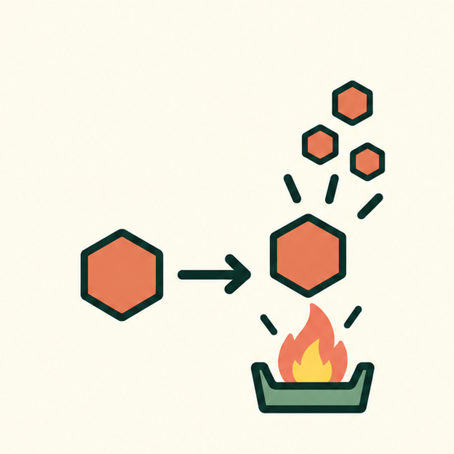
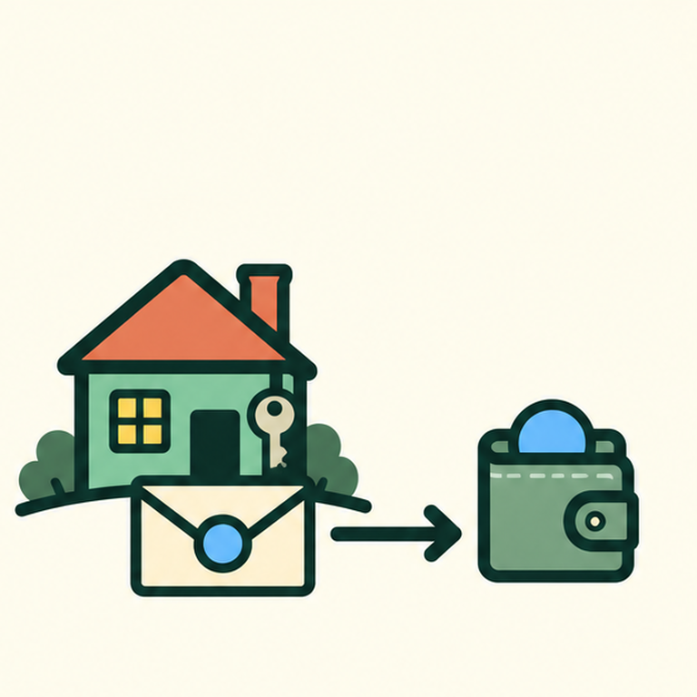
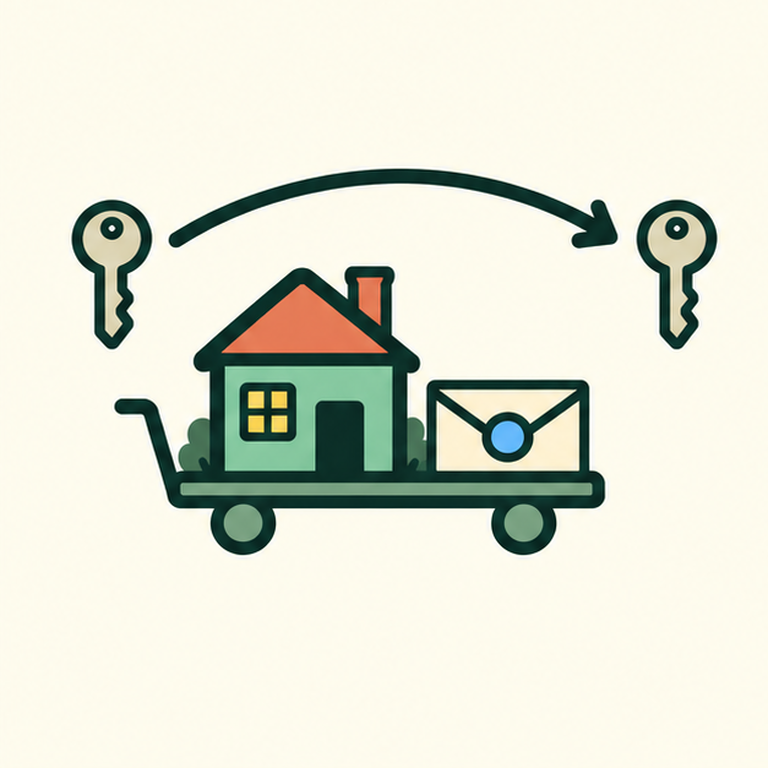

# A street in a box

Seven pictures that show what the fees do, once the box has graduated and houses can leave it. A sky blue circle is
USDC, the coin this box is priced in. A clay hexagon is RENT, the box's token. The open cardboard box is the box, where
houses wait until someone takes them out. An envelope with a blue seal is a house's "rent", waiting for its owner. A
fire in a green tray is a burn, and a key stands for a house's owner. In picture 2, the envelope is the box's own
choice, the empty green tray is the box's own pool and the plain green circle is Square Hole. Arrows show where things
go. They show no amounts and no timing. The fees only come from trades, so when nobody trades, nothing moves and the
envelopes stay empty.

The houses in these scenes are generic fee illustrations. For numbered houses and their traits, see the
[unique edition samples](unique/README.md).

## 01 · The box

This box holds 500 little houses.
Put RENT in the box, and you can take a house out.

## 02 · Fifteen parts

Every buy and every sale pays a small fee in USDC, cut into 15 parts.
Ten go where the box says, two go to the box's own pool and three go to Square Hole (its platform and its buy-back).

## 03 · "Rent" day

When someone buys RENT, the ten parts are shared by all 500 houses.
Each house outside the box gets its share in USDC, and we call it "rent".

## 04 · Houses still in the box

A house still in the box has nobody to give its share to.
So its share buys RENT, and that RENT is burned.

## 05 · "Property tax"

When someone sells RENT, the ten parts buy RENT and burn it.
We call that "property tax", and nobody collects it.

## 06 · Claim

Only the owner of a house outside the box can claim its "rent".
Nobody sends it, so it waits in the envelope until the owner claims it.

## 07 · Moving day

Sell the house or give it away, and its unclaimed "rent" goes with it.
The new owner can claim it.
