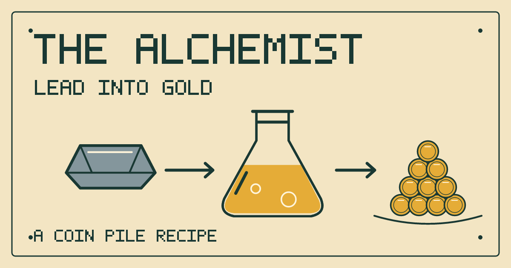

# The Alchemist

Load it: build with `node scripts/kits/bundle.mjs the-alchemist`, then choose `settings/the-alchemist-boxspec-v2.json` in Create → Load settings. First resolve its [public bindings](../../../scripts/kits/README.md#binding-the-setup); the generated inventory lists anything still unresolved.

Lead into gold. A box whose buyers' fee share buys another coin for its pile.

LEAD is the box token, PEPE is the price coin, and gold is the pile coin. On Sepolia,
use **Test PEPE and Test Gold**, the TA-30 test stand-ins. They carry no claim to real gold.
After graduation, holders hand in LEAD for their share of the pile; 5% of a normal
share stays behind. The pile starts empty. Conversions can fail and value can fall.



**Pending: ALCHEMIST-REGISTRATION. Contract: not deployed.** This kit supplies a
recipe and original pictures. It does not assert that either coin is listed or
that an Alchemist directory row exists. Only the founder executes chain transactions.

| File | Use |
| --- | --- |
| [SH-KIT-THE-ALCHEMIST.md](SH-KIT-THE-ALCHEMIST.md) | Settings, mechanics, risks and remaining launch steps |
| [art-notes.md](art-notes.md) | Palette, art construction, dimensions and reuse |
| [storybook.md](storybook.md) | Seven pictures with live captions |
| [src/art.mjs](src/art.mjs) | Original vector shapes and drawn lettering |
| [build-art.mjs](build-art.mjs) | Deterministic local SVG and PNG generation |
| [check.mjs](check.mjs) | Words, links, dimensions, fresh renders and recipe checks |
| [check.test.mjs](check.test.mjs) | Corruption checks and symlink entry tests |
| [Registry recipe](../../../packages/box-spec/examples/v2/the-alchemist.json) | Pending Sepolia stand-in bindings |

From the repository root, using Node 24.22.1 and the installed workspace:

```sh
node examples/boxes/the-alchemist/build-art.mjs
node examples/boxes/the-alchemist/check.mjs
node --test examples/boxes/the-alchemist/check.test.mjs packages/box-spec/examples/v2/registry.test.mjs
```

Rendering uses the workspace's pinned `@resvg/resvg-js`; no fonts or pictures are
downloaded. This is a coin pile with no collectible items or item assignments.
Copy the recipe for another box, then review its coins, listings and fixed route.
The kit creates no new license grant; confirm the repository's applicable terms
before publishing a derivative.
