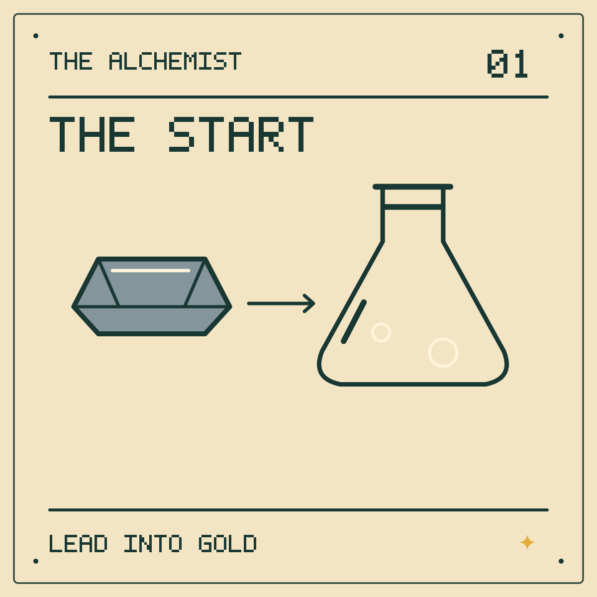
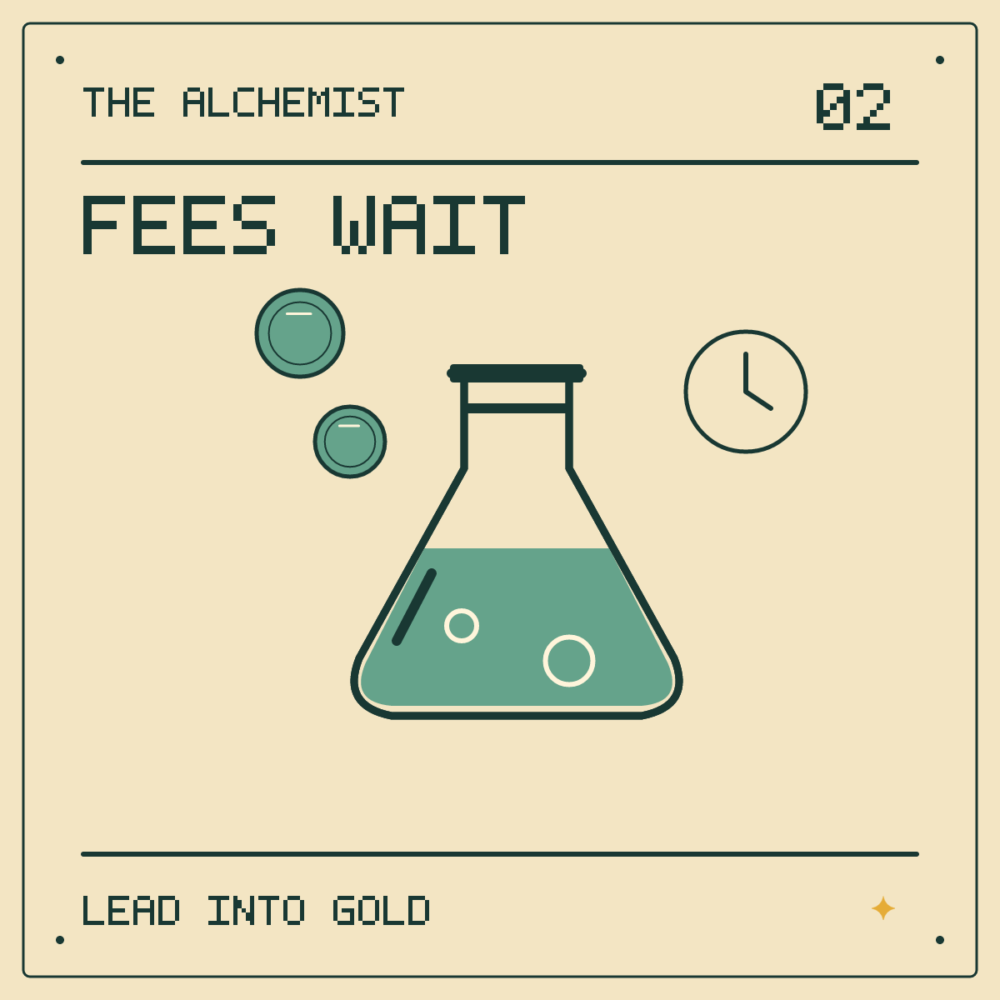
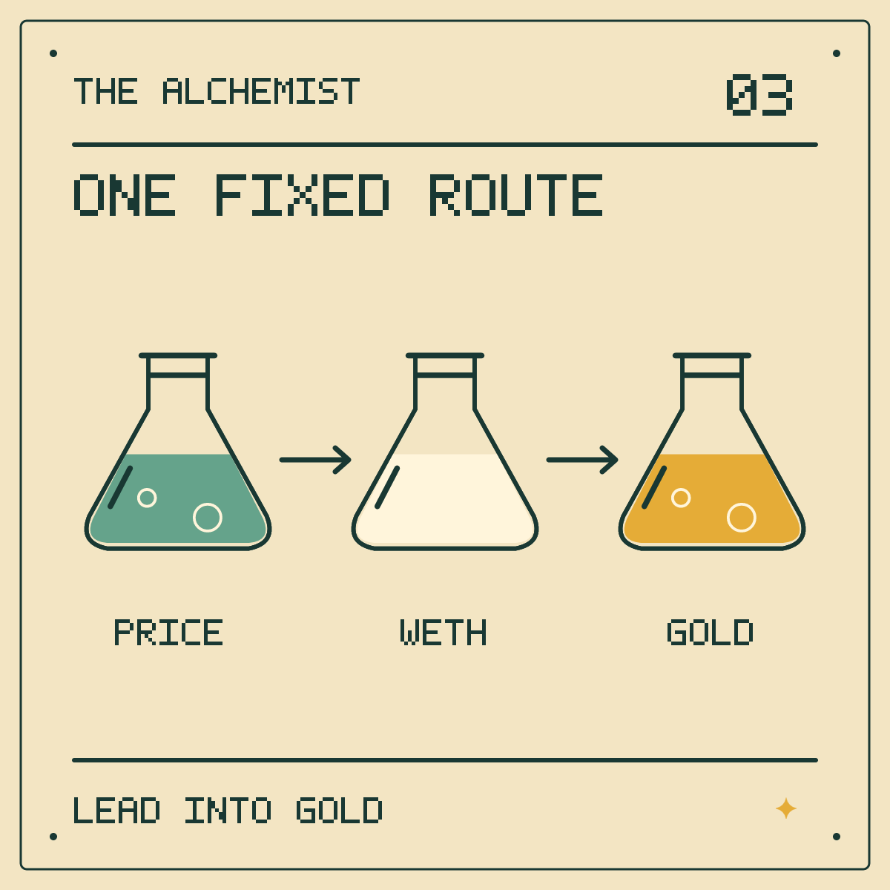
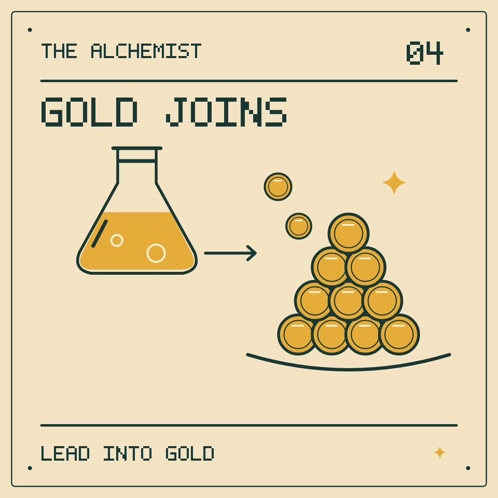
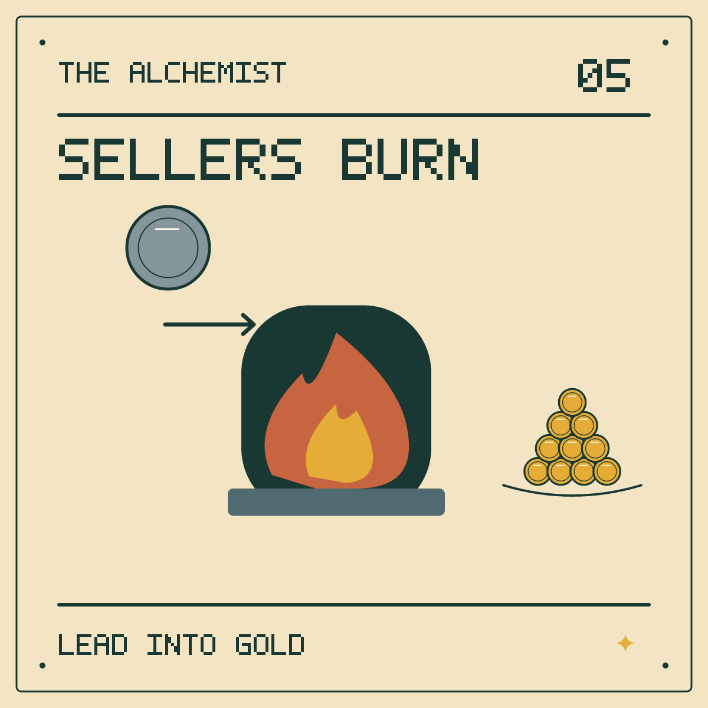
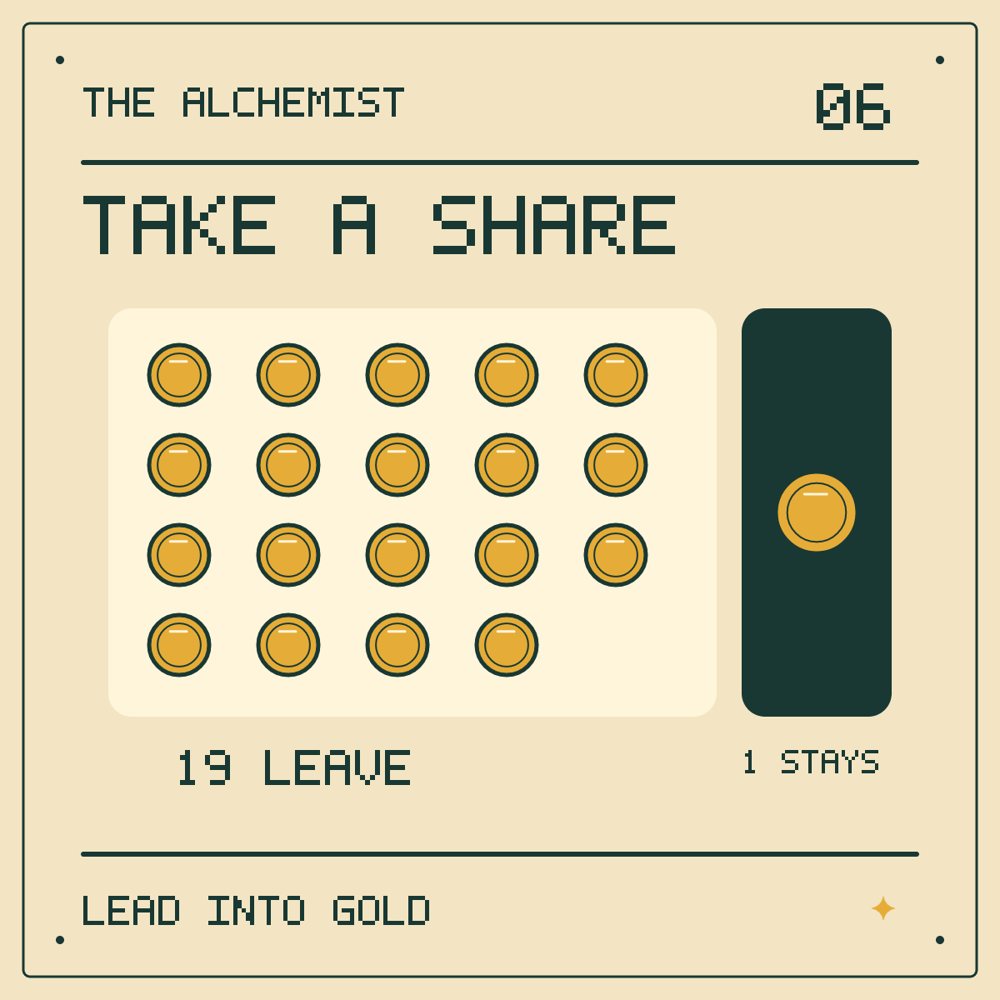
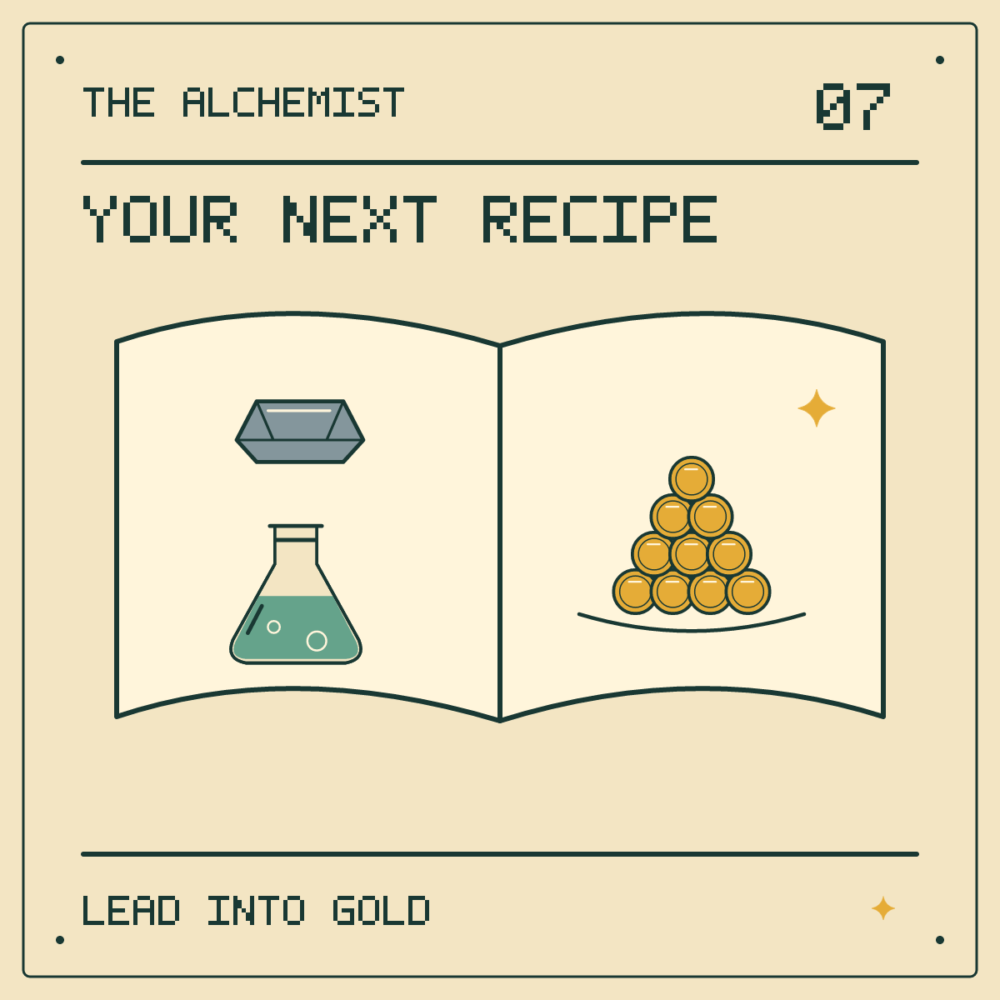

# Lead into gold, in seven scenes

The pictures tell a metaphor. Fees buy a pile coin; LEAD is the box token.
Keep these captions beside the pictures, including when used as PNGs.

## 01. the start

LEAD is the box token. The gold pile starts empty.

## 02. fees wait

Buyers' fees and inbox money feed the buyers' choice. Conversion waits until graduation.

## 03. one fixed route

The route idea is PEPE to WETH to gold. On Sepolia, use Test PEPE and Test Gold stand-ins.

## 04. gold joins

A successful Alchemist step buys gold and adds it to the pile. Pending fees are not gold yet.

## 05. sellers burn

Sellers' fee share buys LEAD in the box's pool and burns it. This is a separate fee choice.

## 06. take a share

Hand in LEAD after graduation for its share of the pile. Five percent of a normal share stays for remaining holders, subject to raw-unit rounding.

## 07. your next recipe

Reuse the pattern with other admitted coins and a reviewed fixed route. Each new box keeps the coins and route chosen at creation.
